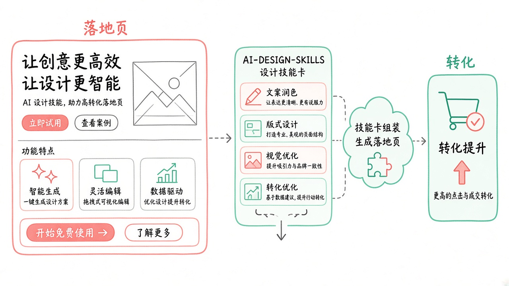
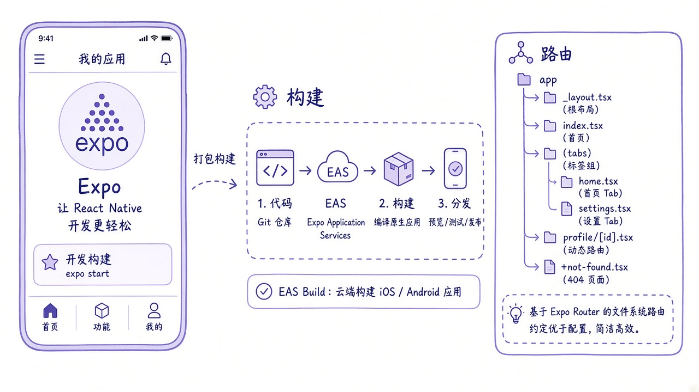
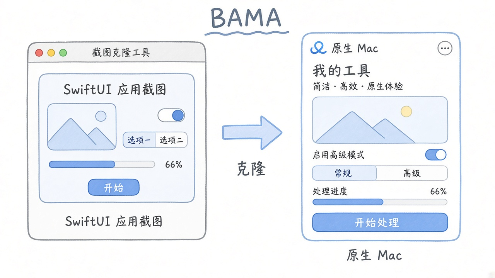
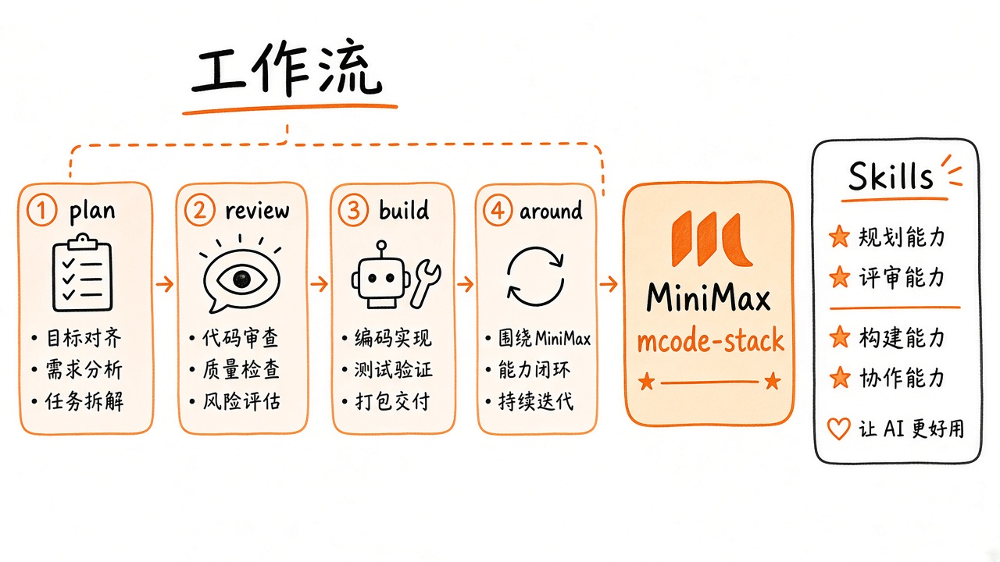
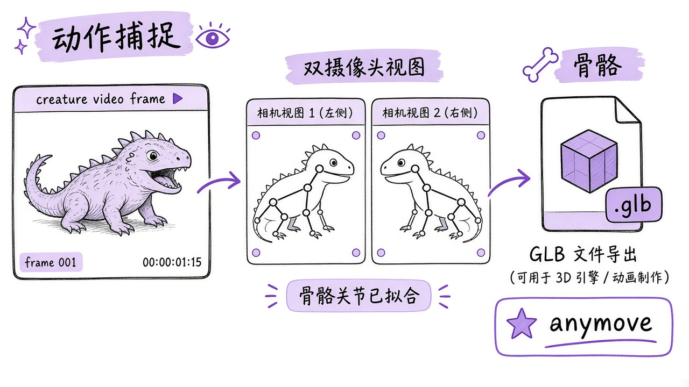
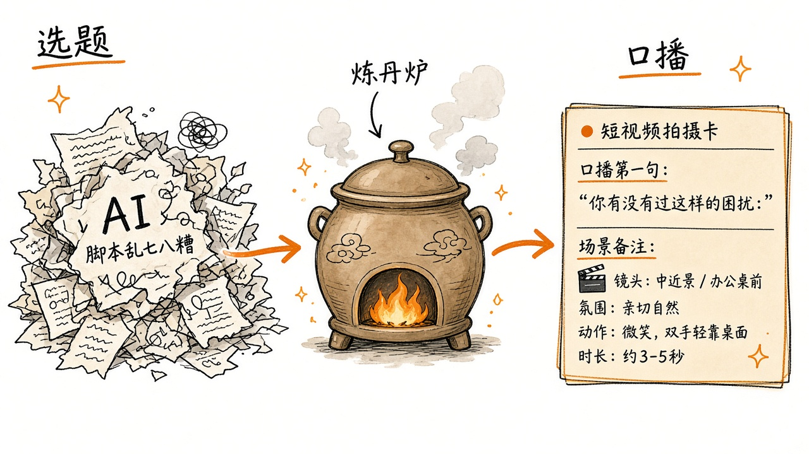

# 2026-10-29 Skills 日报

今日精选 6 条：落地页设计技能、Expo 官方包、BAMA 原生 Mac 应用、MiniMax 内部栈、任意生物动作捕捉，以及短视频「炼丹炉」。

## 1. elayadesign/ai-design-skills — 从零搭有转化的落地页

**介绍**  
ai-design-skills（MIT，★~1.1 万，今日热榜）：给 Claude / Cursor / Codex 的设计技能集；目前主打 `landing-page-design`（问卷 → 结构 → 转化文案 → 视觉系统）。

**用法**  
仓库：[github.com/elayadesign/ai-design-skills](https://github.com/elayadesign/ai-design-skills)。
```bash
# Claude Code
mkdir -p .claude/skills
git clone https://github.com/elayadesign/ai-design-skills.git /tmp/ai-design-skills
cp -r /tmp/ai-design-skills/skills/landing-page-design .claude/skills/
# Cursor
mkdir -p .cursor/rules
curl -o .cursor/rules/landing-page-design.md \
  https://raw.githubusercontent.com/elayadesign/ai-design-skills/main/skills/landing-page-design/SKILL.md
```

**应用场景**  
新产品要一页官网：让 agent 先问清楚再出结构与视觉，而不是直接糊模板。



**推荐学习程度**：入门

---

## 2. expo/skills — Expo / EAS 官方 Agent Skills

**介绍**  
expo/skills（MIT，★~3608）：Expo 官方技能包，覆盖 Expo Router、EAS Build/Submit、配置与排错等，适配 Claude Code 插件市场与 skills CLI。

**用法**  
仓库：[github.com/expo/skills](https://github.com/expo/skills)。
```bash
npx skills@latest add expo/skills --skill '*'
# Claude Code：claude plugin install expo@claude-plugins-official
```

**应用场景**  
Vue/Web 之外要上 Expo App，让 agent 按官方路径配 EAS、改 router，少踩过时教程。



**推荐学习程度**：入门

---

## 3. daveebbelaar/bama — Build Any Mac App 技能流水线

**介绍**  
BAMA（★~601，2026-10-24）：研究 → 克隆界面 → 设计 → Swift/SwiftUI 实现 → 优化测试的一整套 Mac 原生应用 Agent Skills；可 `npx skills` 或 Claude 插件装。

**用法**  
仓库：[github.com/daveebbelaar/bama](https://github.com/daveebbelaar/bama)。
```bash
npx skills@latest add daveebbelaar/bama
# Claude Code：
# /plugin marketplace add daveebbelaar/bama
# /plugin install bama@bama
```
然后说：`Clone my to-do app as a native Mac app.`

**应用场景**  
看中某个 Web/iOS 工具，想快速做出 SwiftUI 原生 Mac 版原型。



**推荐学习程度**：进阶

---

## 4. MiniMax-AI/mcode-stack — MiniMax Code 团队同款工作流

**介绍**  
mcode-stack（★~234，2026-10-28 开源）：MiniMax Code 团队用来做产品的 workflows + skills，可当插件市场装进 Claude Code。

**用法**  
仓库：[github.com/MiniMax-AI/mcode-stack](https://github.com/MiniMax-AI/mcode-stack)。
```bash
git clone https://github.com/MiniMax-AI/mcode-stack.git ~/mcode-stack
# Claude Code 插件市场指向该仓后：
# /plugin install ronny@mcode-stack
```

**应用场景**  
想对齐一套「大厂 coding agent」清单式工作流，直接装他们公开的栈。



**推荐学习程度**：进阶

---

## 5. patch-gg/anymove — 一条 AI 视频拆成生物动作

**介绍**  
anymove（★~361，2026-10-27）：单镜头 AI 视频里塞双视角，DINOv2 读关节、拟合骨骼，导出 GLB；可作 Claude 插件。

**用法**  
仓库：[github.com/patch-gg/anymove](https://github.com/patch-gg/anymove)。
```bash
git clone https://github.com/Patch-gg/anymove && cd anymove
# 按 README 建 venv、装 torch 与 requirements
# Claude：/plugin install anymove@anymove
```

**应用场景**  
角色/生物动画：从生成视频抽出可进引擎的动作 GLB。



**推荐学习程度**：深入

---

## 6. liuhaisi2026212-maker/taishang-laojun — 短视频选题口播「炼丹炉」

**介绍**  
太上老君·AI炼丹炉（★~267）：抖音创作者「柳爷」复盘方法论做成 Skill——破冰、观众心理、事件衬托内核；改 AI 味口播为可拍的一句一事。

**用法**  
仓库：[github.com/liuhaisi2026212-maker/taishang-laojun](https://github.com/liuhaisi2026212-maker/taishang-laojun)。
```bash
npx -y skills add liuhaisi2026212-maker/taishang-laojun -g --all
```
对 agent 说：`用炼丹炉，我想拍视频但不知道拍什么`。

**应用场景**  
产品/个人号短视频：有素材不会选题写口播，或要把 AI 稿改成能拍的。



**推荐学习程度**：入门
