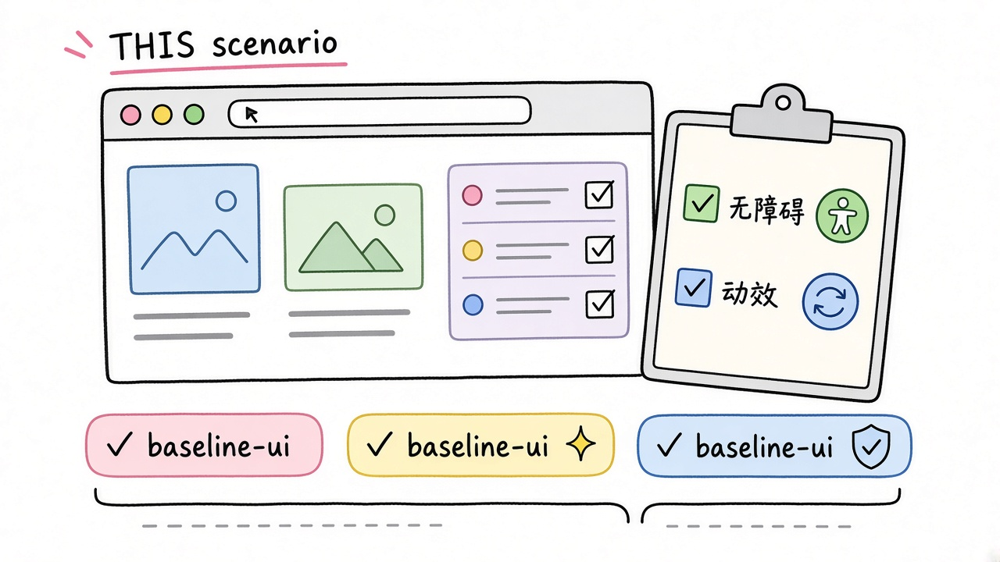
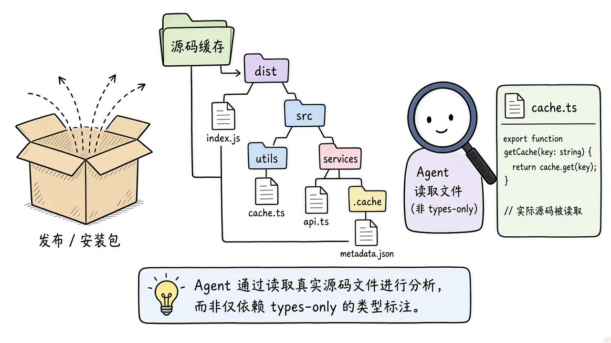
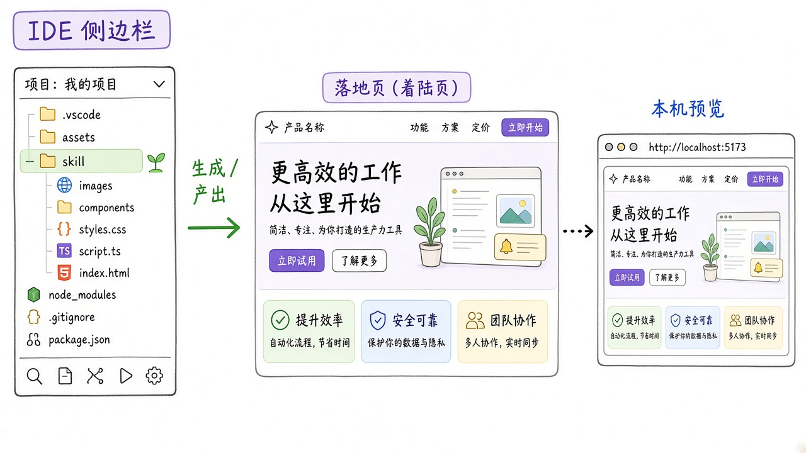
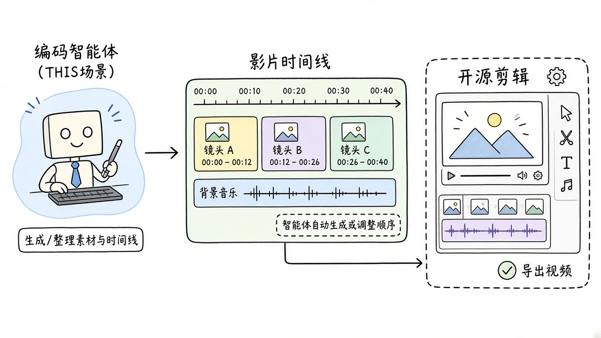
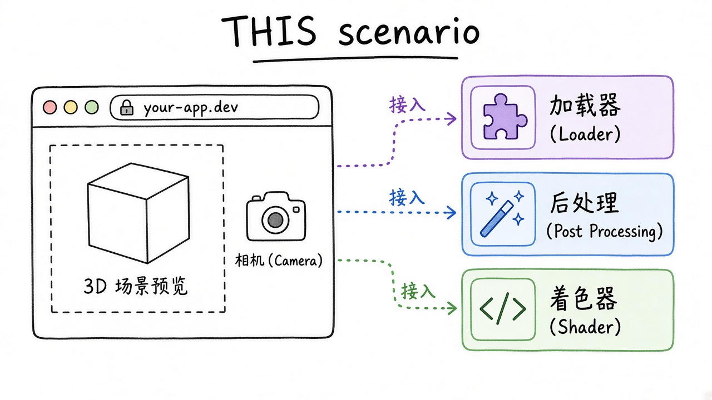
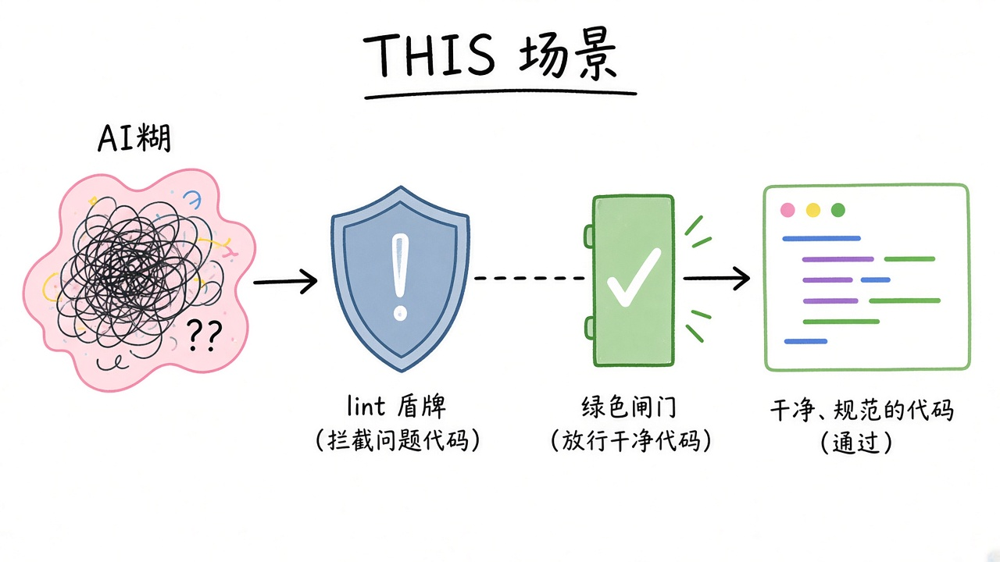
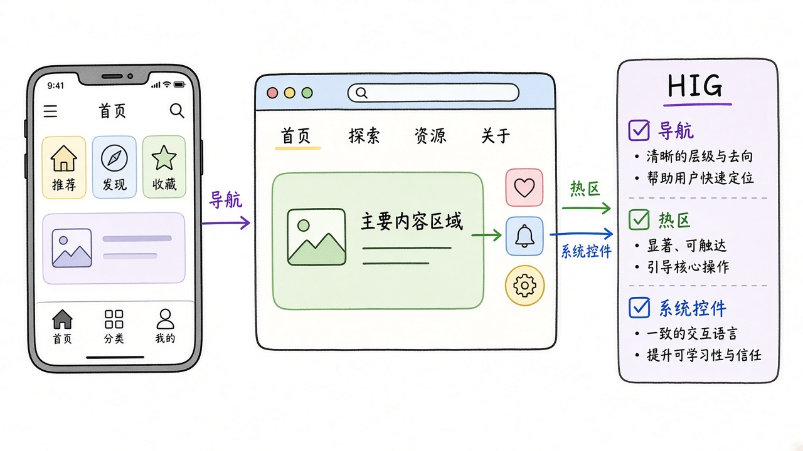
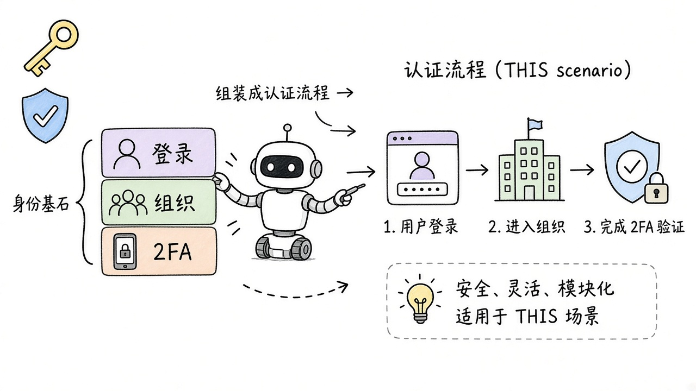
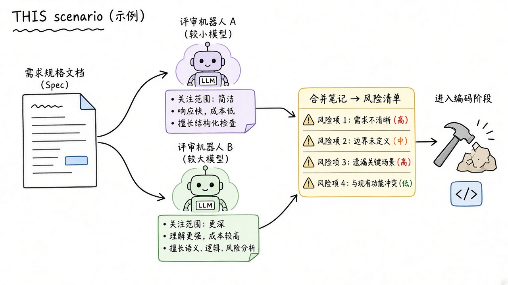

# 2026-10-30 Skills 日报

今日精选 9 个可安装的 Agent Skill（ui-skills、opensrc、baoyu-design、OpenFilm 等）。与往日日报、周报不重复。

## 1. ibelick/ui-skills — ui-skills：设计工程师向的 UI Agent 技能集

**介绍**  
Julien 的开源 UI Skills 仓库（skills.sh 热榜常客）：面向 Design Engineer，把 baseline-ui、无障碍、动效性能、元数据等可执行规范打成可安装技能，并提供 CLI 与 MCP 注册表。强调「像设计工程师一样改界面」，而不是再堆一套模板文案。

**用法**  
npx skills add ibelick/ui-skills；或 npx ui-skills start / categories / get baseline-ui。也可把 MCP 指到 https://www.ui-skills.com/mcp（list_skills / get_skill）。装完后让 Agent「按 baseline-ui 审查当前页」。

**应用场景**  
前端改版：让 Agent 按无障碍与动效性能清单改组件，而不是只换配色。

**推荐学习程度**：入门

---

## 2. vercel-labs/opensrc — opensrc：给 Agent 拉依赖真实源码

**介绍**  
Vercel Labs 实验：CLI + Agent Skill，按 npm / PyPI / crates.io / GitHub 版本拉取依赖源码并全局缓存到 ~/.opensrc/。Agent 不再只看类型定义与文档摘要，可以直接 rg/读实现；适合排查「库到底怎么工作」和版本相关的奇怪 bug。

**用法**  
npm i -g opensrc（或按文档安装 CLI）；再 npx skills add vercel-labs/opensrc。用法如 rg "parse" $(opensrc path zod)、opensrc path pypi:requests、opensrc path crates:serde@1.0。锁文件可自动对齐已装版本。

**应用场景**  
依赖行为对不上文档：让 Agent 先 opensrc path 再读源码，再改你的调用方式。

**推荐学习程度**：入门

---

## 3. jimliu/baoyu-design — baoyu-design：把 Claude Design 搬进本地 Agent

**介绍**  
把 claude.ai/design 的设计工作流打包成可移植 Agent Skill：本地产出精致 HTML 线框/原型/落地页，并附带幻灯片、画布、设计系统、数据看板等 Artifact 技能与本机编辑器。不依赖网站订阅、产物留在仓库里；适合 Cursor / Claude Code / Codex 等文件型 Agent。

**用法**  
npx skills add JimLiu/baoyu-design（需 Node 20+）。装后让 Agent 用 baoyu-design 出 designs/<project>/ HTML；幻灯片/画布等用对应 skill 的 scripts/artifact.mjs open 打开本机编辑器。

**应用场景**  
产品评审前：在编辑器里一句话生成可点击落地页原型，并本地改文案与布局。

**推荐学习程度**：进阶

---

## 4. openfilm/openfilm — OpenFilm：把编码 Agent 变成开源视频 Agent

**介绍**  
开源 AI 视频 Agent：给任意编码 Agent 装上技能后，可规划镜头、生成/编排素材并在自带编辑器里改片。定位「视频版的编码工作流」——脚本与时间线可进仓库，而不是锁死在闭源网页剪辑器。

**用法**  
npx skills add openfilm/openfilm；按 README 准备 ffmpeg 等运行时（部分打包已含无头浏览器依赖）。然后用自然语言交代成片目标、参考风格与时长，让 Agent 迭代时间线。

**应用场景**  
产品发布短片：在仓库里用 Agent 出第一版剪辑，再在 OpenFilm 编辑器里微调字幕与镜头。

**推荐学习程度**：进阶

---

## 5. cloudai-x/threejs-skills — threejs-skills：对着真实版本写 Three.js

**介绍**  
面向 Claude Code 等 Agent 的 Three.js 技能包：把基础、加载器、纹理、后处理、R3F、着色器等拆成可安装技能，强调「对着你实际安装的 three 版本写能跑的代码」，减少过时 API 幻觉。

**用法**  
npx skills add cloudai-x/threejs-skills；按需启用 threejs-fundamentals、threejs-loaders、threejs-postprocessing、threejs-react-three-fiber、threejs-shaders 等。写场景前先让 Agent 读取项目 three 版本。

**应用场景**  
营销站 WebGL 段落：让 Agent 按当前 three + R3F 写出可运行的后处理与加载逻辑。

**推荐学习程度**：进阶

---

## 6. dmmulroy/anti-slop — anti-slop：用 Oxlint 规则拒绝低证据 TS/JS

**介绍**  
把「反 AI 糊代码」落成可执行的 Oxlint 插件与 Agent Skill：意见化规则集，拦低证据、敷衍式 TypeScript/JavaScript 写法；可用 install-anti-slop 技能自动拷插件、对齐 Oxlint 版本并写入仓库配置。和文风类 humanizer 不同，它卡的是代码味道。

**用法**  
npx skills add dmmulroy/anti-slop --skill install-anti-slop，再让 Agent「在当前仓库安装 anti-slop」。或手动把 src/ 拷进仓库并安装匹配版本的 oxlint / @oxlint/plugins。

**应用场景**  
CI 门禁：Agent 提交前先过 anti-slop，减少 any 滥用与空实现占位。

**推荐学习程度**：入门

---

## 7. dickwu/apple-design-skill — apple-design-skill：按 Apple HIG 审移动/桌面 UI

**介绍**  
独立的 Apple Human Interface Guidelines 审阅技能：内嵌大量从 developer.apple.com 拉取的 HIG 要点，能把 Apple 术语映射到 Flutter / React Native / Tauri / Electron / SwiftUI / UIKit / AppKit，并带设计工艺视角，避免「长得像 iOS 模板」。与动效向的 apple-design 口味技能不同，这是专项 HIG 审查器。

**用法**  
npx skills add dickwu/apple-design-skill（可用 -a cursor/claude-code/codex，-g 装到用户级）。触发设计审阅或运行 /apple-design；也可 git clone 到 ~/.claude/skills/apple-design。

**应用场景**  
跨端 App 发版前：让 Agent 对照 HIG 指出导航、触控热区与系统控件误用。

**推荐学习程度**：入门

---

## 8. better-auth/skills — better-auth/skills：认证库官方 Agent 技能

**介绍**  
Better Auth 官方技能仓：含 create-auth、emailAndPassword、organization、twoFactor、best-practices 以及 explain-error 等命令型技能，教 Agent 按框架惯例搭认证、组织与 2FA，而不是临时拼一堆中间件。适合 Next/全栈项目把登录授权交给可重复的技能流程。

**用法**  
npx skills add better-auth/skills；按任务启用 twoFactor、organization、create-auth 等子技能。与安全审计类 skill 搭配时，先让本包生成符合库约定的脚手架。

**应用场景**  
新项目接登录：一句话让 Agent 按 Better Auth 最佳实践加上邮箱密码与组织多租户。

**推荐学习程度**：入门

---

## 9. riekelt/multi-agent-review — multi-agent-review：动工前多模型审规格

**介绍**  
「先审计划，再写代码」的插件式技能：对规格/方案按主题开两个模型档位做审查，带推理轨迹，目标是在执行前暴露缺口与风险。支持 Claude Code / Codex / Cursor 的 plugin 清单安装，和写完再 code-review 的技能形成前后互补。

**用法**  
Claude Code：/plugin marketplace add riekelt/multi-agent-review 后 /plugin install multi-agent-review@multi-agent-review；或按 README 拷贝 plugins/multi-agent-review 到各客户端 plugins 目录。把 PRD/技术方案丢给它，先拿审查再开工。

**应用场景**  
大改动开工前：用两档模型交叉审架构笔记，找出遗漏的迁移与回滚点。

**推荐学习程度**：进阶
