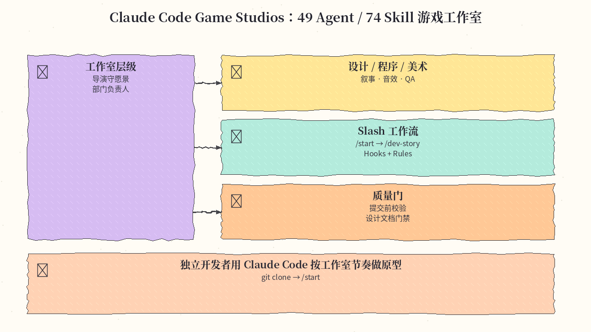
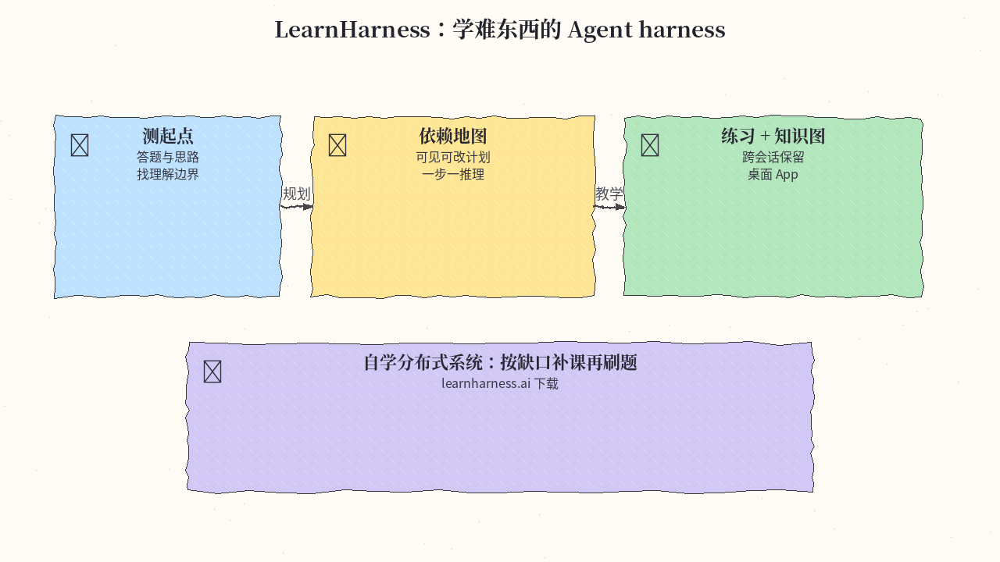
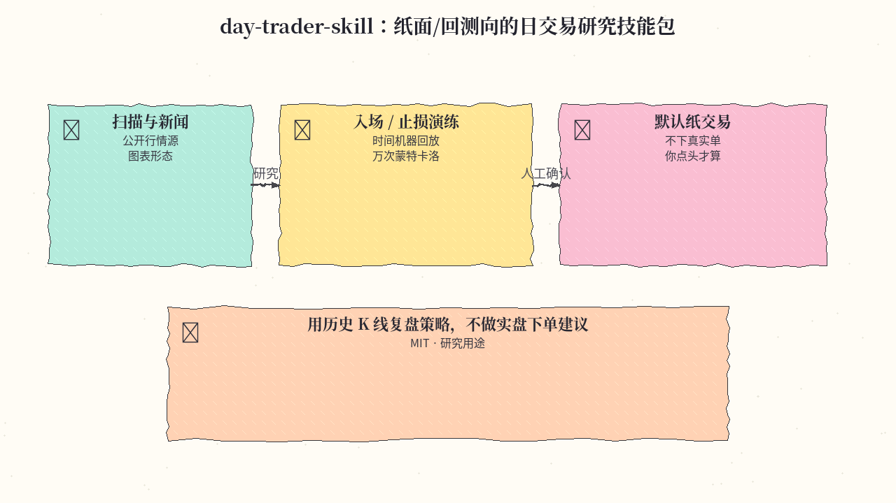
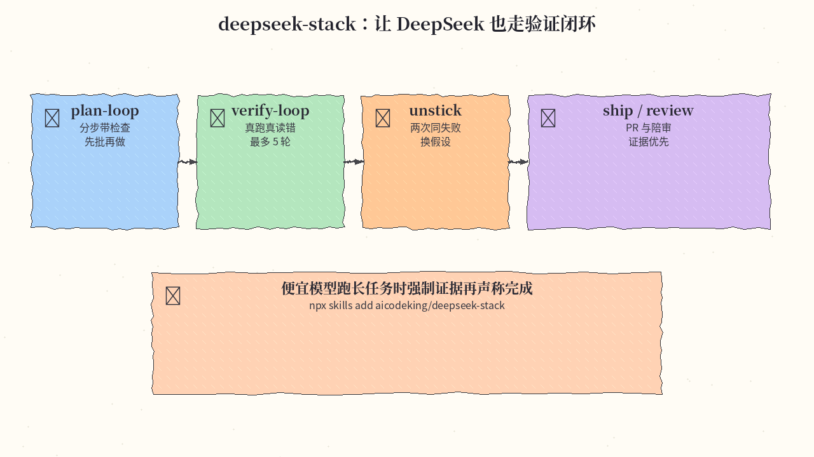
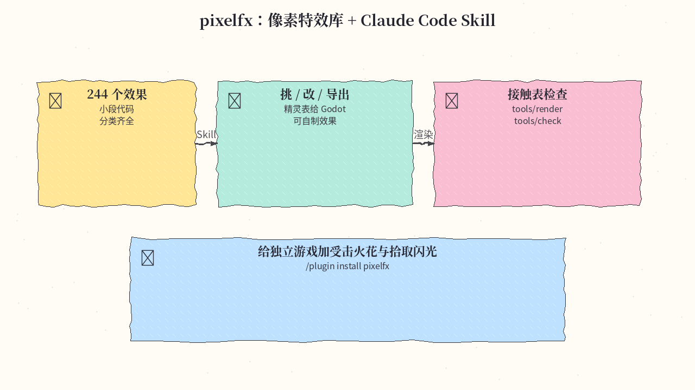
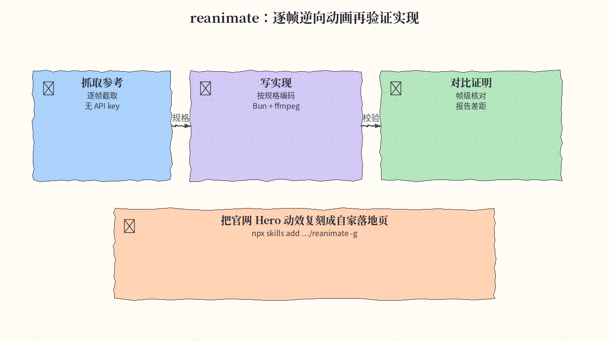
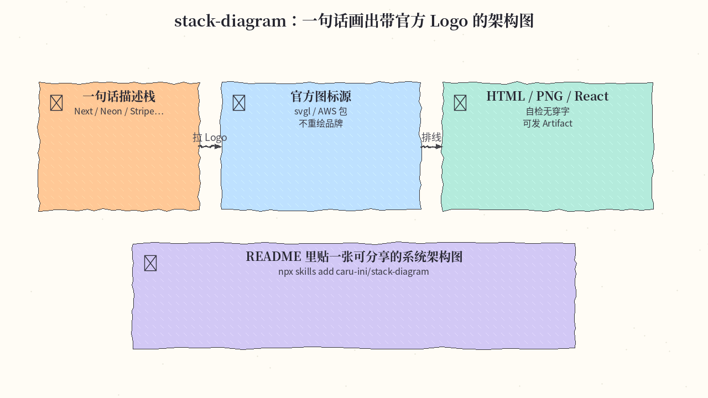

# 2026-11-02 Skills 日报

今日精选 7 条：Claude Code 游戏工作室、学习 harness、纸面交易研究技能、DeepSeek 验证栈、像素特效、动画逆向复刻，以及一句话架构图。与今早周报（unslop / hallmark / security-audit / impeccable / taste 等）及近几日日报不重复。

## 1. Donchitos/Claude-Code-Game-Studios — 49 Agent / 74 Skill 游戏工作室

**介绍**  
把单次 Claude Code 会话变成带层级的游戏开发工作室：49 个专业 agent、74 个工作流 skill（含 `/start`、`/design-system`、`/dev-story` 等）、Hooks 与 Rules。MIT，约 32.4k★。

**用法**  
仓库：[github.com/Donchitos/Claude-Code-Game-Studios](https://github.com/Donchitos/Claude-Code-Game-Studios)。

```bash
git clone https://github.com/Donchitos/Claude-Code-Game-Studios.git my-game
cd my-game
# 在 Claude Code 中打开后运行 /start，按向导选择阶段与 rigor
```

**应用场景**  
独立开发者从概念到可玩原型，用导演/程序/QA agent 守质量门，而不是单聊乱写。



**推荐学习程度**：进阶

---

## 2. amosblomqvist/learnharness — 学难东西的 Agent harness

**介绍**  
面向「困难主题」的桌面学习 harness：先测理解边界，再规划依赖地图，逐步教学与练习，并用知识图跨会话保留。AGPL-3.0，约 4.7k★；macOS / Windows 安装包。

**用法**  
仓库：[github.com/amosblomqvist/learnharness](https://github.com/amosblomqvist/learnharness)；下载：[learnharness.ai](https://learnharness.ai) 或 GitHub Releases。安装后新建课程目标，按提示作答与「出声思考」；可接自备模型 key。

**应用场景**  
自学分布式共识：从缺口补课，再进入变式练习。



**推荐学习程度**：入门

---

## 3. Jakeschincariol/day-trader-skill — 日交易研究 / 纸面演练技能包

**介绍**  
11 个 Claude skills：扫描图表、跟踪新闻、演练入场出场，并用「时间机器」基于历史 bar 回放结果。MIT，约 4.3k★。工具读公开数据（Yahoo / Nasdaq / SEC 等）；**默认纸交易，不会自动下真实订单**——本文仅作研究/回测工具介绍，不构成投资建议。

**用法**  
仓库：[github.com/Jakeschincariol/day-trader-skill](https://github.com/Jakeschincariol/day-trader-skill)。

```bash
# Claude Code 插件：
/plugin marketplace add Jakeschincariol/day-trader-skill
/plugin install day-trader-skill@day-trader-skill
# 或：git clone 后 cp -r day-trader-skill/trader-* ~/.claude/skills/
```

**应用场景**  
用历史 K 线复盘某套日内策略的胜率分布，始终人工确认、不上实盘自动单。



**推荐学习程度**：进阶

---

## 4. aicodeking/deepseek-stack — DeepSeek 计划/验证/交付技能栈

**介绍**  
一组 SKILL.md：针对便宜模型常见翻车点（跳过计划、空口「已修好」、死磕同一假设）。含 `ds-plan-loop`、`ds-verify-loop`、`ds-unstick`、`ds-ship` 等。约 106★，2026-10-28 起；`npx skills add` 可装。

**用法**  
仓库：[github.com/aicodeking/deepseek-stack](https://github.com/aicodeking/deepseek-stack)。

```bash
npx skills add aicodeking/deepseek-stack
# 或只装一个：npx skills add aicodeking/deepseek-stack --skill ds-verify-loop
# 不确定从哪开始：/ds-help
```

**应用场景**  
用 DeepSeek V4.1 Flash 跑长修复任务时，强制「真跑测试再宣称完成」。



**推荐学习程度**：入门

---

## 5. patch-gg/pixelfx — 像素特效库 + Claude Code Skill

**介绍**  
244 个可编程像素特效，附 Claude Code skill：查找、改参、导出精灵表、自制效果。约 2.7k★，2026-10-30；可 `npm i github:patch-gg/pixelfx` 或装插件。

**用法**  
仓库：[github.com/patch-gg/pixelfx](https://github.com/patch-gg/pixelfx)。

```text
/plugin marketplace add patch-gg/pixelfx
/plugin install pixelfx@pixelfx
```

然后让 Agent：「给受击加 frost nova」「导出爆炸类为 Godot 精灵表」。

**应用场景**  
独立游戏快速加拾取闪光与技能前摇特效，并导出给引擎。



**推荐学习程度**：入门

---

## 6. NiazMorshed2007/reanimate — 逐帧逆向动画再验证

**介绍**  
Skill 工作流：抓取参考动画 → 写规格 → 实现 → 帧级对比证明。约 741★；`npx skills add … -g`，首次会装静态 ffmpeg 与 Playwright Chromium（约 250MB），无需 API key。

**用法**  
仓库：[github.com/NiazMorshed2007/reanimate](https://github.com/NiazMorshed2007/reanimate)。

```bash
npx skills add NiazMorshed2007/reanimate -g
# 需要 Bun ≥1.1（macOS/Linux）
```

**应用场景**  
把竞品落地页 Hero 动效复刻到自家站点，并留下可核对的对比报告。



**推荐学习程度**：进阶

---

## 7. caru-ini/stack-diagram — 一句话生成带官方 Logo 的架构图

**介绍**  
描述技术栈 → 拉官方图标（svgl / AWS 等）→ 输出自包含 HTML / PNG / React，并自检连线不穿字。MIT，约 420★，2026-11-01；`npx skills add` 即可。

**用法**  
仓库：[github.com/caru-ini/stack-diagram](https://github.com/caru-ini/stack-diagram)。

```bash
npx skills add caru-ini/stack-diagram
# 例：Diagram our stack: Next.js + Hono on Vercel, Neon, Clerk, Stripe…
```

需 Python 3.9+ 与网络；PNG 导出用 Playwright。

**应用场景**  
给 README 或 RFC 贴一张可分享的系统架构图，深浅色都有。



**推荐学习程度**：入门

---
