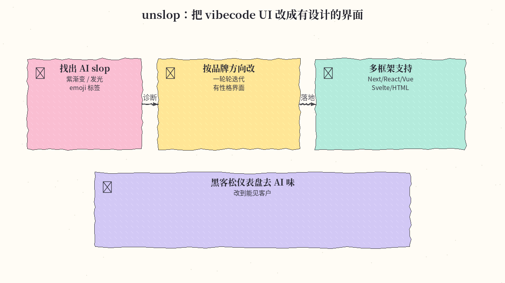
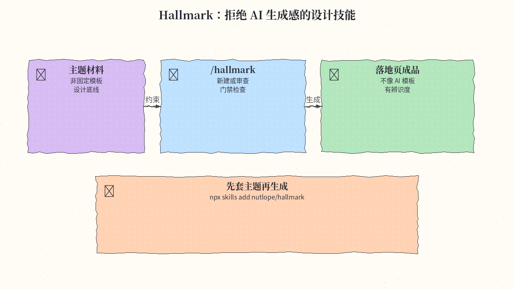
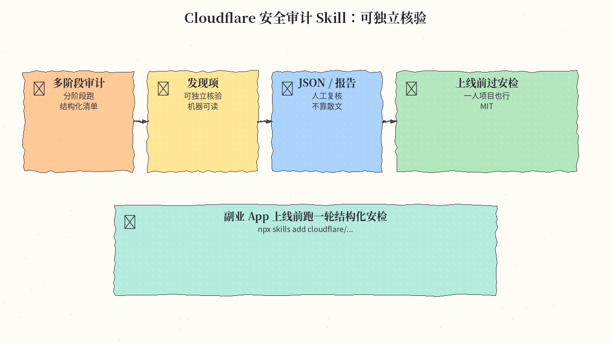
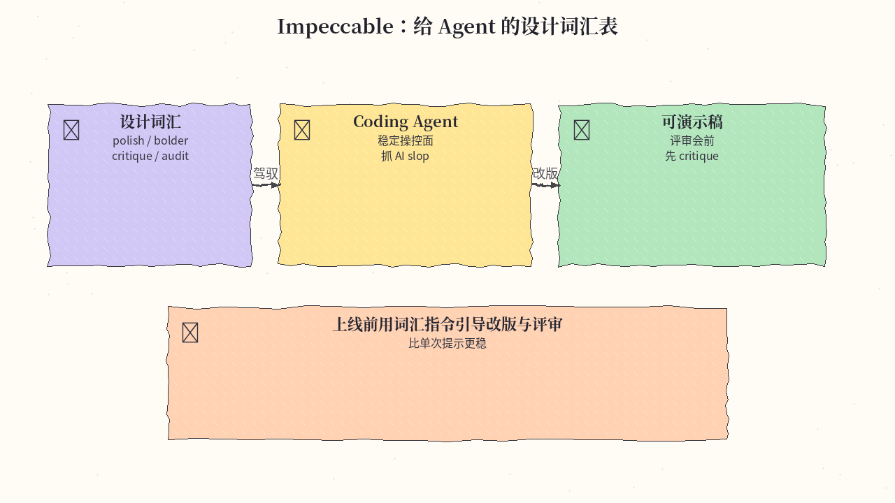
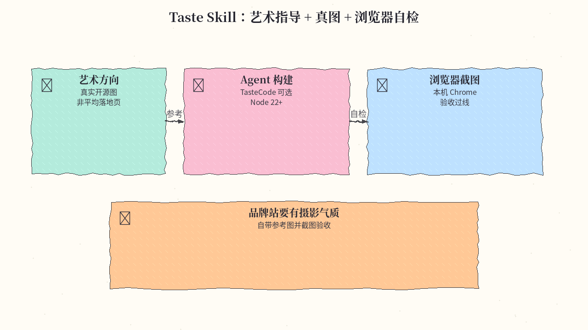
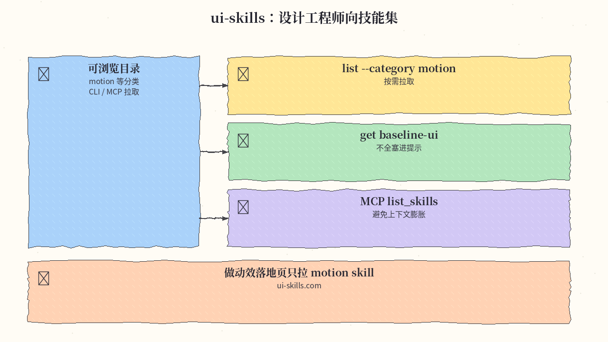
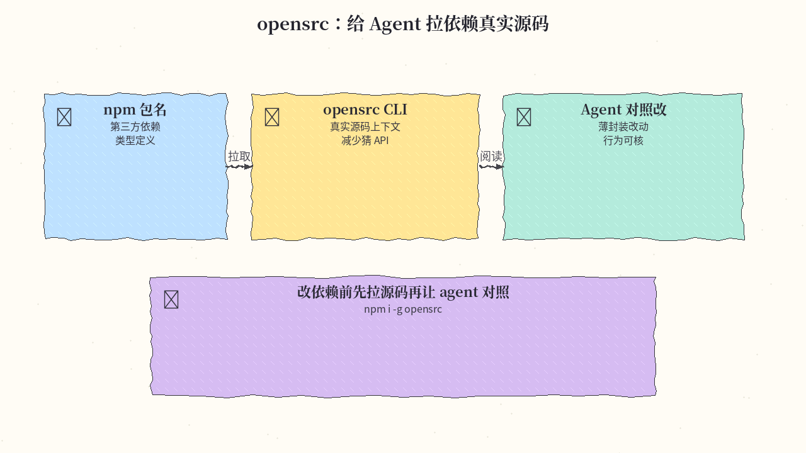
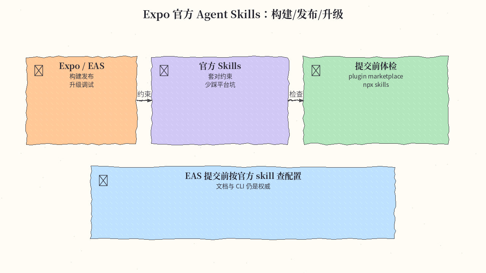
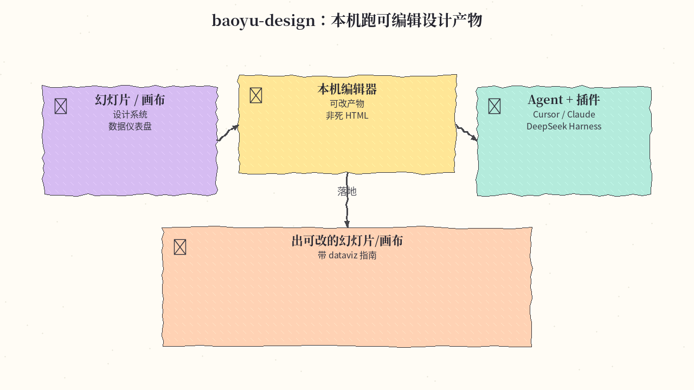
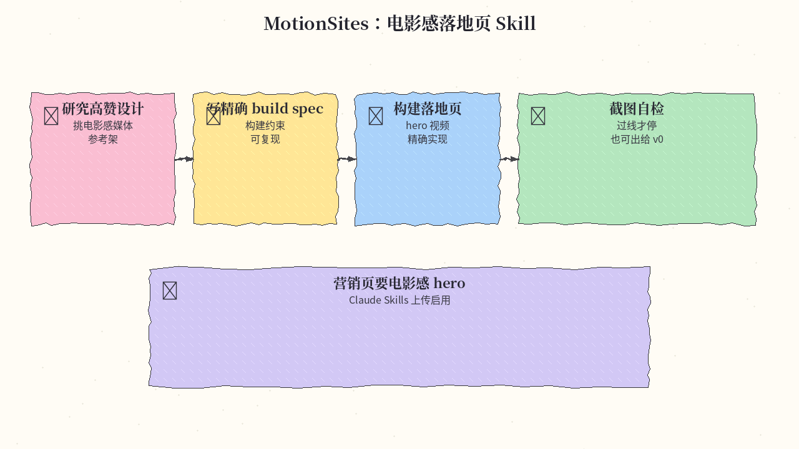

# 2026-11-02 Skills 周报

上周（10/26–11/01）精选 10 个值得装进 agent 工具箱的 Skill（去 AI 味设计 / 安全审计 / 源码拉取 / Expo / 电影感落地页）。

## 1. heydamir/unslop — unslop：把 vibecode UI 改成有设计的界面

**介绍**  
本周新星 skill（CC-BY-4.0，★~4.9k，创建于 2026-10-29）：先找出紫渐变/发光/emoji 标签等 AI slop，再按产品方向一轮轮改到有性格的界面；支持 Next/React/Vue/Svelte/纯 HTML，也可对着线上链接做。

**用法**  
Claude：`git clone` 后把 `skills/unslop` 拷到 `~/.claude/skills/`。Codex：`$skill-installer install https://github.com/heydamir/unslop/tree/main/skills/unslop`。可选装 Playwright 做线上快照。

**应用场景**  
黑客松出来的仪表盘一眼 AI 味，让 agent 按品牌方向红线改到能见客户。

**推荐学习程度**：入门

---

## 2. Nutlope/hallmark — Hallmark：拒绝 AI 生成感的设计技能

**介绍**  
Hallmark（MIT，★~4.5 万）：本周 GitHub Trending 常客。用主题材料（非固定模板）约束设计底线与门禁，可 `/hallmark` 起新建或审查；站 [usehallmark.com](https://www.usehallmark.com)。

**用法**  
`npx skills add nutlope/hallmark -g`（或去掉 `-g` 装到当前项目）。Claude / Codex / Cursor / OpenCode 均支持；浏览器检查需 puppeteer-core + Chrome。

**应用场景**  
要落地页不像「又一个 AI 模板」，先套 Hallmark 主题再生成。

**推荐学习程度**：入门

---

## 3. cloudflare/security-audit-skill — Cloudflare 安全审计 Skill

**介绍**  
cloudflare/security-audit-skill（MIT，★~5.6 万）：多阶段安全审计 skill，发现项可独立核验并输出机器可读结果。本周多份周榜点名，适合一人项目上线前的结构化过安检。

**用法**  
按仓库 README 把 skill 装进 Claude Code / 兼容 agent（常见 `npx skills add cloudflare/security-audit-skill` 或拷贝 skill 目录）；对目标仓库跑审计阶段并读 JSON/报告。

**应用场景**  
副业 App 上线前没人审代码，先跑一轮结构化安全审计清单。

**推荐学习程度**：进阶

---

## 4. pbakaus/impeccable — Impeccable：给 Agent 的设计词汇表

**介绍**  
Impeccable（Apache-2.0，★~9.9 万）：本周 Trending——用 polish / bolder / critique / audit 等设计词汇驾驭 coding agent，上线前抓 AI slop。比单次提示更稳定的设计操控面。

**用法**  
仓库：[github.com/pbakaus/impeccable](https://github.com/pbakaus/impeccable)。按 README 安装 skill 后，用词汇指令引导改版与评审。

**应用场景**  
评审会前让 agent 先 `critique` 一屏，再按 `polish` 出可演示稿。

**推荐学习程度**：进阶

---

## 5. Leonxlnx/taste-skill — Taste Skill：艺术指导 + 真图 + 浏览器自检

**介绍**  
Taste Skill（MIT，★~10.8 万）：给 agent 艺术方向、真实开源档案图片与浏览器自检，而不是平均落地页。可配 TasteCode 桌面端；需 Node 22+ 与本机 Chrome。

**用法**  
`npx skills add https://github.com/Leonxlnx/taste-skill --skill "design-taste-frontend"`。站：[tasteskill.dev](https://tasteskill.dev)。

**应用场景**  
品牌站要有摄影气质，让 agent 自带参考图并截图验收。

**推荐学习程度**：进阶

---

## 6. ibelick/ui-skills — ui-skills：设计工程师向技能集

**介绍**  
ibelick/ui-skills（★~1 万）：面向设计工程师的可浏览 skill 目录（motion 等分类），可用 CLI/MCP 按需拉取，而不是一次塞进巨型提示。站 [ui-skills.com](https://www.ui-skills.com/)。

**用法**  
`npx ui-skills start` / `npx ui-skills list --category motion` / `npx ui-skills get baseline-ui`；亦可接 MCP：`list_skills` / `get_skill`。

**应用场景**  
做动效落地页时只拉取 motion 相关 skill，避免上下文膨胀。

**推荐学习程度**：进阶

---

## 7. vercel-labs/opensrc — opensrc：给 Agent 拉依赖真实源码

**介绍**  
Vercel Labs opensrc（★~3k）：把 npm 包装成 agent 可读的真实源码上下文，减少「凭记忆猜 API」。适合改第三方行为或深挖类型定义时。

**用法**  
`npm install -g opensrc` 后按 README 在项目里拉取目标包源码供 agent 阅读。仓库：[github.com/vercel-labs/opensrc](https://github.com/vercel-labs/opensrc)。

**应用场景**  
要改一层薄封装时，先 opensrc 拉依赖源码再让 agent 对照改。

**推荐学习程度**：进阶

---

## 8. expo/skills — Expo 官方 Agent Skills

**介绍**  
expo/skills（★~4k）：Expo 官方为构建/发布/升级/调试 Expo 与 EAS 准备的 agent skills；文档与 CLI 仍是权威，skills 帮 agent 套对约束。

**用法**  
Claude/Codex 用官方 plugin marketplace；其他 agent：`npx skills` CLI 安装（见 [docs.expo.dev/skills](https://docs.expo.dev/skills/)）。仓库：[github.com/expo/skills](https://github.com/expo/skills)。

**应用场景**  
EAS 提交前让 agent 按官方 skill 检查配置，少踩平台坑。

**推荐学习程度**：入门

---

## 9. JimLiu/baoyu-design — baoyu-design：本机跑可编辑设计产物

**介绍**  
JimLiu/baoyu-design（★~5.8k）：把 Claude Design 类产物搬进本地 agent——幻灯片、画布、设计系统、数据仪表盘 + dataviz 指南，带本机编辑器；亦有 DeepSeek Harness 插件形态。

**用法**  
按仓库 README 把 skills 装到 Cursor / Claude Code / Codex；需要时装对应本地编辑器。DeepSeek Harness 可用 npm 插件名安装。

**应用场景**  
用本机 agent 出可改的幻灯片/画布，而不是一坨不可编辑 HTML。

**推荐学习程度**：进阶

---

## 10. Motionsites-AI/claude-skill — MotionSites：电影感落地页 Skill

**介绍**  
Motionsites-AI/claude-skill（★~1.4k，创建于 2026-10-26）：免费 Claude skill——研究高赞设计、挑电影感媒体、写精确 build spec、构建后再截图自检直到过线；也可只产出给 Lovable/v0 等的提示。

**用法**  
下载仓库 zip，在 Claude Customize → Skills 上传启用（需开启 code execution）。仓库：[github.com/Motionsites-AI/claude-skill](https://github.com/Motionsites-AI/claude-skill)。

**应用场景**  
营销页要电影感 hero 视频，让 skill 自带媒体架与验收环。

**推荐学习程度**：入门

---
