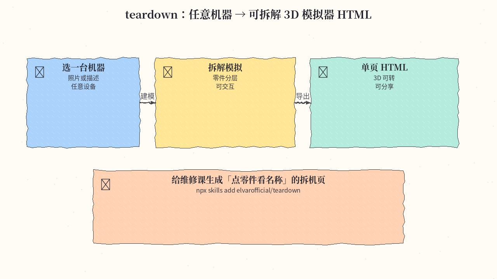
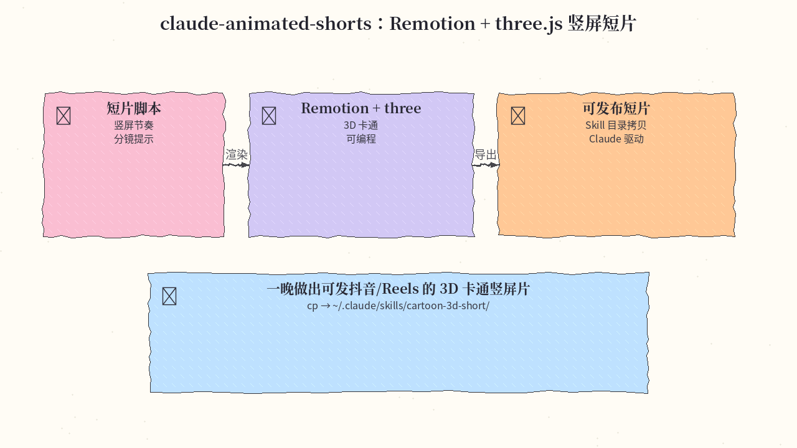
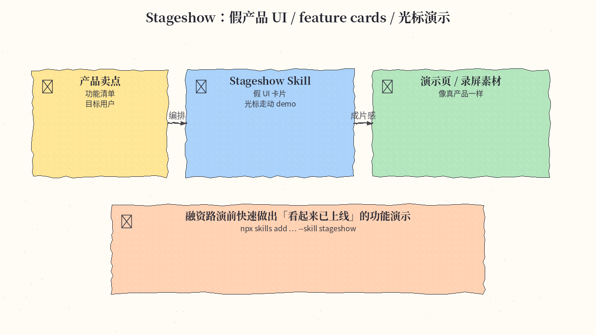
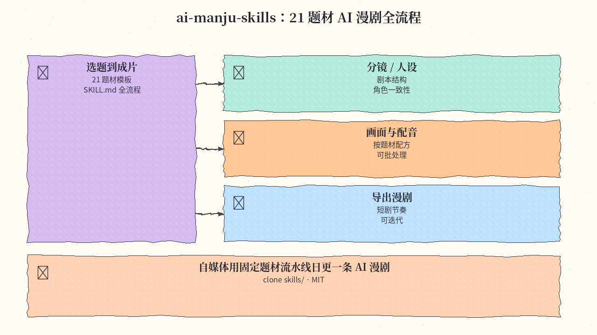
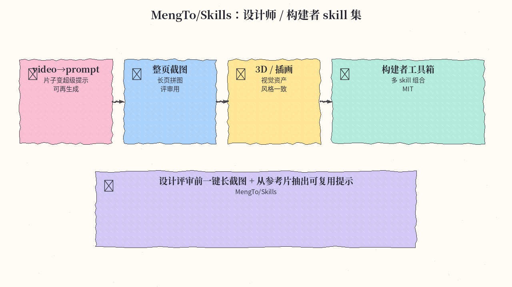
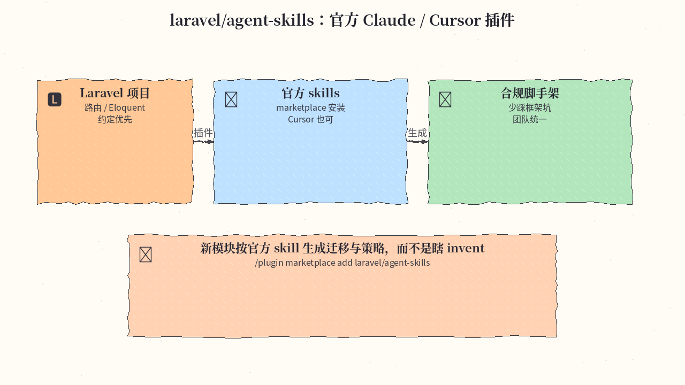
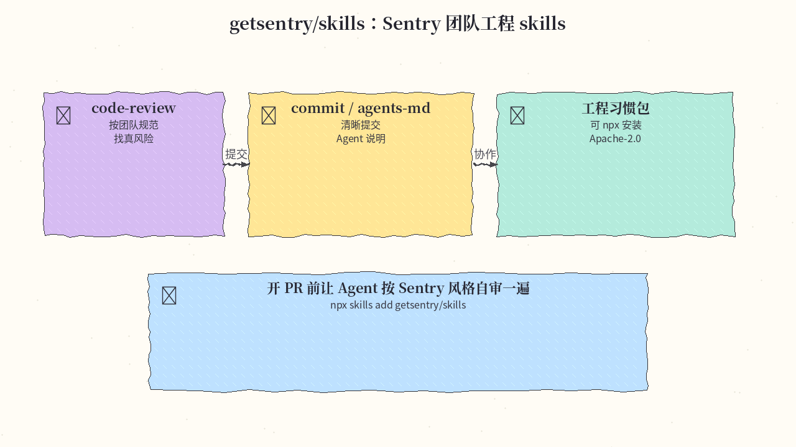
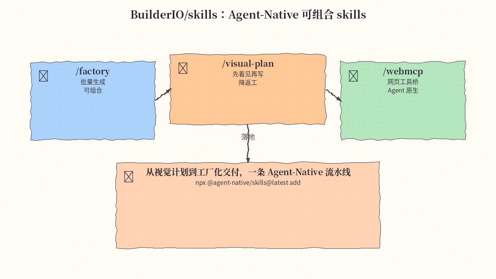

# 2026-11-03 Skills 日报

今日精选 8 条：机器拆解 3D 页、竖屏动画短片、假产品演示、AI 漫剧流水线、设计师 skill 集、Laravel 官方插件、Sentry 工程习惯，以及 Builder.io Agent-Native 组合拳。与往日日报、周报不重复。

## 1. elvarofficial/teardown — 任意机器 → 可拆解 3D 模拟器 HTML

**介绍**  
Skill：把任意设备变成可交互拆解的 3D 模拟器 HTML，零件可点、可转。MIT，约 1.3k★；通常配合 npm 与 Playwright。

**用法**  
仓库：[github.com/elvarofficial/teardown](https://github.com/elvarofficial/teardown)。

```bash
npx skills add elvarofficial/teardown -g -a claude-code
# 随后按 skill 说明 npm install，并准备 Playwright 浏览器
```

**应用场景**  
给维修课生成「点零件看名称」的拆机教学页。



**推荐学习程度**：进阶

---

## 2. mromidev/claude-animated-shorts — Remotion + three.js 竖屏短片

**介绍**  
面向 Claude 的竖屏动画短片 skill：Remotion + three.js 做可编程 3D 卡通短片。MIT，约 654★。

**用法**  
仓库：[github.com/mromidev/claude-animated-shorts](https://github.com/mromidev/claude-animated-shorts)。

```bash
# 按 README 将 skill 拷到 Claude skills 目录，例如：
cp -r claude-animated-shorts ~/.claude/skills/cartoon-3d-short/
# 然后在 Claude Code 里按 skill 提示写分镜并渲染
```

**应用场景**  
一晚做出可发抖音 / Reels 的 3D 卡通竖屏片。



**推荐学习程度**：进阶

---

## 3. benjitaylor/skills — Stageshow 假产品演示

**介绍**  
`stageshow` skill：快速拼出假产品 UI、feature cards 与光标走动演示，适合路演与录屏。仓库约 926★。

**用法**  
仓库：[github.com/benjitaylor/skills](https://github.com/benjitaylor/skills)。

```bash
npx skills add benjitaylor/skills --skill stageshow
```

**应用场景**  
融资路演前做出「看起来已上线」的功能演示页。



**推荐学习程度**：入门

---

## 4. zhanghao123vip/ai-manju-skills — 21 题材 AI 漫剧全流程

**介绍**  
一套覆盖 21 个题材的 AI 漫剧 SKILL.md：从选题、人设、分镜到成片的可复用配方。MIT，约 490★。

**用法**  
仓库：[github.com/zhanghao123vip/ai-manju-skills](https://github.com/zhanghao123vip/ai-manju-skills)。

```bash
git clone https://github.com/zhanghao123vip/ai-manju-skills.git
# 将 skills/ 下对应题材拷入你的 agent skills 目录后按 SKILL.md 跑流水线
```

**应用场景**  
自媒体用固定题材流水线日更一条 AI 漫剧。



**推荐学习程度**：入门

---

## 5. MengTo/Skills — 设计师 / 构建者 skill 集

**介绍**  
Meng To 的 skill 合集：video→superprompt、整页长截图、3D/插画等，面向设计师与独立构建者。MIT，约 7.2k★。

**用法**  
仓库：[github.com/MengTo/Skills](https://github.com/MengTo/Skills)。按 README 用 `npx skills add` 或拷贝所需 skill 目录；先从截图与 video-prompt 类技能试水。

**应用场景**  
设计评审前一键长截图，并从参考片抽出可复用超级提示。



**推荐学习程度**：入门

---

## 6. laravel/agent-skills — Laravel 官方 Agent 插件与 skills

**介绍**  
Laravel 官方维护的 Claude / Cursor 插件与 skills，按框架约定生成路由、迁移、策略等，减少 invent。约 733★。

**用法**  
仓库：[github.com/laravel/agent-skills](https://github.com/laravel/agent-skills)。

```text
/plugin marketplace add laravel/agent-skills
/plugin install laravel-agent-skills@laravel-agent-skills
# Cursor 等其它客户端安装方式见仓库 README
```

**应用场景**  
新模块按官方 skill 生成迁移与策略，团队输出一致。



**推荐学习程度**：入门

---

## 7. getsentry/skills — Sentry 团队工程 skills

**介绍**  
Sentry 工程团队公开的 skills：code-review、commit、agents-md 等，把评审与提交习惯编码进 Agent。Apache-2.0，约 1.1k★。

**用法**  
仓库：[github.com/getsentry/skills](https://github.com/getsentry/skills)。

```bash
npx skills add getsentry/skills
```

**应用场景**  
开 PR 前让 Agent 按 Sentry 风格自审一遍再推。



**推荐学习程度**：入门

---

## 8. BuilderIO/skills — Agent-Native 可组合 skills

**介绍**  
Builder.io 的 Agent-Native skill 集：`/factory`、`/visual-plan`、`/webmcp` 等可组合工作流。MIT，约 4.6k★。

**用法**  
仓库：[github.com/BuilderIO/skills](https://github.com/BuilderIO/skills)。

```bash
npx @agent-native/skills@latest add
# 按提示选择 /factory、/visual-plan、/webmcp 等
```

**应用场景**  
从视觉计划到工厂化交付，一条 Agent-Native 流水线落地页。



**推荐学习程度**：进阶

---
