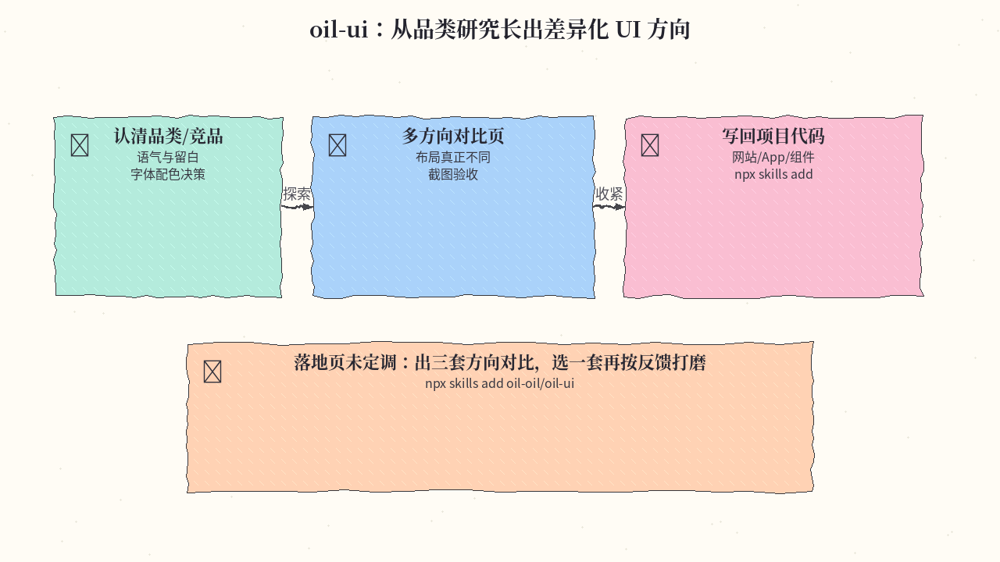
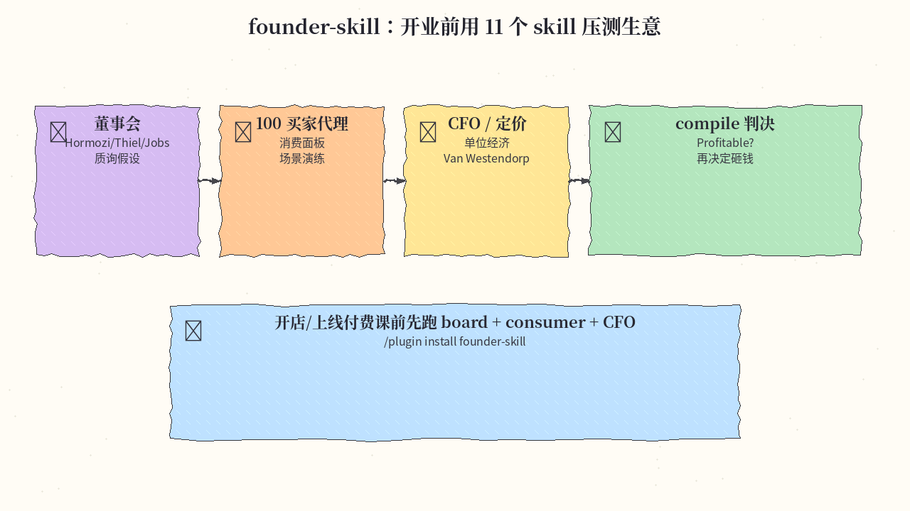
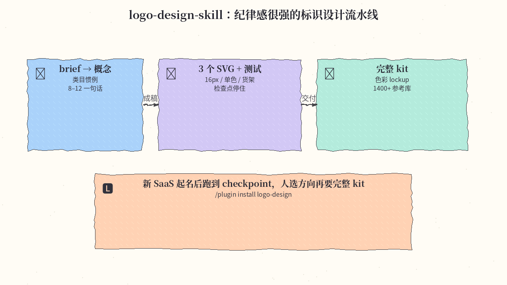
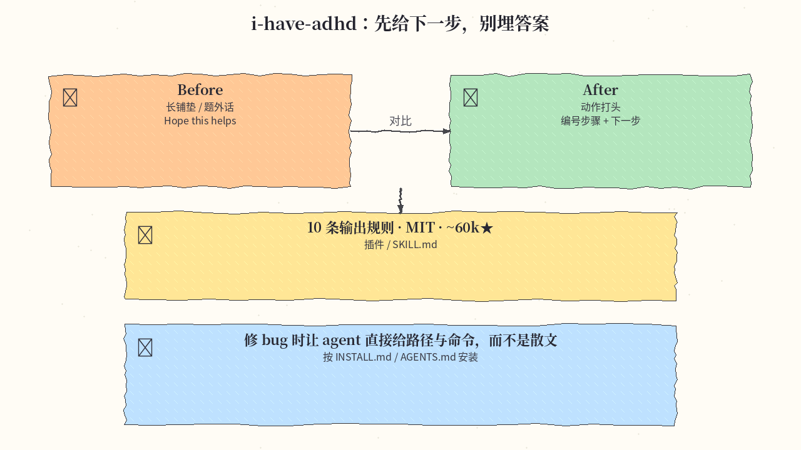
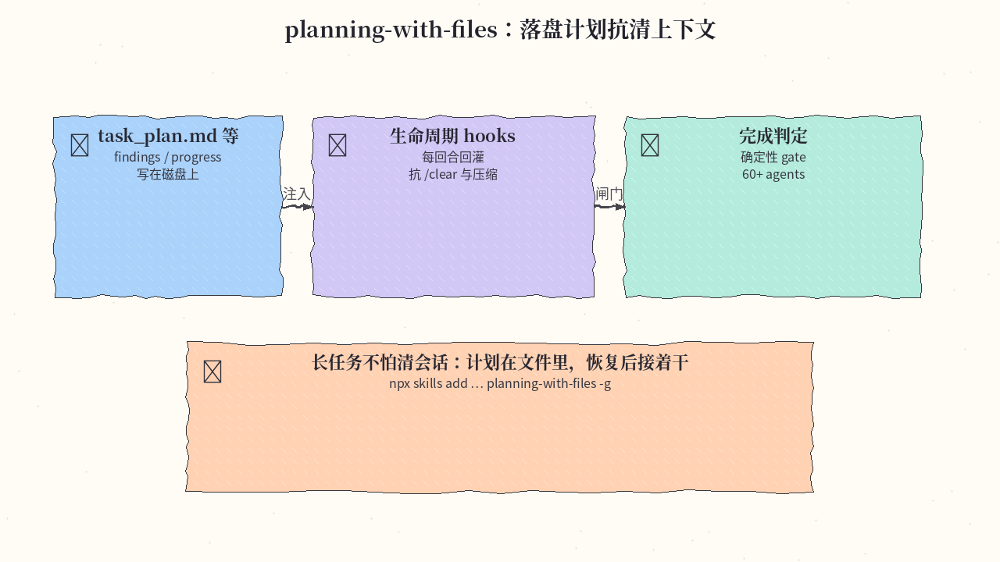
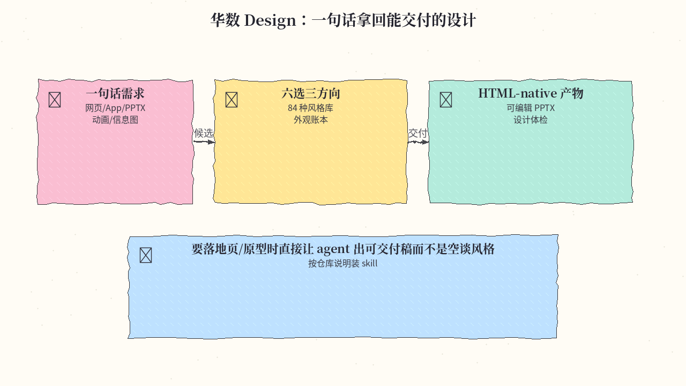
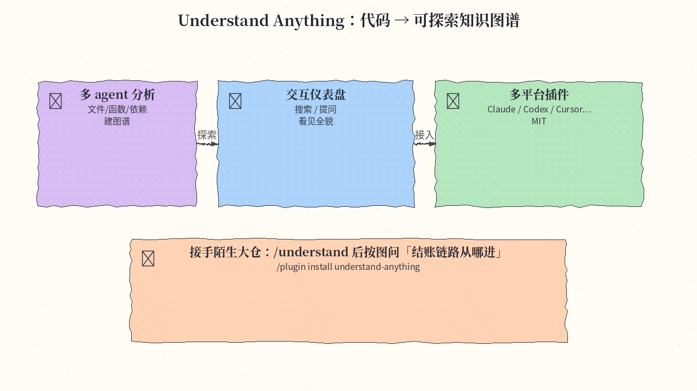

# 2026-11-04 Skills 日报

今日精选 7 条：oil-ui 差异化 UI 探索、创业压测 founder-skill、标识设计流水线、ADHD 友好输出、落盘计划 planning-with-files、华数 Design，以及 Understand Anything 代码知识图谱。与往日日报、周报不重复（已排除曾出现在 GitHub 日报的 floorplan / elephant-goldfish / text-to-cad）。

## 1. oil-oil/oil-ui — 从品类研究长出 UI 方向

**介绍**  
面向 Agent 的 UI 设计 skill：先认清品类与竞品气质，再把「高级/干净」落成字体、留白、配色；默认可推荐单一方向，也可生成多风格同屏对比页，并基于真实截图打磨。MIT，约 2.7k★。

**用法**  
仓库：[github.com/oil-oil/oil-ui](https://github.com/oil-oil/oil-ui)；站：[ui.oiloil.org](https://ui.oiloil.org/)。

```bash
npx skills add oil-oil/oil-ui
# 对 agent：用 oil-ui 给课程预约产品探索几个设计方向并做出可预览页面
```

已装 Oil UI Pro 时不要重复装开源版。

**应用场景**  
落地页未定调：让 oil-ui 出三套差异够大的方向对比，选一套后再按截图反馈收紧。



**推荐学习程度**：进阶

---

## 2. Jakeschincariol/founder-skill — 开业前用 11 个 skill 压测生意

**介绍**  
11 个 Claude skill：Hormozi/Thiel/Jobs 风格董事会、竞品侦查、默认 100 个买家代理的消费面板、定价、Offer/CFO/营销/品牌/运营/发布，最后 compile 出带「Profitable / Not yet」判决的计划。纯本地 Python、无联网依赖。MIT，约 2.4k★。

**用法**  
仓库：[github.com/Jakeschincariol/founder-skill](https://github.com/Jakeschincariol/founder-skill)。

```text
/plugin marketplace add Jakeschincariol/founder-skill
/plugin install founder-skill@founder-skill
# 插件技能名为 /founder-skill:founder-board 等；要短名可拷 skills/founder-* 到 ~/.claude/skills/
```

建议顺序：board → competitors → consumer → pricing → offer → cfo → … → plan。

**应用场景**  
想开城市 matcha 店或上线付费课：先跑 board 与 consumer，再看 CFO 单位经济是否撑得住。



**推荐学习程度**：进阶

---

## 3. kaankiziltug/logo-design-skill — 纪律感很强的标识设计

**介绍**  
把 agent 变成标识设计师：brief→类目惯例→8–12 概念→3 个 SVG→16px/单色/货架测试→检查点停住等人选方向→再出色彩/lockup/演示板/favicon。附 1400+ 真实世界 SVG logo 分类库与无依赖 Python 审计工具。MIT，约 5.9k★。

**用法**  
仓库：[github.com/kaankiziltug/logo-design-skill](https://github.com/kaankiziltug/logo-design-skill)。

```text
/plugin marketplace add kaankiziltug/logo-design-skill
/plugin install logo-design@logo-design-skill
# 或 cp -r skills/logo-design ~/.claude/skills/logo-design
```

需要能看图的模型；技能会在 checkpoint 停住等人选方向。

**应用场景**  
给新 SaaS 起名后要 logo：跑到 checkpoint，在灰阶概念里选方向，再要完整 kit。



**推荐学习程度**：专精

---

## 4. ayghri/i-have-adhd — 先给下一步，别埋答案

**介绍**  
让 coding agent 输出更可执行：动作打头、步骤编号、结尾给一个两分钟内能做的下一步；压制铺垫与「Hope this helps!」。10 条规则写在 SKILL.md。MIT，约 60k★。

**用法**  
仓库：[github.com/ayghri/i-have-adhd](https://github.com/ayghri/i-have-adhd)。可对 CLI 说「按 AGENTS.md / INSTALL.md 安装 i-have-adhd」；各宿主（Claude / agy 等）安装细节见 INSTALL.md。

**应用场景**  
修 bug 时让 agent 直接给路径与命令，而不是先写一段散文再埋答案。



**推荐学习程度**：入门

---

## 5. OthmanAdi/planning-with-files — 落盘计划抗清上下文

**介绍**  
持久文件化规划：把 `task_plan.md` / `findings.md` / `progress.md` 写在磁盘上；生命周期 hooks 每回合回灌选中计划，扛住 `/clear`、崩溃与压缩；带确定性完成闸门。兼容 60+ agents。MIT，约 28k★。

**用法**  
仓库：[github.com/OthmanAdi/planning-with-files](https://github.com/OthmanAdi/planning-with-files)。

```bash
npx skills add OthmanAdi/planning-with-files --skill planning-with-files -g
# 完整安装矩阵见 docs/installation.md；另有中文等语言变体 skill
```

**应用场景**  
长任务不怕清会话：计划在文件里，恢复后接着干，而不是靠模型「还记得吗」。



**推荐学习程度**：进阶

---

## 6. alchaincyf/huashu-design — 华数 Design：一句话拿回可交付设计

**介绍**  
华数 Design 3.0：在 agent 里打一句话，拿回网页/App 原型、可编辑 PPTX、动画、信息图等；六个候选挑三个方向，84 种带样张的风格库，带外观账本与设计体检。MIT，约 29k★。（同作者的 huashu-art-motion 等已另日介绍，本条是交付向 Design 主包。）

**用法**  
仓库：[github.com/alchaincyf/huashu-design](https://github.com/alchaincyf/huashu-design)。按 README 将 skill 装入 Claude Code / Codex / Cursor 等；对 agent 直接描述要交付的页面或 PPT。

**应用场景**  
要落地页/原型时直接让 agent 出可交付稿，而不是空谈「高级感」。



**推荐学习程度**：入门

---

## 7. Egonex-AI/Understand-Anything — 代码 → 可探索知识图谱

**介绍**  
多 agent 流水线分析项目，建成文件/函数/类/依赖的知识图谱，并给出可搜索、可提问的交互仪表盘。插件覆盖 Claude Code / Codex / Cursor / Copilot / Gemini CLI 等。MIT，约 90k★。

**用法**  
仓库：[github.com/Egonex-AI/Understand-Anything](https://github.com/Egonex-AI/Understand-Anything)。

```text
/plugin marketplace add Egonex-AI/Understand-Anything
/plugin install understand-anything
/understand
```

一键多平台：`curl -fsSL https://raw.githubusercontent.com/Egonex-AI/Understand-Anything/main/install.sh | bash`

**应用场景**  
接手陌生大仓：跑 `/understand` 后按图问「结账链路从哪进、webhook 落在哪」。



**推荐学习程度**：入门

---
