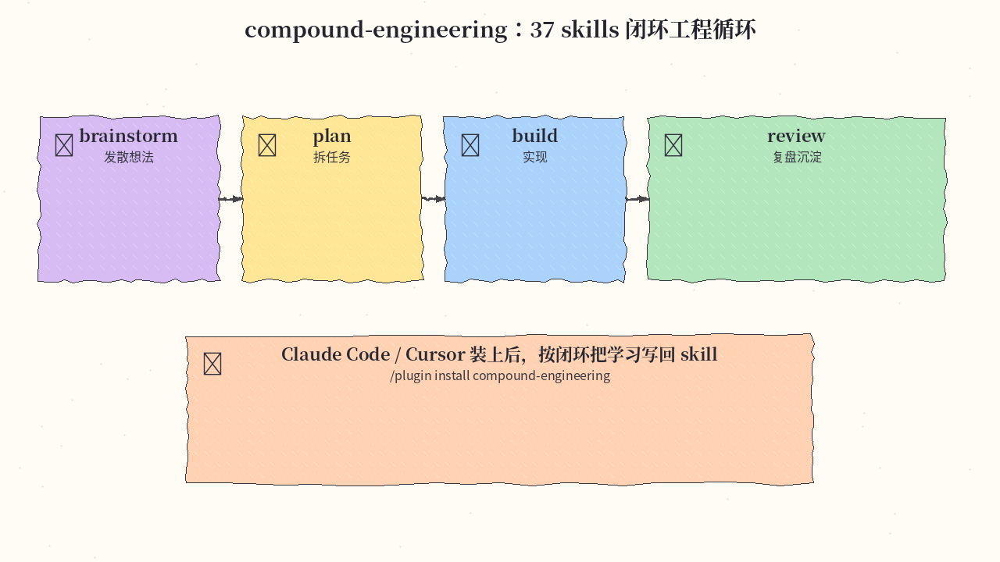
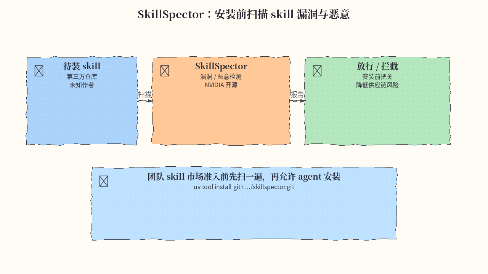
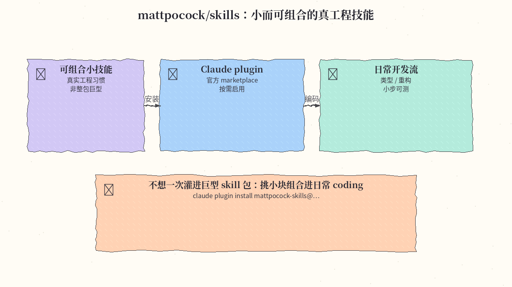
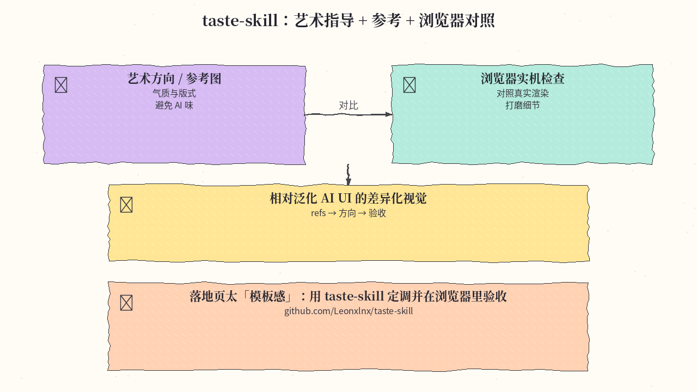
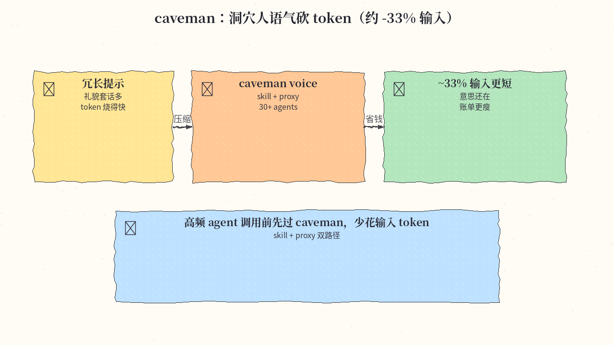
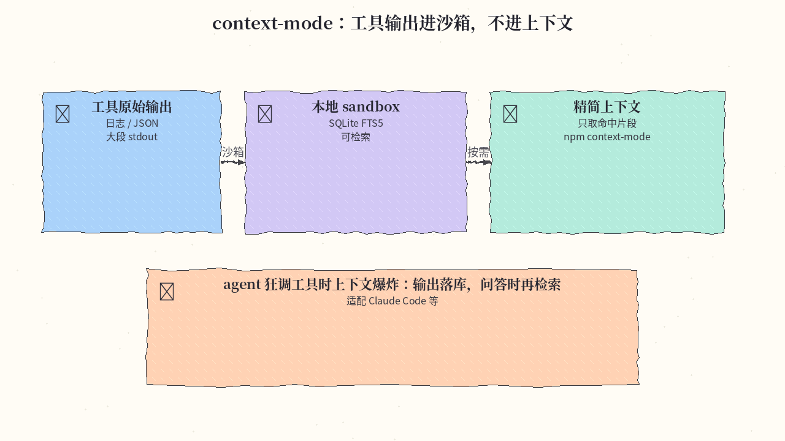
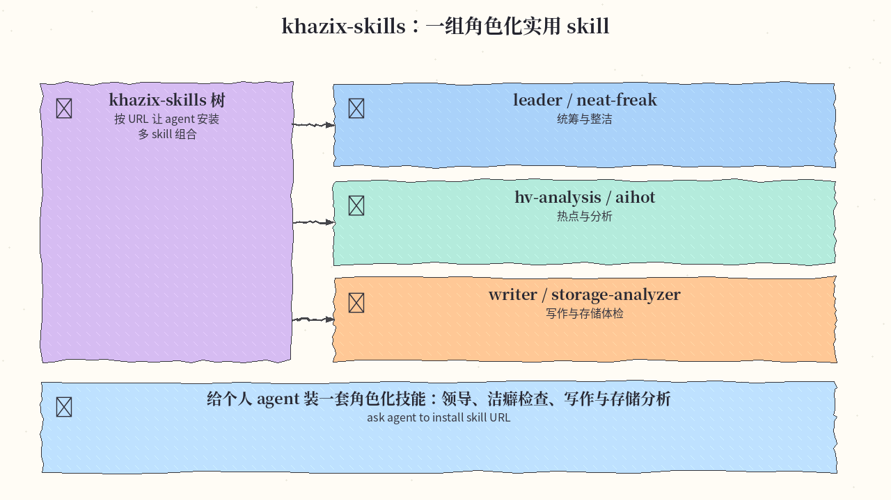
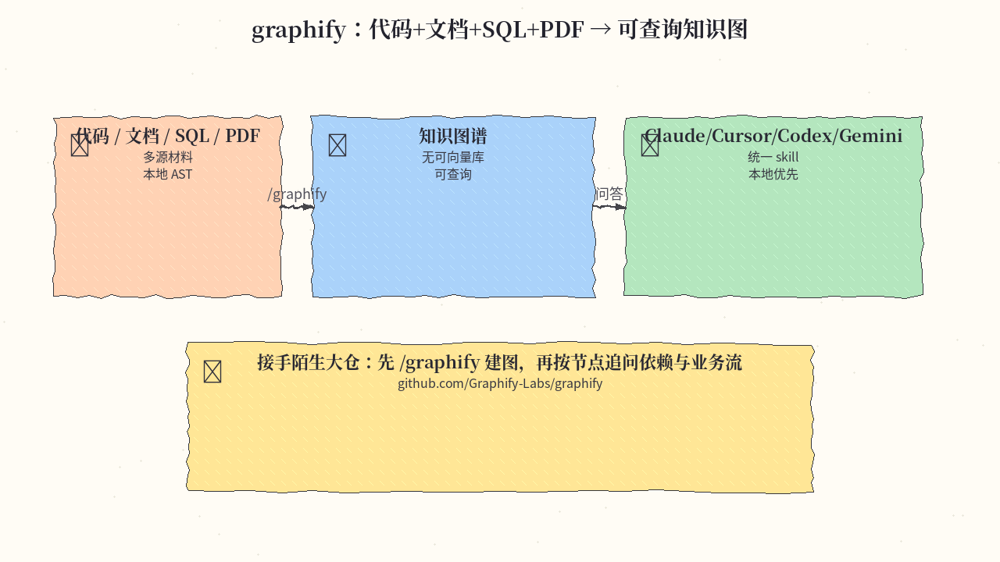

# 2026-11-05 Skills 日报

今日精选 8 条：复合工程闭环、skill 安全扫描、可组合小技能、taste 艺术指导、caveman 省 token、上下文沙箱、khazix 角色包，以及 graphify 知识图。与往日日报、周报不重复。

## 1. EveryInc/compound-engineering-plugin — 37 skills 工程闭环

**介绍**  
37 个 skills 串成 brainstorm → plan → build → review → capture learning 循环，把「做完就忘」变成可沉淀的工程习惯。约 26k★。

**用法**  
仓库：[github.com/EveryInc/compound-engineering-plugin](https://github.com/EveryInc/compound-engineering-plugin)。

```text
# Claude Code
/plugin marketplace add EveryInc/compound-engineering-plugin
/plugin install compound-engineering

# Cursor
/add-plugin compound-engineering
```

**应用场景**  
从想法到落地再到复盘：让 agent 按闭环推进，并把学到的写回 skill，而不是一次性对话。



**推荐学习程度**：进阶

---

## 2. NVIDIA/SkillSpector — 安装前扫描 skill 漏洞与恶意

**介绍**  
安装 agent skill 前扫描漏洞与恶意行为，降低供应链风险。约 24k★（仓库名 `NVIDIA/SkillSpector`）。

**用法**  
仓库：[github.com/NVIDIA/SkillSpector](https://github.com/NVIDIA/SkillSpector)。

```bash
uv tool install git+https://github.com/NVIDIA/skillspector.git
# 对目标 skill 目录或 URL 运行扫描，按报告决定是否安装
```

**应用场景**  
团队 skill 市场准入：第三方 skill 先扫再装，避免恶意提示或危险脚本进生产 agent。



**推荐学习程度**：入门

---

## 3. mattpocock/skills — 小而可组合的真工程技能

**介绍**  
一组小而可组合、偏向真实工程习惯的 skills（非整包巨型合集）。约 313k★。

**用法**  
仓库：[github.com/mattpocock/skills](https://github.com/mattpocock/skills)。

```bash
claude plugin install mattpocock-skills@claude-plugins-official
```

**应用场景**  
不想一次灌进巨型 skill 包：按需挑小块组合进日常 coding（类型、重构、小步可测）。



**推荐学习程度**：入门

---

## 4. Leonxlnx/taste-skill — 艺术指导 + 参考 + 浏览器对照

**介绍**  
面向 UI/视觉：艺术方向、参考图，并用浏览器实机检查，对抗泛化「AI UI」味道。约 110k★。

**用法**  
仓库：[github.com/Leonxlnx/taste-skill](https://github.com/Leonxlnx/taste-skill)。按 README 安装为 Claude/Cursor skill 后，提供产品气质与参考，再让 agent 出方向并在浏览器验收。

**应用场景**  
落地页太模板感：用 taste-skill 定调、选参考，并在真实渲染里打磨细节。



**推荐学习程度**：进阶

---

## 5. JuliusBrussee/caveman — 洞穴人语气砍输入 token

**介绍**  
用「caveman」短促语气压缩提示，宣称可砍约 33% 输入 token；提供 skill + proxy，适配 30+ agents。约 117k★。

**用法**  
仓库：[github.com/JuliusBrussee/caveman](https://github.com/JuliusBrussee/caveman)。按 README 安装 skill，或架 proxy 让现有 agent 流量先过 caveman 再上模型。

**应用场景**  
高频 agent 调用账单偏高：先过 caveman 缩短输入，意思保留、token 更少。



**推荐学习程度**：入门

---

## 6. mksglu/context-mode — 工具输出进沙箱，不进上下文

**介绍**  
把工具输出放进本地 sandbox + SQLite FTS5，默认不灌进模型上下文，问答时再检索命中片段。约 33k★；提供 npm `context-mode`，可接 Claude Code 等。

**用法**  
仓库：[github.com/mksglu/context-mode](https://github.com/mksglu/context-mode)。

```bash
npm i -g context-mode
# 按 README 接到 Claude Code / 其他 agent，使工具 stdout 落库而非塞满上下文
```

**应用场景**  
agent 狂调工具导致上下文爆炸：输出落库，需要时 FTS 取片段。



**推荐学习程度**：进阶

---

## 7. KKKKhazix/khazix-skills — 角色化实用 skill 包

**介绍**  
一组角色化 skills：leader / neat-freak / hv-analysis / khazix-writer / aihot / storage-analyzer 等。约 22k★。

**用法**  
仓库：[github.com/KKKKhazix/khazix-skills](https://github.com/KKKKhazix/khazix-skills)。按树下各 skill 的 URL，直接让 agent「安装该 skill URL」即可；也可手动拷到 skills 目录。

**应用场景**  
给个人 agent 装一套角色：统筹（leader）、洁癖检查（neat-freak）、写作与存储体检等。



**推荐学习程度**：入门

---

## 8. Graphify-Labs/graphify — 代码+文档 → 可查询知识图

**介绍**  
`/graphify` skill：把 codebase、文档、SQL、PDF 建成可查询知识图；本地 AST，不依赖向量库。支持 Claude / Cursor / Codex / Gemini。约 142k★。

**用法**  
仓库：[github.com/Graphify-Labs/graphify](https://github.com/Graphify-Labs/graphify)。按 README 安装到对应 agent 后执行 `/graphify`（或等价命令）指向仓库/文档目录，再按图查询。

**应用场景**  
接手陌生大仓：先建图，再按节点追问模块依赖与业务流，而不是盲搜文件。



**推荐学习程度**：进阶

---
