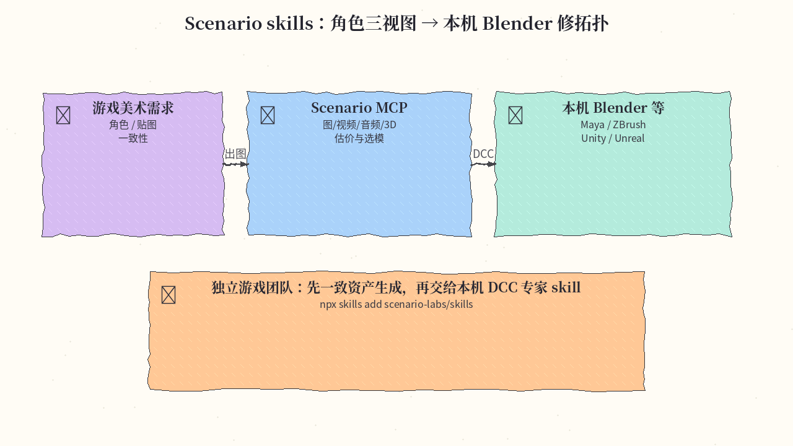
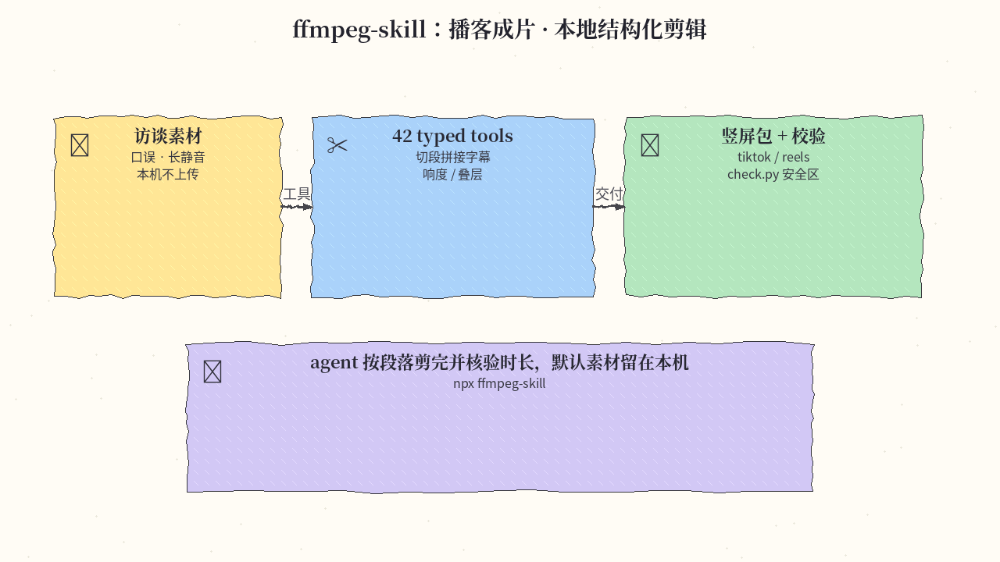
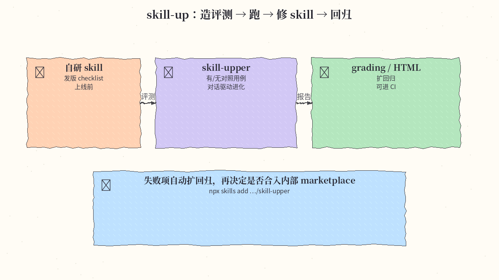

# 2026-11-06 Skills 日报

今日三条：Scenario 游戏美术技能包、本地 FFmpeg 剪辑 skill、阿里 skill-up 评测进化环。

## 1. scenario-labs/skills — Scenario 游戏/影视资产生成技能包

**介绍**  
给 coding agent 装上 Scenario MCP 工作流：游戏与内容向的图、视频、音频、贴图、天空盒、3D，以及驱动本机 DCC/引擎（Blender / Maya / ZBrush / Unreal / Unity）的专家技能族；按角色/目标一键装，可钉提交。约 3.1k★。

**用法**  
仓库：[github.com/scenario-labs/skills](https://github.com/scenario-labs/skills)。

```bash
# 菜单挑选（推荐先摸清包结构）
npx skills add scenario-labs/skills

# 单技能
npx skills add scenario-labs/skills --skill scenario

# 接 Scenario MCP（Claude Code）
claude mcp add --transport http scenario https://mcp.scenario.com/mcp
```

**应用场景**  
独立游戏团队让 agent 先出一致角色三视图与 sprite 动画，再交给本机 Blender skill 修拓扑，而不是在聊天里反复贴提示词。



**推荐学习程度**：进阶

---

## 2. kajisho5/ffmpeg-skill — 本地 FFmpeg 剪辑引擎（42 tools + MCP）

**介绍**  
本地视频剪辑 skill：42 个结构化 FFmpeg 工具（切段、拼接、去静音、字幕、叠层、响度、平台交付等），机器可读 contract，默认不上传素材。可当独立 skill，也可 MCP；与 HTML 渲视频类工具互补，偏真实素材剪辑。约 4.6k★。

**用法**  
仓库：[github.com/kajisho5/ffmpeg-skill](https://github.com/kajisho5/ffmpeg-skill)。

```bash
sudo apt install ffmpeg   # macOS/Windows 见仓库 Install 表
npx ffmpeg-skill          # 默认装到 Claude Code；可用 --cursor / --codex / --all
npx ffmpeg-skill doctor
npx ffmpeg-skill contract --json | head -40
# 可选本地转写：pip install faster-whisper
```

**应用场景**  
播客访谈成片：agent 按段落切掉口误与长静音，套 `tiktok`/`reels` 模板出竖屏包，并用 `check.py` 核验时长与安全区。



**推荐学习程度**：入门

---

## 3. alibaba/skill-up — Agent Skill 评测与进化环

**介绍**  
评测 Agent Skills / agent / workspace 的 CLI，并配套 skill-upper：用证据驱动把 skill 越改越好，输出 grading/benchmark/HTML 等报告，可进 CI。声明式 `eval.yaml` + cases，支持 Claude Code / Codex / Qoder 等引擎。约 1.4k★。

**用法**  
仓库：[github.com/alibaba/skill-up](https://github.com/alibaba/skill-up)。

```bash
# 装 skill-upper（通常会引导再装 CLI）
npx skills add https://github.com/alibaba/skill-up/tree/main/skills/skill-upper -g -a claude-code -y
# Codex：
# npx skills add https://github.com/alibaba/skill-up/tree/main/skills/skill-upper -g -a codex -y

# 直接装 CLI
curl -fsSL https://raw.githubusercontent.com/alibaba/skill-up/main/install.sh | bash
# 手册：https://alibaba.github.io/skill-up/
```

**应用场景**  
团队自研「发版 checklist」skill 上线前：用 skill-upper 生成有/无 skill 对照用例，失败项自动扩回归，再决定是否合入内部 marketplace。



**推荐学习程度**：深水

---
