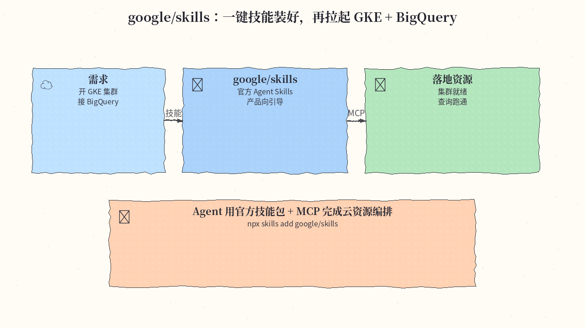
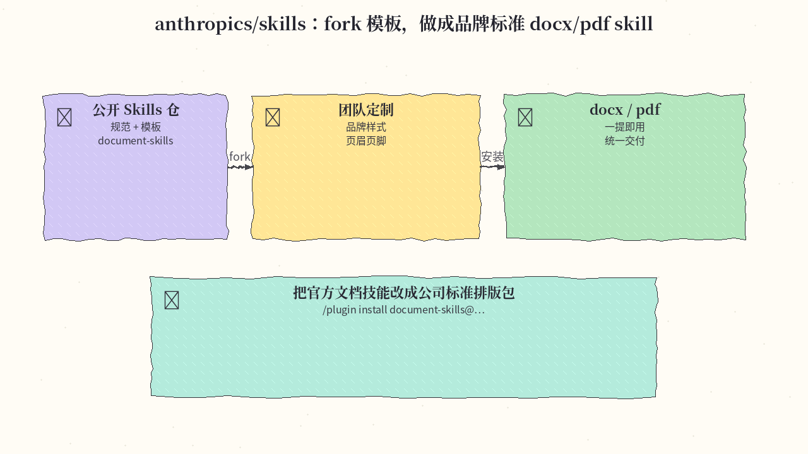
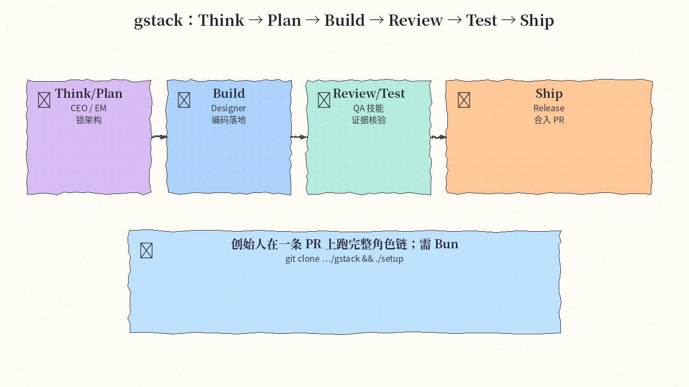

# 2026-11-09 Skills 日报

今日三条：Google 官方云技能包、Anthropic 公开 Skills 规范仓、以及 Garry Tan 的 gstack 角色工厂。

## 1. google/skills — Google Cloud / 产品官方 Agent Skills

**介绍**  
google/skills 是 Google 产品与技术的官方 Agent Skills 集合，覆盖云侧配置与 MCP 相关能力，可按菜单挑选安装范围。约 23.7k★。

**用法**  
仓库：[github.com/google/skills](https://github.com/google/skills)。skills.sh：[skills.sh/google/skills](https://skills.sh/google/skills)。

```bash
npx skills add google/skills
# 之后按提示选择技能与安装范围（project / global）
npx skills update
```

**应用场景**  
Agent 按官方技能引导拉起 GKE，并接好 BigQuery 查询链路。



**推荐学习程度**：入门

---

## 2. anthropics/skills — 公开 Agent Skills 仓 + 规范/模板

**介绍**  
anthropics/skills 是 Anthropic 的公开 Agent Skills 仓库：含示例、规范指向（agentskills.io）以及 document-skills 等文档能力参考实现，方便团队 fork 成自己的标准。约 190k★。

**用法**  
仓库：[github.com/anthropics/skills](https://github.com/anthropics/skills)。

```bash
# Claude Code：注册 marketplace 后安装，或直接：
/plugin install document-skills@anthropic-agent-skills
/plugin install example-skills@anthropic-agent-skills
# 也可用 npx skills / 仓库内 SKILL.md 模板自行 fork
```

**应用场景**  
团队 fork 模板，做成品牌标准的 docx/pdf 排版 skill，交付物统一页眉、字体与样式。



**推荐学习程度**：入门

---

## 3. garrytan/gstack — Garry Tan 的 Claude Code「虚拟工程团队」

**介绍**  
gstack 把 Claude Code（及其他 coding agent）变成角色工厂：CEO / EM / Designer / QA / Release 等 slash skills，串起 Think→Plan→Build→Review→Test→Ship。需要 Bun；MIT。约 141k★。

**用法**  
仓库：[github.com/garrytan/gstack](https://github.com/garrytan/gstack)。依赖 Claude Code + Git + Bun（文档要求约 v1.4.2+）。

```bash
git clone --single-branch --depth 1 https://github.com/garrytan/gstack.git ~/.claude/skills/gstack
cd ~/.claude/skills/gstack && ./setup
# 其他 agent：./setup --host <name> 或看 ./setup --status
# 团队模式见仓库：./setup --team
```

**应用场景**  
创始人在一条 PR 上跑完整链：Think→Plan→Build→Review→Test→Ship，角色切换靠 slash skills。



**推荐学习程度**：进阶

---
