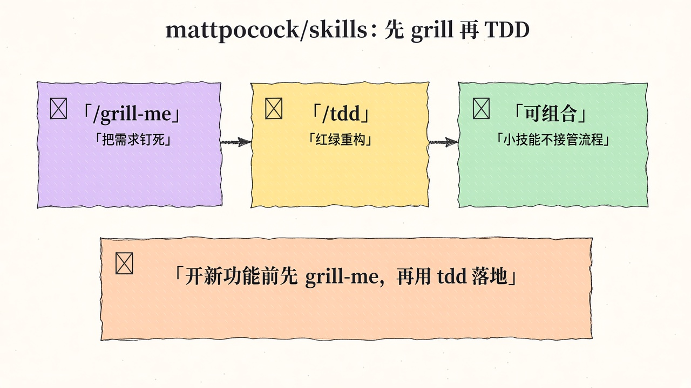
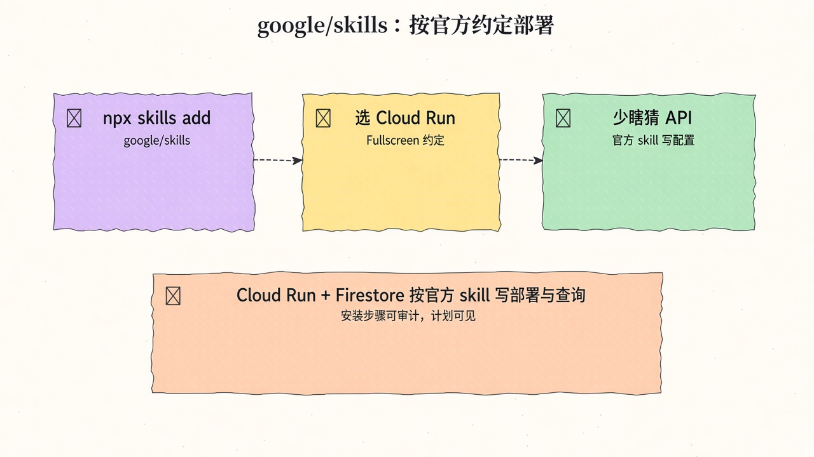
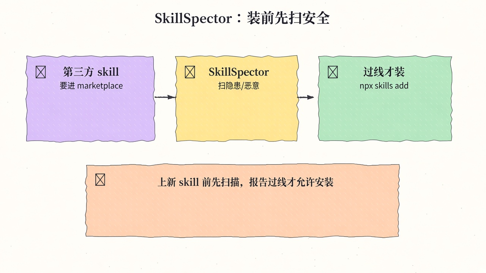
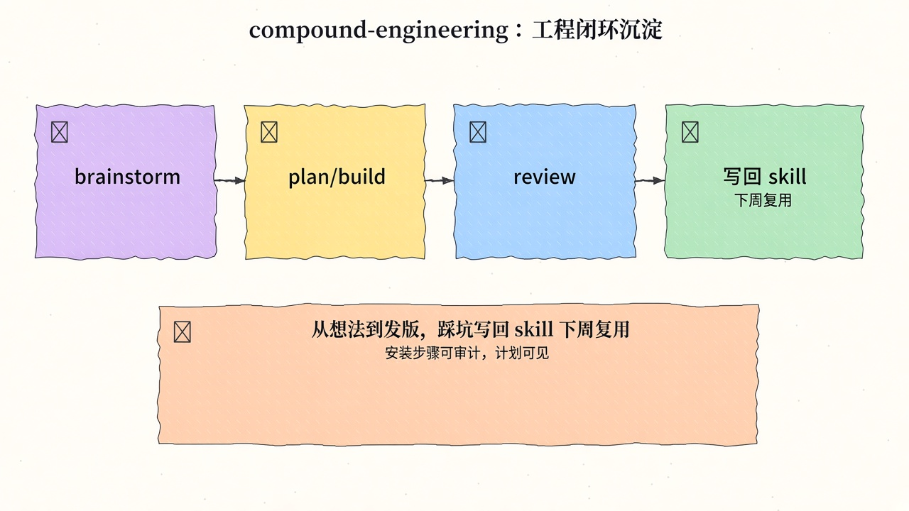
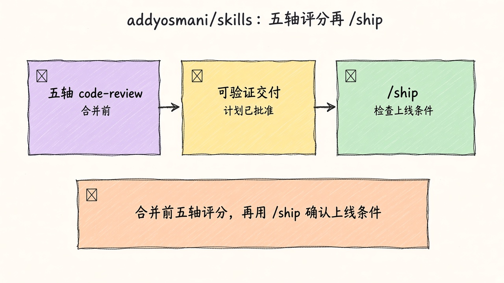
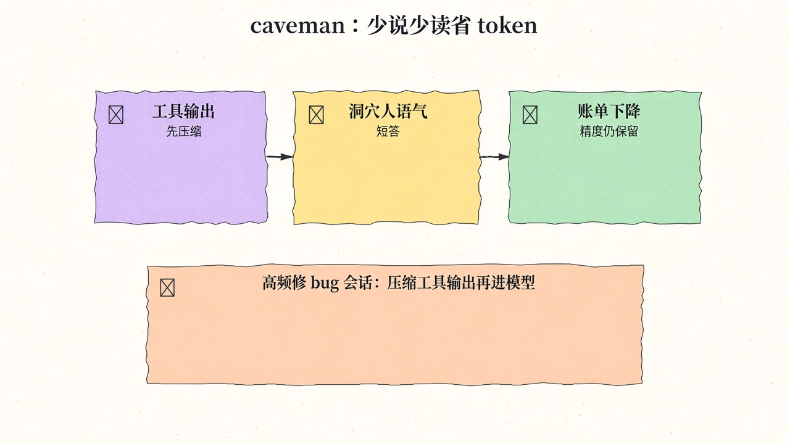
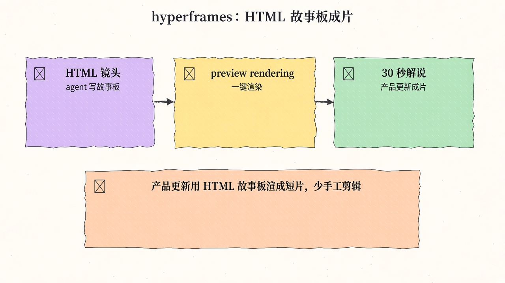
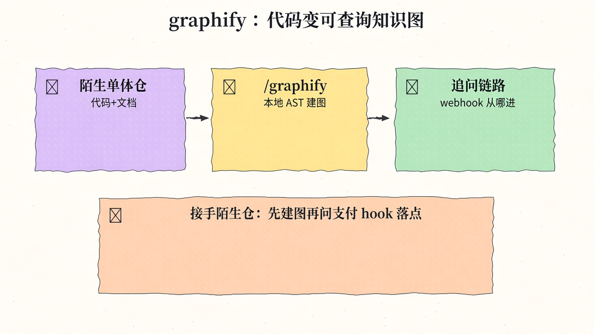
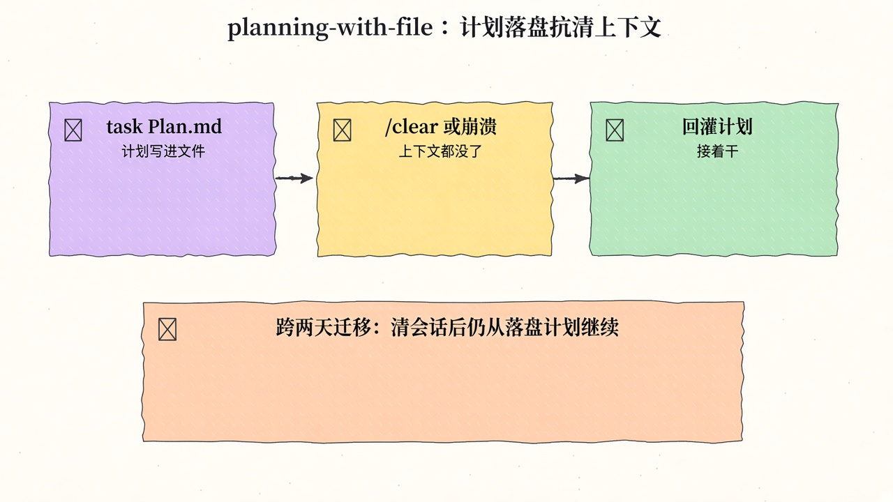
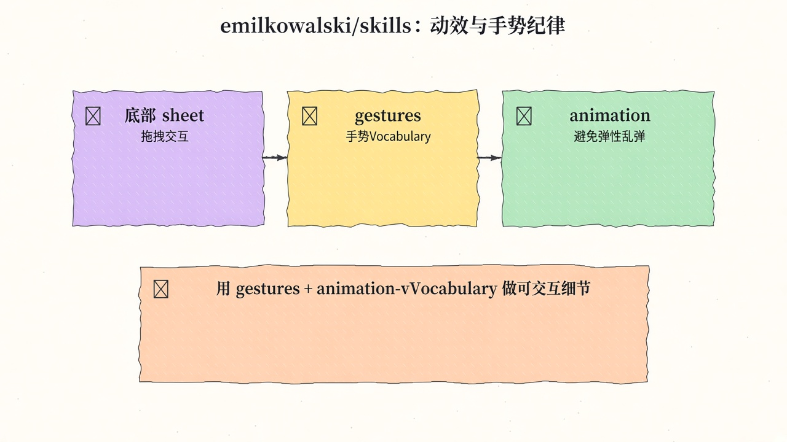

# 2026-11-09 Skills 周报

上周（11/02–11/08）精选 10 个值得装进 agent 工具箱的 Skill（工程纪律 / 安全准入 / 可交付媒体）。

## 1. mattpocock/skills — 小而可组合的真工程技能

**介绍**  
Matt Pocock 的 Skills for Real Engineers（MIT，★~318.6k）：一组小而可组合、偏向真实工程习惯的 skills（非整包巨型合集）。站 [aihero.dev/skills](https://aihero.dev/skills)。

**用法**  
仓库：[github.com/mattpocock/skills](https://github.com/mattpocock/skills)。

```bash
claude plugin install mattpocock-skills@claude-plugins-official
```

**应用场景**  
不想一次灌进巨型 skill 包：按需挑小块组合进日常 coding（类型、重构、小步可测）。



**推荐学习程度**：入门

---

## 2. google/skills — Google 产品与 Cloud 官方 Agent Skills

**介绍**  
Google 官方 Agent Skills（Apache-2.0，★~23.7k）：覆盖 Cloud 入门/IAM、多产品解决方案、Agent Platform、BigQuery AI、Genkit、GKE 推理排障等；可用 `npx skills add google/skills` 按需勾选。

**用法**  
仓库：[github.com/google/skills](https://github.com/google/skills)；skills.sh：[skills.sh/google/skills](https://skills.sh/google/skills)。

```bash
npx skills add google/skills
npx skills update
```

**应用场景**  
Agent 要在 GCP 上部署推理 / 配 IAM / 查 BigQuery，希望加载官方窄技能而不是把整本云文档塞进上下文。



**推荐学习程度**：入门

---

## 3. NVIDIA/SkillSpector — 安装前扫描 skill 漏洞与恶意

**介绍**  
SkillSpector（Apache-2.0，★~24.9k）：安装 agent skill 前扫描漏洞、恶意模式、提示注入与供应链风险；适配 Claude Code / Codex / MCP 等。文档：[docs.nvidia.com/skills/scanning-agent-skills](https://docs.nvidia.com/skills/scanning-agent-skills)。

**用法**  
仓库：[github.com/NVIDIA/SkillSpector](https://github.com/NVIDIA/SkillSpector)。

```bash
uv tool install git+https://github.com/NVIDIA/skillspector.git
# 对目标 skill 目录或 URL 运行扫描，按报告决定是否安装
```

**应用场景**  
团队 skill 市场准入：第三方 skill 先扫再装，避免恶意提示或危险脚本进生产 agent。



**推荐学习程度**：入门

---

## 4. EveryInc/compound-engineering-plugin — 37 skills 工程闭环

**介绍**  
Compound Engineering 官方插件（MIT，★~26.0k）：约 37 个 skills 串成 brainstorm → plan → build → review → capture learning 循环。站 [every.to/compound-engineering](https://every.to/compound-engineering)。

**用法**  
仓库：[github.com/EveryInc/compound-engineering-plugin](https://github.com/EveryInc/compound-engineering-plugin)。

```text
# Claude Code
/plugin marketplace add EveryInc/compound-engineering-plugin
/plugin install compound-engineering

# Cursor
/add-plugin compound-engineering
```

**应用场景**  
从想法到落地再到复盘：让 agent 按闭环推进，并把学到的写回 skill，而不是一次性对话。



**推荐学习程度**：进阶

---

## 5. addyosmani/agent-skills — 生产级工程习惯技能包

**介绍**  
Addy Osmani 的 production-grade engineering skills（MIT，★~114.2k）：约 25 个技能，含五轴 code review、逐问需求诘问（interview-me）、强制红绿重构的 TDD 等；站 [skills.addy.ie](https://skills.addy.ie)。

**用法**  
仓库：[github.com/addyosmani/agent-skills](https://github.com/addyosmani/agent-skills)。

```bash
npx skills add addyosmani/agent-skills
npx skills add addyosmani/agent-skills --skill code-review-and-quality
# Claude：
# /plugin marketplace add addyosmani/agent-skills
# /plugin install agent-skills@addy-agent-skills
```

**应用场景**  
合并前评审、需求澄清、测试驱动改动——想把资深工程节奏固化进 Agent，而不是每次口头叮嘱。



**推荐学习程度**：入门

---

## 6. JuliusBrussee/caveman — 洞穴人语气砍输入 token

**介绍**  
caveman（Apache-2.0，★~118.4k）：用短促「caveman」语气压缩提示，宣称可砍约 33% 输入 token；skill + proxy，适配 30+ agents。文档：[docs.caveman.so/caveman](https://docs.caveman.so/caveman)。

**用法**  
仓库：[github.com/JuliusBrussee/caveman](https://github.com/JuliusBrussee/caveman)。

```bash
curl -fsSL https://raw.githubusercontent.com/JuliusBrussee/caveman/v4.1.0/install.sh | bash
# 预览：... | bash -s -- --dry-run
```

**应用场景**  
高频 agent 调用账单偏高：先过 caveman 缩短输入，意思保留、token 更少。



**推荐学习程度**：入门

---

## 7. heygen-com/hyperframes — 写 HTML，渲成视频

**介绍**  
Hyperframes（Apache-2.0，★~81.1k）：面向 agent 的视频管线——用 HTML/CSS 描述画面与时间轴，渲染成视频。站 [hyperframes.heygen.com](https://hyperframes.heygen.com)。

**用法**  
仓库：[github.com/heygen-com/hyperframes](https://github.com/heygen-com/hyperframes)。

```bash
claude plugin marketplace add heygen-com/hyperframes
claude plugin install hyperframes@hyperframes
# 或：npx skills add heygen-com/hyperframes
```

**应用场景**  
让 coding agent 用 HTML 描述讲解镜头，批量渲成产品介绍或内部培训短片。



**推荐学习程度**：进阶

---

## 8. Graphify-Labs/graphify — 代码+文档 → 可查询知识图

**介绍**  
graphify（Apache-2.0，★~144.5k）：`/graphify` skill 把 codebase、文档、SQL、PDF 建成可查询知识图；本地 AST，不依赖向量库。支持 Claude / Cursor / Codex / Gemini。站 [graphify.com](https://www.graphify.com)。

**用法**  
仓库：[github.com/Graphify-Labs/graphify](https://github.com/Graphify-Labs/graphify)。

```bash
uv tool install graphifyy      # 或：pipx install graphifyy
graphify install               # 检测助手并注册 skill
# 之后在助手里：/graphify .
```

**应用场景**  
接手陌生大仓：先建图，再按节点追问模块依赖与业务流，而不是盲搜文件。



**推荐学习程度**：进阶

---

## 9. OthmanAdi/planning-with-files — 落盘计划抗清上下文

**介绍**  
Planning with Files（MIT，★~28.0k）：把 `task_plan.md` / `findings.md` / `progress.md` 落盘，hooks 每轮回注，计划扛住 `/clear`、崩溃与 compaction；可装进 60+ agents。

**用法**  
仓库：[github.com/OthmanAdi/planning-with-files](https://github.com/OthmanAdi/planning-with-files)。

```bash
npx skills add OthmanAdi/planning-with-files --skill planning-with-files -g
```

**应用场景**  
长任务跨多次 compaction：计划与进度仍在磁盘，agent 醒过来还能接着干。



**推荐学习程度**：进阶

---

## 10. emilkowalski/skills — 动效与设计口味技能

**介绍**  
Emil Kowalski 的 Skills for Designers and Engineers（MIT，★~54.9k）：含 animate、review-animations、apple-design 等，偏动效审阅与设计语言约束。站 [emilkowal.ski/skill](https://emilkowal.ski/skill)。

**用法**  
仓库：[github.com/emilkowalski/skills](https://github.com/emilkowalski/skills)。

```bash
npx skills@latest add emilkowalski/skills
```

**应用场景**  
给 agent 生成的交互动效做一轮「像不像产品级动画」的自检。



**推荐学习程度**：进阶

---
