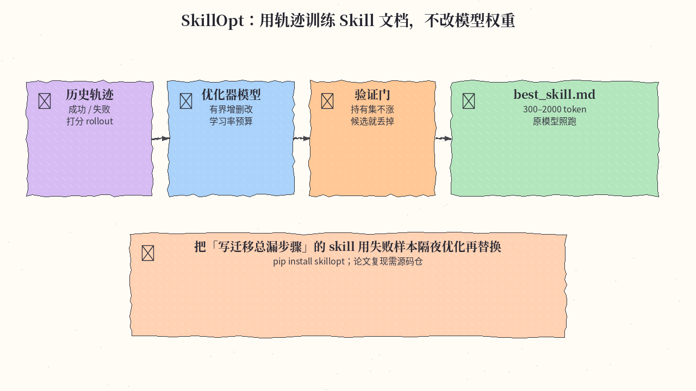
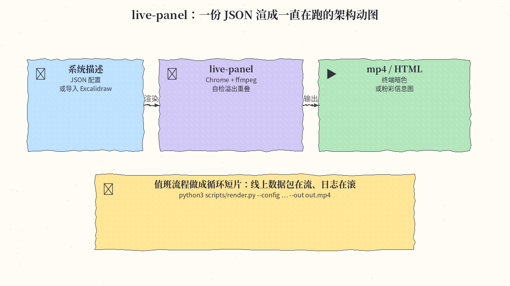

# 2026-11-11 Skills 日报

今日两条：微软用轨迹训练 Skill 文档的优化器，以及一份 JSON 渲成「一直在跑」的架构动图。

## 1. microsoft/SkillOpt — 把 Skill 文档当成可训练参数

**介绍**  
SkillOpt 把 skill 文档看作冻结模型上的可训练状态：目标模型跑任务得到打分轨迹，另一个优化器模型提出有界的增 / 删 / 改，默认只有持有验证集严格涨分才接受。部署产物是一份通常 300–2000 token 的 `best_skill.md`，推理时不再额外调优化器。论文称在 6 个基准、7 个目标模型、3 种 harness 的全部 52 个格子上持平或最好（数字来自论文/README）。2026 年 11 月被 NeurIPS 接收为 Spotlight。另有 `skillopt-sleep`：夜间从本地编码 agent 会话里收获技能，同样过验证门。MIT，约 19.0k★。站与文档：[microsoft.github.io/SkillOpt](https://microsoft.github.io/SkillOpt/)，论文：[arXiv:2605.23904](https://arxiv.org/abs/2605.23904)。

**用法**  
仓库：[github.com/microsoft/SkillOpt](https://github.com/microsoft/SkillOpt)。安装说明：[docs/guide/installation.md](https://github.com/microsoft/SkillOpt/blob/main/docs/guide/installation.md)。

```bash
python -m pip install skillopt
skillopt-sleep --help
# 研究训练 / 评测配置、benchmark 数据与 agent 集成壳在源码仓，不在 PyPI wheel 里：
git clone https://github.com/microsoft/SkillOpt.git && cd SkillOpt
python -m pip install -e ".[searchqa]"
cp .env.example .env   # 配置后端密钥
python scripts/materialize_searchqa.py
python scripts/train.py --config configs/searchqa/default.yaml --out_root outputs/searchqa_quickstart
python scripts/eval_only.py --config configs/searchqa/default.yaml \
  --skill outputs/searchqa_quickstart/best_skill.md --split valid_unseen
```

PyPI 当前是 0.2.0；部分 Sleep / Cursor / 多 skill 能力还在 `main`，需要源码安装。

**应用场景**  
团队有一份「写数据库迁移」skill 总漏步骤：用历史失败轨迹隔夜跑优化，验证分涨了才替换生产 skill，模型权重不动。



**推荐学习程度**：深水

---

## 2. ythx-101/live-panel-skill — 一份 JSON，渲成一直在跑的架构动图

**介绍**  
live-panel 把一份 JSON（或从 Excalidraw 导入）渲成「布局固定、状态在动」的架构图：线上数据包在流、日志在滚、计数器在跳。两种外观（终端暗色 / 粉彩信息图），画幅预设适配 X（4:5）和小红书（3:4），输出 H.264 mp4 或可循环的自包含 HTML。内置 ring / funnel / loop / excalidraw 等视图；`check_frames.py` 抽帧检查文字溢出与重叠。依赖 Python 标准库 + Chrome/Chromium + ffmpeg，无 API key。MIT，约 850★。外观与动效思路来自 @thedelost 的架构图短片，仓库要求在发布相关示例时保留署名。

**用法**  
仓库：[github.com/ythx-101/live-panel-skill](https://github.com/ythx-101/live-panel-skill)。作 skill 时把目录放到 agent 的 skills 路径（Claude Code：`~/.claude/skills/live-panel/`）。

```bash
git clone https://github.com/ythx-101/live-panel-skill && cd live-panel-skill
python3 scripts/render.py --config examples/minimal/config.json --out minimal.mp4 --html-out minimal.html
python3 scripts/check_frames.py --config examples/minimal/config.json --out-dir frames --repeat
# 已有手绘图：
# python3 scripts/excalidraw_import.py my.excalidraw -o my.json
# python3 scripts/render.py --config my.json --out my.mp4
```

Linux / macOS 可直接跑；Windows 需在 WSL 里渲染。

**应用场景**  
把「用户 → agent → 工具」的当晚值班流程做成循环短片发到团队频道：线上数据包在流动、日志在滚，而不是一张静态框线图。



**推荐学习程度**：入门

---
