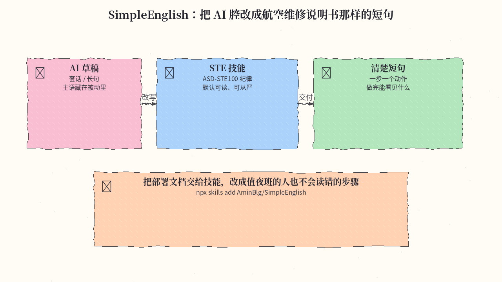
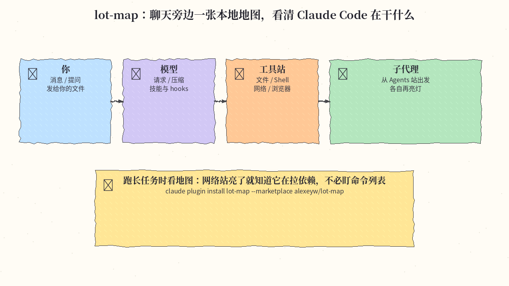
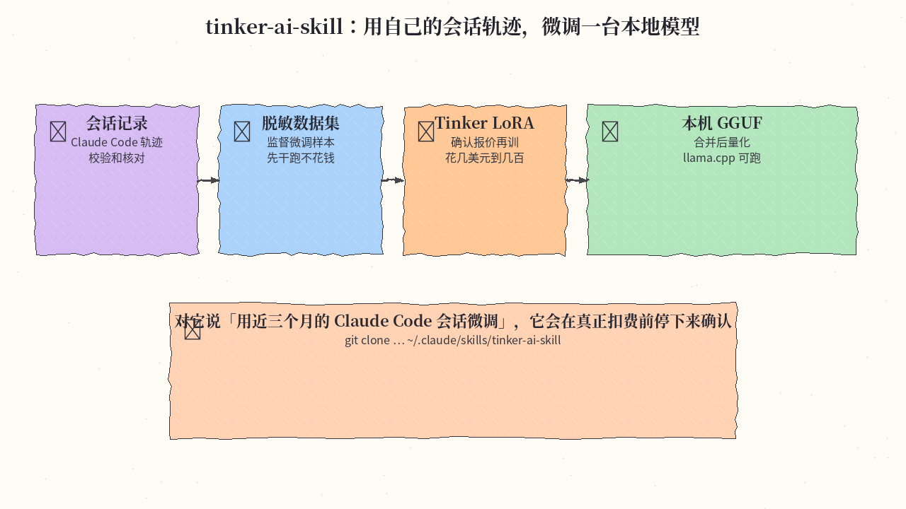

# 2026-11-12 Skills 日报

今日三条：用航空技术英语纪律改文档、给 Claude Code 一张本地工作地图，以及把会话轨迹微调成可本机跑的模型。

## 1. AminBlg/SimpleEnglish — 让模型按 ASD-STE100 写清楚短句

**介绍**  
SimpleEnglish 是一套 Agent Skill，把 LLM 的输出收成 [ASD-STE100 Simplified Technical English](https://www.asd-ste100.org/) 那种纪律：航空维修手册从 1983 年起用的受控英语，好让疲劳的机械师也不会读错步骤。默认写成外行也读得懂的句子，需要时再切到更严格的 STE。仓库附有评测记录，作者称在 9 个 Claude 模型上测过。一个技能目录、无额外依赖，MIT，约 4.4k★，当日仍在 Python Trending。兼容 Agent Skills 标准（Claude Code、Cursor、Codex、Gemini CLI、OpenCode 等）。

**用法**  
仓库：[github.com/AminBlg/SimpleEnglish](https://github.com/AminBlg/SimpleEnglish)。

```bash
npx skills add AminBlg/SimpleEnglish
```

这只安装技能本身。若要用 session hook 和 output style，需按 README 安装对应的 Claude Code 插件，再设置 `outputStyle`；只装技能、不装插件时，单独改 `outputStyle` 不会生效。

**应用场景**  
把一篇带套话和长被动句的部署文档交给技能，改成值夜班的人照着做也不会走错的短步骤：一步一个动作，写清做完会看到什么。



**推荐学习程度**：入门

---

## 2. alexeyw/lot-map — 聊天旁边一张本地地图，看清 Claude Code 在干什么

**介绍**  
lot-map 是 Claude Code 的插件：在聊天旁开一个窗格，把工具调用、模型步骤、hook、技能和子代理画成地图——从中心脉冲到各个站点（你、模型、记忆、文件、Shell、网络、浏览器、Agents、Skills、Hooks），不必只盯命令列表。数据只留在本机，界面有五种语言。终端里需要至少 144 列，否则只画文字，可用 `/lot-map` 打开。作者在 Claude Code 2.1.321、macOS 上构建测试，也有 Windows 可用的反馈。MIT，约 405★，当日仍在推送。

**用法**  
仓库：[github.com/alexeyw/lot-map](https://github.com/alexeyw/lot-map)。

```bash
claude plugin install lot-map --marketplace alexeyw/lot-map
```

在会话提示符里也可以 `/plugin install lot-map --marketplace alexeyw/lot-map`。桌面端：提示框旁的 **+** → **Plugins** → 用 `alexeyw/lot-map` 添加 marketplace，再添加插件。更新时先 `claude plugin marketplace update lot-map`，再 `claude plugin update lot-map@lot-map`，然后开新会话。

**应用场景**  
跑一轮会装依赖、改文件、再开子代理的长任务时，看地图上的网络站和 Agents 站是否亮起，就能判断它在拉包还是把活分出去了。



**推荐学习程度**：入门

---

## 3. drost-ai/tinker-ai-skill — 用自己的会话轨迹，微调一台本地模型

**介绍**  
tinker-ai-skill 把你在 coding agent 里的会话，变成可在本机跑的微调模型：按一份九步 `SKILL.md` 收集轨迹、脱敏做成监督微调数据集，在 [Tinker](https://thinkingmachines.ai/tinker) 上训练 LoRA，再合并并量化成 llama.cpp 可用的 GGUF。作者用同一条流水线做出开源的 Tess-4 / Tess-4.5，并在仓里附了十一支脚本、六份参考说明，以及不碰真实数据、也不花钱的合成轨迹干跑。技能会在产生费用之前停下来确认。MIT，约 316★。适用于 Claude Code、Codex、OpenCode，以及其他遵循 Agent Skills 标准的宿主。

**用法**  
仓库：[github.com/drost-ai/tinker-ai-skill](https://github.com/drost-ai/tinker-ai-skill)。目录名必须是 `tinker-ai-skill`：

```bash
# Claude Code（全局）
git clone https://github.com/drost-ai/tinker-ai-skill.git ~/.claude/skills/tinker-ai-skill
# Codex
git clone https://github.com/drost-ai/tinker-ai-skill.git ~/.agents/skills/tinker-ai-skill
# OpenCode
git clone https://github.com/drost-ai/tinker-ai-skill.git ~/.config/opencode/skills/tinker-ai-skill
```

装好后可直接说：「用近三个月的 Claude Code 会话微调 Qwen3.6-35B-A3B。」需要 Python 3.11+、uv 或 pip、`tinker-cookbook`、以及 Tinker 与 Weights & Biases 的密钥。Tinker 按 token 计费；README 在 2026-11 价格下给出的粗算（一轮、约 64K 行）：约 100 条个人语料微调 Qwen3.6-35B-A3B 大约数美元，约 1000 条（其发布所用规模）则到几十美元量级，稠密模型更贵。数据集步骤在本地免费完成。

**应用场景**  
把近几个月自己仓库里的 Claude Code 会话做成训练集，先用合成数据干跑整条管道，确认报价后再在 Tinker 上训 LoRA，最后把 GGUF 放到本机 llama.cpp 里用。



**推荐学习程度**：进阶
