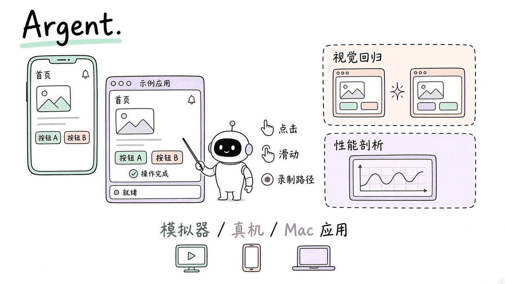
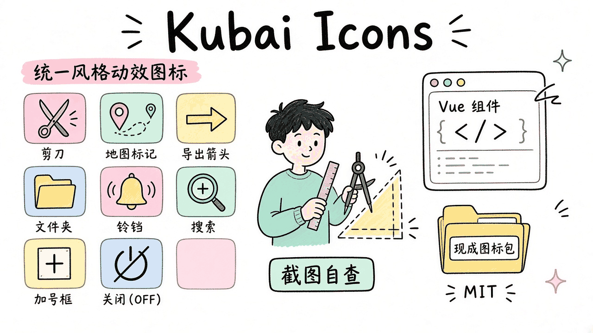
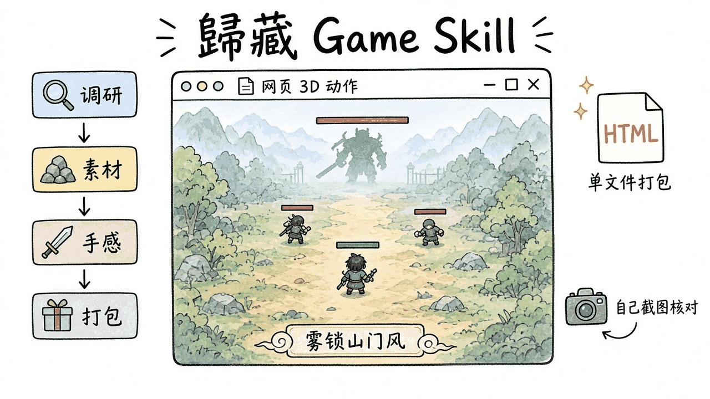

# 2026-11-13 Skills 日报

今日三条：Software Mansion 的端侧操控工具包 Argent、统一风格动效图标技能 Kubai Icons，以及歸藏的网页 3D 动作游戏技能。

## 1. software-mansion/argent — 让助手直接操控手机、模拟器和 Mac 应用

**介绍**  
Argent 是 Software Mansion（React Native 核心贡献团队）的 agent 工具包：给你的 AI 助手接通 iOS 模拟器、Android 模拟器/真机、Apple TV / Android TV / Fire TV、Electron/Chromium 应用，以及原生 Mac 应用。可以点、滑、手势、输入、按硬件键；把一条路径录成可回放的 e2e；做带 OCR / 字体感知的视觉回归；并接入 Hermes、React DevTools、Xcode Instruments、Perfetto 做性能剖析。也覆盖日志、网络（含 `fetch` / `XMLHttpRequest`）以及原生 / React 树。约 3.2k★。源码为 Apache-2.0，但各平台的 `simulator-server`、macOS 的 `ax-service` 以及部分 `.dylib` 是专有二进制，只授权在本项目内使用，不能反编译或单独再分发。文档：[argent.swmansion.com](https://argent.swmansion.com)。遥测默认开启，可用 `argent telemetry disable` 关闭。

**用法**  
仓库：[github.com/software-mansion/argent](https://github.com/software-mansion/argent)。

```bash
npx @swmansion/argent@latest init
# pnpm：pnpm dlx @swmansion/argent@latest init
```

向导会安装包、注册 MCP，并写入相应的 agent skill。装好后可直接问助手「Argent 能做什么」，或让它在模拟器里打开应用、点某个按钮、录一条回归路径。安装与平台说明见 [Installation](https://docs.swmansion.com/argent/docs/fundamentals/installation)。

**应用场景**  
改完 React Native 或原生界面后，让助手在 iOS 模拟器里走一遍主路径、截图对比、必要时再抓一节性能轨迹，而不是自己在模拟器里重复点。



**推荐学习程度**：进阶

---

## 2. kubai087/kubai-icons — 同一只手，画出一套能用的动效图标

**介绍**  
Kubai Icons 是一套给 coding agent 用的作图技能，外加 2800+ 已画好的开源图标（近 900 个对象，另有带徽章和「关闭」斜线变体），可在 React、Vue 3 / Nuxt、普通 JS、Web Component 和静态 SVG 里用。技能会约束几何、并让模型对自己的截图多轮检查，以保持统一手绘风格。作者在 Claude Opus 5.5 上开发并做盲测，也说明 Codex 等模型可用同一技能。约 790★。注意许可证是拆开的：图标与四个组件包为 MIT；技能本身是 source-available 的 [Kubai Icons License](https://github.com/kubai087/kubai-icons/blob/master/LICENSE)；网站源码保留权利。站点：[icons.kubai.design](https://icons.kubai.design)。

**用法**  
仓库：[github.com/kubai087/kubai-icons](https://github.com/kubai087/kubai-icons)。把仓克隆到 agent 的 skills 目录（目录名保持 `kubai-icons`）：

```bash
# Claude Code
git clone https://github.com/kubai087/kubai-icons.git ~/.claude/skills/kubai-icons
# Codex：改到 ~/.agents/skills/kubai-icons
```

也可从 [Releases](https://github.com/kubai087/kubai-icons/releases/latest) 下载 `kubai-icons-v*.zip` 解压到同一位置。重启 agent 后直接说需求即可，例如：「读这个仓库，给主要功能画一组动态图标。」或：「给我可放进 Figma 的静态 SVG。」现成图标库的 Vue 包在 `packages/vue`（`kubai-icons-vue`）。

**应用场景**  
给 Vue 项目补一套风格统一的功能图标：能用现成库就先从 MIT 图标包里挑；缺的再让技能按同一套规则补画，并让它自己截图校对。



**推荐学习程度**：入门

---

## 3. op7418/guizang-game-skill — 按走通过的流程，做能在浏览器里玩的 3D 动作游戏

**介绍**  
歸藏（op7418）把做演示游戏《雾锁山门》时的流程写成 Agent Skill：先问清参考、视角、氛围和手头的素材工具，再按「调研与规划 → 设定与素材 → 动作 → 手感与特效 → 声音与打包」推进，并让 agent 自己逐帧推进画面、截图核对。技能里写了战斗手感清单（前后摇、命中顿帧、分级击退、格挡与弹反等）和一条踩坑清单，最后可打成单个 HTML、静态站点或离线包。作者写明：演示花了大约 6 小时、4.5 亿 token（含 Opus 5.5 测试），且技能目前只在一个项目上完整走过一遍，不保证成品质量；你仍需试玩并反馈。Skill 文档与脚本为 AGPL-3.0；演示内容（美术、模型、配音、配乐、文案）保留权利，可试玩和分享链接，未经许可不可转载或商用。约 245★（11-11 发布）。演示：[op7418.github.io/guizang-game-skill](https://op7418.github.io/guizang-game-skill/)。

**用法**  
仓库：[github.com/op7418/guizang-game-skill](https://github.com/op7418/guizang-game-skill)。需要 Node.js 18+。

```bash
git clone https://github.com/op7418/guizang-game-skill ~/.claude/skills/guizang-game-skill
# Codex 等：克隆到对应的 skills 目录
```

然后直接说需求，例如：

```
做一个武侠题材的俯视角网页 3D 动作游戏，一个场景、一波小怪、一个 Boss。
我有 Tripo 和即梦可以用。
```

角色设定图和 3D 可用 [Tripo](https://www.tripo3d.ai/)、即梦等；没有这些工具时技能会改用免费或程序化素材，画面会打折扣。

**应用场景**  
想先做出一个能在手机和电脑浏览器里打开的小动作关卡：把参考和素材工具告诉 agent，让它按清单做手感并打成单文件 HTML，你负责试玩提「动作僵 / 打击感差」这类意见。



**推荐学习程度**：进阶
