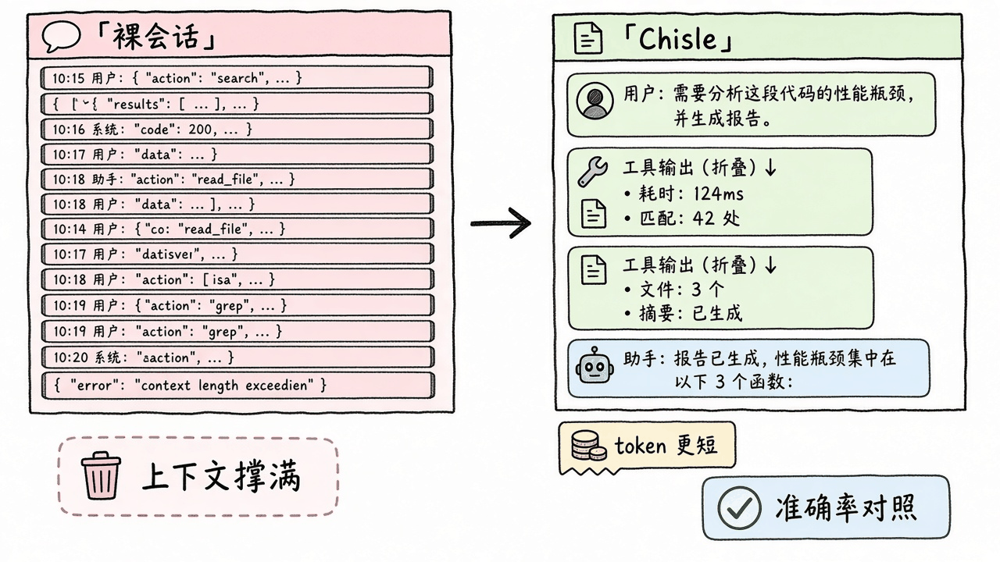

# 2026-11-16 Skills 日报

今日四条：从文风、YAGNI 和工具输出三条轴砍 token 的 Chisle、30 个 SEO / GEO 技能包、用可编辑音符作曲的 music-skill，以及把书编译成 Agent Skill 的 bookleme。

## 1. JayPokale/Chisle — 从三条轴砍 agent 的 token 账单

**介绍**  
Chisle 是一套跨 Claude Code、Codex、Cursor、Gemini、OpenCode 等的规则集 + 工具输出压缩器（仓库写 13 个 agent）：短促文风、YAGNI 优先的代码，以及把过大的工具输出压短。MIT，约 1.1k★。项目从 [JuliusBrussee/caveman](https://github.com/JuliusBrussee/caveman) 与 [DietrichGebert/ponytail](https://github.com/DietrichGebert/ponytail) 合并而来，但规则集更宽，不是同一仓库。周五晚发布 [v3.12.0](https://github.com/JayPokale/Chisle)（OpenCode v2 插件、`--update` 真正更新 Claude 插件），周六补 v3.12.1。README 图注写对照无规则集：账单输出 token 少 29%、回答短 45%、过大工具输出小 48%、正确率 156/156 vs 154/156——数字来自作者自测，未独立复跑。

**用法**  
仓库：[github.com/JayPokale/Chisle](https://github.com/JayPokale/Chisle)。主安装：

```bash
npx chisle
```

也可以：

```bash
claude plugin marketplace add JayPokale/Chisle
claude plugin install chisle@chisle
curl -fsSL https://raw.githubusercontent.com/JayPokale/Chisle/main/install.sh | bash
```

Windows 可用 `irm https://raw.githubusercontent.com/JayPokale/Chisle/main/install.ps1 | iex`。README 还提到 `--dry-run`、`--uninstall`、`/chisle off`、`/chisle-review`、`/chisle-audit`、`npx chisle tools`、`npx chisle mcp wrap`。管道安装脚本使用前应自行审阅。

**应用场景**  
同一项修 bug 任务：左边裸会话被测试日志和冗长 JSON 撑满上下文；右边 Chisle 把工具输出折短，账单更短，准确率标在旁边对照。



**推荐学习程度**：入门

---

## 2. Illyism/seo-skills — 30 个可安装的 SEO / GEO 技能包

**介绍**  
seo-skills 是 Ilias Ism 做的 30 个 `SKILL.md` 工作流，覆盖技术 SEO、Ahrefs / DataForSEO、第一手证据库、外链、GEO / AEO、文案等（目录在 `seo/`、`content/`、`copywriting/`、`marketing/`）。约 1.3k★，本周涨幅很明显，本月尚未报道过。周四发布 README 所称的 v1.3.0，扩展到 30 个 skill。作者目录：[il.ly/skills](https://il.ly/skills)。GitHub 许可证字段为空，根目录没有 LICENSE 文件；README 文末写「MIT © Ilias Ism」。若干 skill / 赞助区指向作者自家产品，装之前要分清开源工作流和商业服务。部分流程需要 Ahrefs / DataForSEO 等密钥。

**用法**  
仓库：[github.com/Illyism/seo-skills](https://github.com/Illyism/seo-skills)。

```bash
npx skills add Illyism/seo-skills
npx skills add Illyism/seo-skills --skill seo-autopilot
npx skills add Illyism/seo-skills --list
# 也可加 -a claude-code / -a cursor
```

**应用场景**  
Agent 打开仓库或站点，一边跑技术审计与标题改写，一边对照搜索结果和 GEO 引用缺口，直接给出可提交的改动，而不是一份厚厚的审计 PDF。


**推荐学习程度**：进阶

---

## 3. owoevan-dev/music-skill — 用可编辑的音符作曲，而不是生成一段音频

**介绍**  
music-skill 让模型写出每一个音符，再由 skill 检查乐谱、用采样乐器或合成器演奏、缩混和母带。输出 MP3 / WAV、MIDI、分轨，以及可改后再渲的工程。不用音频生成模型。MIT（第三方音源另见仓库 `THIRD_PARTY.md`）。约 230★。周六发布 0.7.0：每首曲子抽十二个词、计划对照乐谱，并更新了示例和 README。它不会写词、不唱歌。

**用法**  
仓库：[github.com/owoevan-dev/music-skill](https://github.com/owoevan-dev/music-skill)。

```text
/plugin marketplace add owoevan-dev/music-skill
/plugin install music-skill@music-skill
```

```bash
npx skills add owoevan-dev/music-skill
# 然后按 README Install 让 agent 装渲染器与音源；另有：
python -m pip install -r skills/music-production/requirements.txt
```

音源下载约 3.7 GB；README 写全部三十套约 3.5 GB 下载 / 8 GB 安装，建议预留约 12 GB。可选 Surge XT（GPL-3.0，单独进程）。Linux / macOS 还需 FluidSynth、FFmpeg。

**应用场景**  
给游戏循环或短片配一段可再改的配乐：左边是钢琴卷帘上可编辑的音符，右边渲出分轨和母带，中间标明没有音频生成模型。


**推荐学习程度**：进阶

---

## 4. bookleme/bookleme — 把一本书编译成可安装的 Agent Skill

**介绍**  
bookleme 是一个 Python 工具（README 宣称零第三方依赖、Python ≥ 3.9）：把书稿编译成 Agent Skill。双引擎 + 可插拔体裁插件，并带逐字忠实度与版权硬门。MIT，约 260★。周五下午发布 v1.0.0 正式版，赶不上周五早报。这是编译器，不是开箱即用的单一 skill。社区验证还少（仅 3 个 fork）。

**用法**  
仓库：[github.com/bookleme/bookleme](https://github.com/bookleme/bookleme)。

```bash
git clone https://github.com/bookleme/bookleme.git
cd bookleme
python3 -m bookleme --version
python3 -m bookleme run --input evals/cases/synthetic/coach_book.md --title "我的第一本书"
python3 -m bookleme validate examples/coach
```

`--install` 会写入技能真源，默认关闭。必须有权使用该书：`--user-rights owned|licensed|public_domain|unknown`；公开分发还要 `--confirm-public`。

**应用场景**  
一本已获授权的书经过抽取、体裁插件、忠实度回验和版权硬门，变成一份可安装的 SKILL，而不是整本塞进上下文。


**推荐学习程度**：进阶
