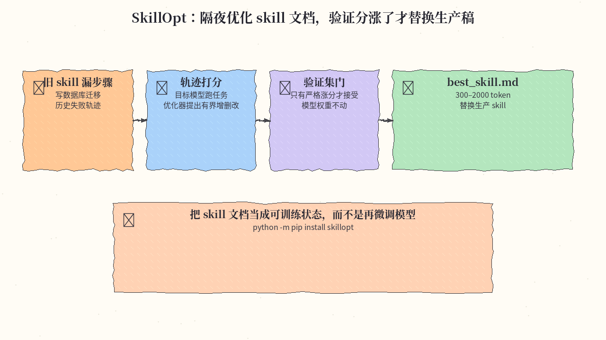
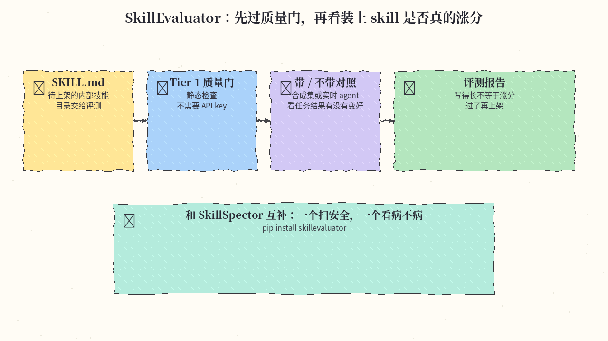
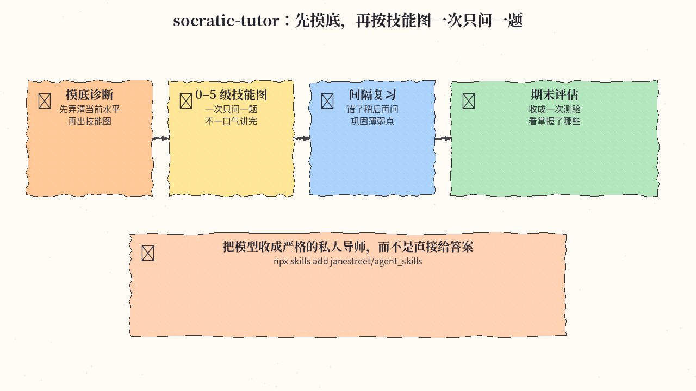
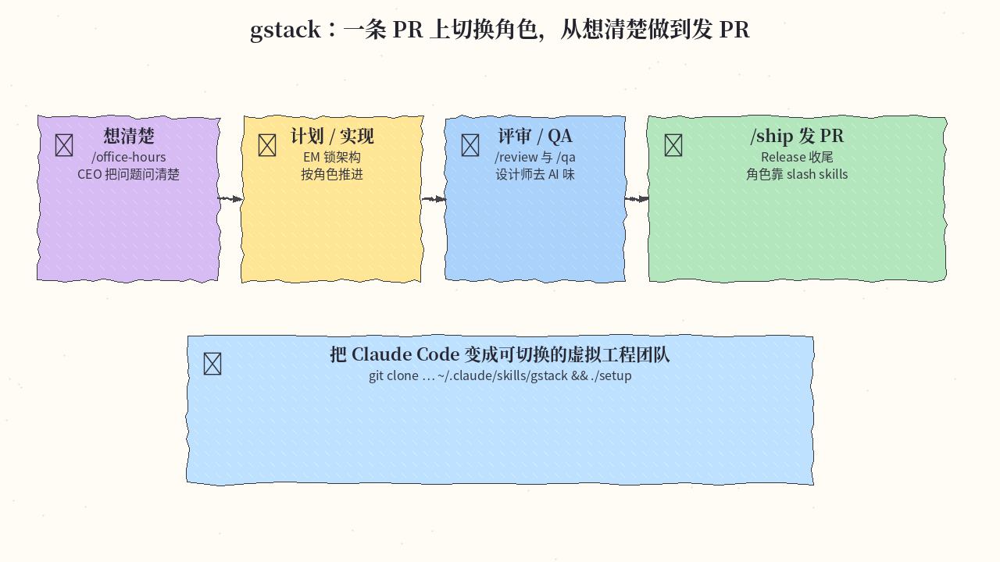
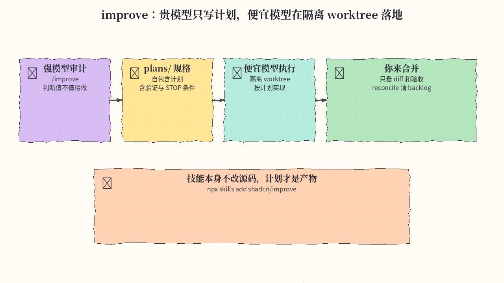
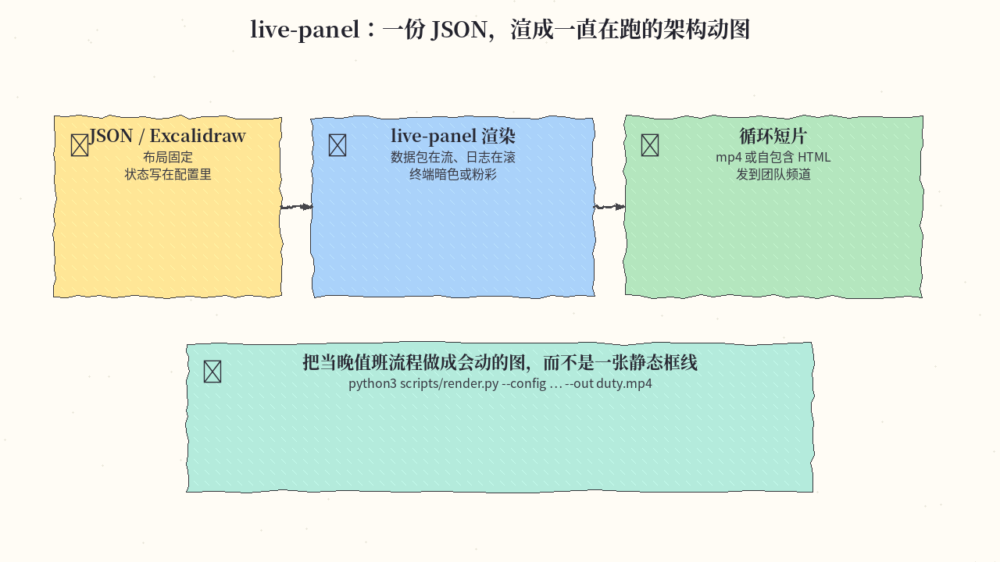
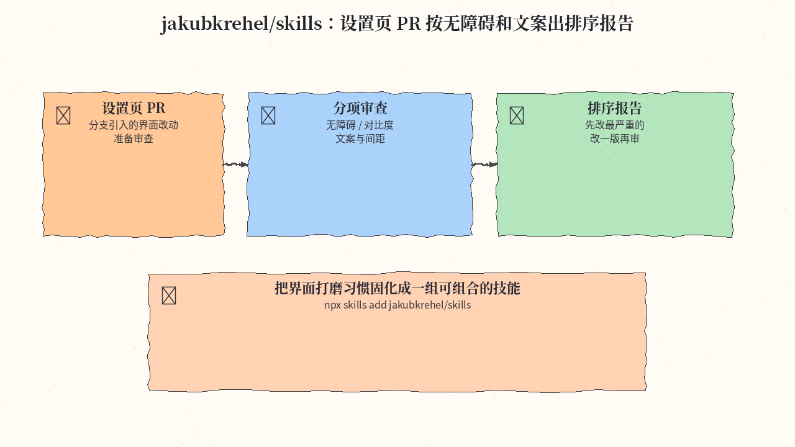
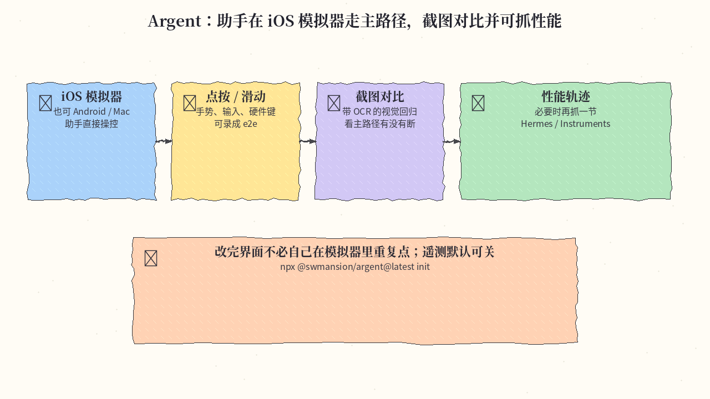
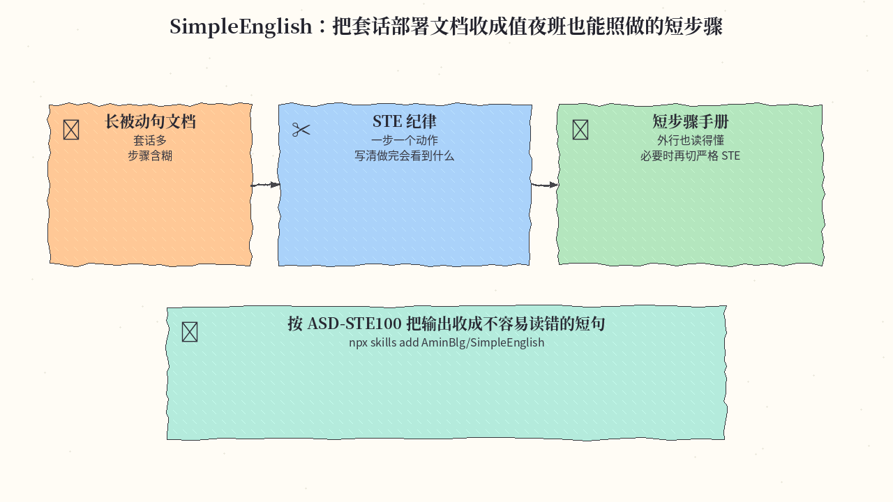
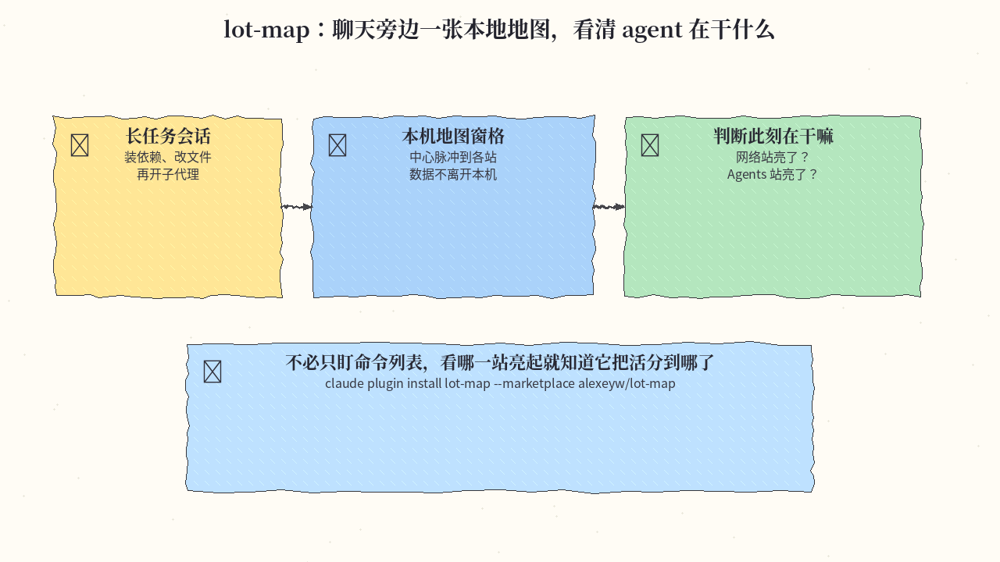

# 2026-11-16 Skills 周报

上周（11/09–11/15）精选 10 个值得装进 agent 工具箱的 Skill（训练评测 / 工程角色 / 界面与可视化）。

## 1. microsoft/SkillOpt — 把 Skill 文档当成可训练参数

**介绍**  
SkillOpt（MIT，★~19.1k）把 skill 文档看作冻结模型上的可训练状态：目标模型跑任务得到打分轨迹，另一个优化器模型提出有界的增 / 删 / 改；默认路径下，只有持有验证集严格涨分才接受。部署产物是一份通常 300–2000 token 的 `best_skill.md`，推理时不再额外调优化器。另有 `skillopt-sleep`：夜间从本地编码 agent 会话里收获技能，同样过验证门。README / 论文称在 6 个基准、7 个目标模型、3 种 harness 的全部 52 个格子上持平或最好。2026 年 11 月被 NeurIPS 接收为 Spotlight。站与文档：[microsoft.github.io/SkillOpt](https://microsoft.github.io/SkillOpt/)，论文：[arXiv:2605.23904](https://arxiv.org/abs/2605.23904)。

**用法**  
仓库：[github.com/microsoft/SkillOpt](https://github.com/microsoft/SkillOpt)。安装说明：[docs/guide/installation.md](https://github.com/microsoft/SkillOpt/blob/main/docs/guide/installation.md)。

```bash
python -m pip install skillopt
skillopt-sleep --help
# 研究训练 / 评测配置、benchmark 数据与 agent 集成壳在源码仓，不在 PyPI wheel 里：
git clone https://github.com/microsoft/SkillOpt.git && cd SkillOpt
python -m pip install -e ".[searchqa]"
```

PyPI 当前是 0.2.0；部分 Sleep / Cursor / 多 skill 能力还在 `main`，需要源码安装。

**应用场景**  
团队有一份「写数据库迁移」skill 总漏步骤：用历史失败轨迹隔夜跑优化，验证分涨了才替换生产 skill，模型权重不动。



**推荐学习程度**：专家

---

## 2. NVIDIA/SkillEvaluator — 分层评测 skill，看它能不能改进行为

**介绍**  
SkillEvaluator（Apache-2.0，★~1.7k）是 NVIDIA 官方的 skill 评测框架，和上周的 SkillSpector 互补：一个扫恶意与漏洞，一个看 skill 写得怎么样、装上之后任务结果有没有变好。分层覆盖质量门、语义重叠、合成评测集，以及带 / 不带 skill 的实时 agent 对照。Tier 1 静态检查不需要 API key。PyPI 当前是 0.9.0（11/13 发布）。文档：[docs.nvidia.com/skills/skillevaluator](https://docs.nvidia.com/skills/skillevaluator/)。

**用法**  
仓库：[github.com/NVIDIA/SkillEvaluator](https://github.com/NVIDIA/SkillEvaluator)。安装说明：[Installation](https://docs.nvidia.com/skills/skillevaluator/installation)。

```bash
pip install skillevaluator
skillevaluator validate ./my-skill --tiers 1
# 文档也推荐：
# uv tool install --python 3.13 "skillevaluator @ git+https://github.com/NVIDIA/SkillEvaluator.git"
# 作为 skill 装进 agent：
npx skills add NVIDIA/SkillEvaluator
```

然后可以直接问助手：「我这个 skill 写得怎么样？」

**应用场景**  
把要上架的内部 skill 先跑一遍 Tier 1 质量门；过了再做带 / 不带 skill 的对照评测，避免「写了很长、实际不涨分」的技能进生产。



**推荐学习程度**：进阶

---

## 3. janestreet/agent_skills — Jane Street 公开的苏格拉底家教

**介绍**  
Jane Street 公开的 agent skills 仓（MIT，★~9.0k，2026-11-03 新建）：每个技能一个目录加 `SKILL.md`。目前第一支是 **socratic-tutor**——把模型收成严格的私人导师：先诊断，再给出 0–5 级技能图，一次只问一个问题，带间隔复习和期末评估。

**用法**  
仓库：[github.com/janestreet/agent_skills](https://github.com/janestreet/agent_skills)。skills.sh：[skills.sh/janestreet/agent_skills](https://www.skills.sh/janestreet/agent_skills)。官方 README 是把技能目录拷进 agent 的 skills 文件夹；skills.sh 提供下面这条安装命令。

```bash
npx skills add janestreet/agent_skills
# 或把 socratic-tutor 目录拷进 agent 的 skills 文件夹
# 普通聊天机器人：把 SKILL.md 正文贴进自定义/系统提示，再说「教我 X」
```

**应用场景**  
准备补线性代数：导师先摸底，再按技能图一次只问一题，错了间隔再问，最后做一次评估。



**推荐学习程度**：入门

---

## 4. garrytan/gstack — Garry Tan 的 Claude Code「虚拟工程团队」

**介绍**  
gstack 把 Claude Code（及其他 coding agent）变成角色工厂：CEO / EM / Designer / reviewer / QA / 安全 / Release 等 slash skills，从想清楚做到发 PR。MIT，★~141.7k。需要 Claude Code + Git + Bun（文档要求约 v1.4.2+；setup 会拒掉低于 1.3.3 的 Bun）。本周仍在推送。

**用法**  
仓库：[github.com/garrytan/gstack](https://github.com/garrytan/gstack)。

```bash
git clone --single-branch --depth 1 https://github.com/garrytan/gstack.git ~/.claude/skills/gstack
cd ~/.claude/skills/gstack && ./setup
# 其他 agent：./setup --host <name> 或 ./setup --host auto
```

装好后可从 `/office-hours` 开始想清楚要做什么，再用 `/review`、`/qa`、`/ship`。

**应用场景**  
创始人在一条 PR 上跑完整链：想清楚 → 计划 → 实现 → 评审 → 测试 → 发 PR，角色切换靠 slash skills。



**推荐学习程度**：进阶

---

## 5. shadcn/improve — 贵模型只写计划，便宜模型负责落地

**介绍**  
improve 是 shadcn 的 Agent Skill（MIT，★~12.0k）：用最强模型做会复利的那一步——读懂仓库、判断值不值得做、写出规格——再把执行交给更便宜的模型。技能本身不改源码，计划才是产物。`/improve` 会审计并排出发现，按你的选择在 `plans/` 写下自包含规格（含本仓的测试 / lint 命令和 STOP 条件）；`/improve execute` 可在隔离 worktree 里派便宜模型执行，合并仍由你决定。

**用法**  
仓库：[github.com/shadcn/improve](https://github.com/shadcn/improve)。兼容 [Agent Skills](https://agentskills.io) 格式。

```bash
npx skills add shadcn/improve
```

在仓库里打开 agent 后常用：

```
/improve                 # 全量审计 → 发现表 → 计划
/improve quick           # 便宜快扫：热点与靠前发现
/improve execute 001     # 派便宜模型执行编号计划
/improve reconcile       # 核对已落地项，清理 backlog
```

**应用场景**  
用强模型先扫一遍本仓，勾选要修的发现，把生成的计划交给便宜模型在隔离 worktree 里执行，你只看 diff 和验收结论。



**推荐学习程度**：入门

---

## 6. ythx-101/live-panel-skill — 一份 JSON，渲成一直在跑的架构动图

**介绍**  
live-panel 把一份 JSON（或从 Excalidraw 导入）渲成「布局固定、状态在动」的架构图：线上数据包在流、日志在滚、计数器在跳。两种外观（终端暗色 / 粉彩信息图），画幅预设适配 X（4:5）和小红书（3:4），输出 H.264 mp4 或可循环的自包含 HTML。内置 ring / funnel / loop / excalidraw 等视图；`check_frames.py` 抽帧检查文字溢出与重叠。依赖 Python 标准库 + Chrome/Chromium + ffmpeg，无 API key。MIT，★~860。外观与动效思路来自 @thedelost 的架构图短片，仓库要求在发布相关示例时保留署名。

**用法**  
仓库：[github.com/ythx-101/live-panel-skill](https://github.com/ythx-101/live-panel-skill)。作 skill 时把目录放到 agent 的 skills 路径（Claude Code：`~/.claude/skills/live-panel/`）。

```bash
git clone https://github.com/ythx-101/live-panel-skill && cd live-panel-skill
python3 scripts/render.py --config examples/minimal/config.json --out minimal.mp4 --html-out minimal.html
python3 scripts/check_frames.py --config examples/minimal/config.json --out-dir frames --repeat
# 已有手绘图：
# python3 scripts/excalidraw_import.py my.excalidraw -o my.json
# python3 scripts/render.py --config my.json --out my.mp4
```

Linux / macOS 可直接跑；Windows 需在 WSL 里渲染。

**应用场景**  
把「用户 → agent → 工具」的当晚值班流程做成循环短片发到团队频道：线上数据包在流动、日志在滚，而不是一张静态框线图。



**推荐学习程度**：入门

---

## 7. jakubkrehel/skills — 把界面做得更好的一组 Agent Skills

**介绍**  
Jakub Krehel（[interfaces.dev](https://interfaces.dev/)、[jakub.kr/skills](https://jakub.kr/skills)）的界面技能包（MIT，★~12.2k）：覆盖无障碍、版式、字体、色彩、文案与 UI 打磨。例如 `better-interface` 出一份分项排序的审查报告，`interface-review` 专门审分支 / PR 引入的界面回归，还有 typography / colors / accessibility / layout / writing，以及 `break`、`state-machine`、`build-design` 等。

**用法**  
仓库：[github.com/jakubkrehel/skills](https://github.com/jakubkrehel/skills)。skills.sh：[skills.sh/jakubkrehel/skills](https://skills.sh/jakubkrehel/skills)。

```bash
npx skills add jakubkrehel/skills
```

**应用场景**  
设置页 PR 开来：agent 按无障碍、对比度、文案和间距出一份排序报告，再改一版再审。



**推荐学习程度**：入门

---

## 8. software-mansion/argent — 让助手直接操控手机、模拟器和 Mac 应用

**介绍**  
Argent 是 Software Mansion（React Native 核心贡献团队）的 agent 工具包：给你的 AI 助手接通 iOS 模拟器、Android 模拟器 / 真机、Apple TV / Android TV / Fire TV、Electron / Chromium 应用，以及原生 Mac 应用。可以点、滑、手势、输入、按硬件键；把一条路径录成可回放的 e2e；做带 OCR 的视觉回归；并接入 Hermes、React DevTools、Xcode Instruments、Perfetto 做性能剖析。约 3.2k★。源码为 Apache-2.0，但各平台的 `simulator-server`、macOS 的 `ax-service` 以及部分 `.dylib` 是专有二进制，只授权在本项目内使用，不能反编译或单独再分发。文档：[argent.swmansion.com](https://argent.swmansion.com)。遥测默认开启，可用 `argent telemetry disable` 关闭。

**用法**  
仓库：[github.com/software-mansion/argent](https://github.com/software-mansion/argent)。

```bash
npx @swmansion/argent@latest init
# pnpm：pnpm dlx @swmansion/argent@latest init
```

向导会安装包、注册 MCP，并写入相应的 agent skill。装好后可直接问助手「Argent 能做什么」，或让它在模拟器里打开应用、点某个按钮、录一条回归路径。安装与平台说明见 [Installation](https://docs.swmansion.com/argent/docs/fundamentals/installation)。

**应用场景**  
改完 React Native 或原生界面后，让助手在 iOS 模拟器里走一遍主路径、截图对比，必要时再抓一节性能轨迹，而不是自己在模拟器里重复点。



**推荐学习程度**：进阶

---

## 9. AminBlg/SimpleEnglish — 让模型按 ASD-STE100 写清楚短句

**介绍**  
SimpleEnglish 是一套 Agent Skill（MIT，★~4.5k），把 LLM 的输出收成 [ASD-STE100 Simplified Technical English](https://www.asd-ste100.org/) 那种纪律：航空维修手册从 1983 年起用的受控英语，好让疲劳的机械师也不会读错步骤。默认写成外行也读得懂的句子，需要时再切到更严格的 STE。一个技能目录、无额外依赖。仓库附有评测记录，README 写在 9 个 Claude 模型上测过。兼容 Agent Skills 标准（Claude Code、Cursor、Codex、Gemini CLI、OpenCode 等）。

**用法**  
仓库：[github.com/AminBlg/SimpleEnglish](https://github.com/AminBlg/SimpleEnglish)。

```bash
npx skills add AminBlg/SimpleEnglish
```

这只安装技能本身。若要用 session hook 和 output style，需按 README 安装对应的 Claude Code 插件，再设置 `outputStyle`；只装技能、不装插件时，单独改 `outputStyle` 不会生效。

**应用场景**  
把一篇带套话和长被动句的部署文档交给技能，改成值夜班的人照着做也不会走错的短步骤：一步一个动作，写清做完会看到什么。



**推荐学习程度**：入门

---

## 10. alexeyw/lot-map — 聊天旁边一张本地地图，看清 Claude Code 在干什么

**介绍**  
lot-map 是 Claude Code 的插件（MIT，★~892）：在聊天旁开一个窗格，把工具调用、模型步骤、hook、技能和子代理画成地图——从中心脉冲到各个站点（你、模型、记忆、文件、Shell、网络、浏览器、Agents、Skills、Hooks），不必只盯命令列表。数据只留在本机。界面有 7 种语言（en / ru / es / fr / de / it / pt）。终端里需要至少 144 列，否则只画文字，可用 `/lot-map` 打开。作者在 Claude Code 2.1.321、macOS 上构建测试，也有 Windows 可用的反馈。本周仍在推送。

**用法**  
仓库：[github.com/alexeyw/lot-map](https://github.com/alexeyw/lot-map)。

```bash
claude plugin install lot-map --marketplace alexeyw/lot-map
```

在会话提示符里也可以 `/plugin install lot-map --marketplace alexeyw/lot-map`。桌面端：提示框旁的 **+** → **Plugins** → 用 `alexeyw/lot-map` 添加 marketplace，再添加插件。更新时先 `claude plugin marketplace update lot-map`，再 `claude plugin update lot-map@lot-map`，然后开新会话。

**应用场景**  
跑一轮会装依赖、改文件、再开子代理的长任务时，看地图上的网络站和 Agents 站是否亮起，就能判断它在拉包还是把活分出去了。



**推荐学习程度**：入门

---
