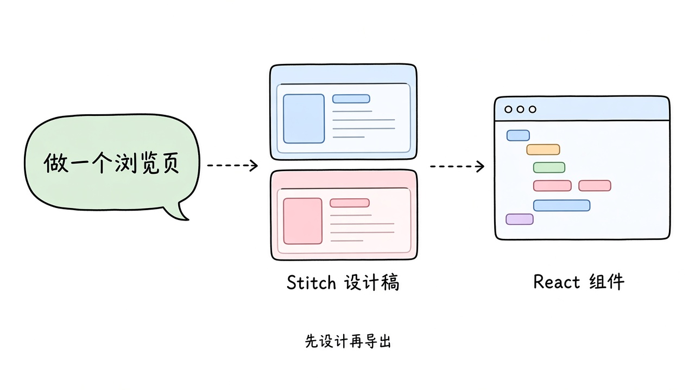
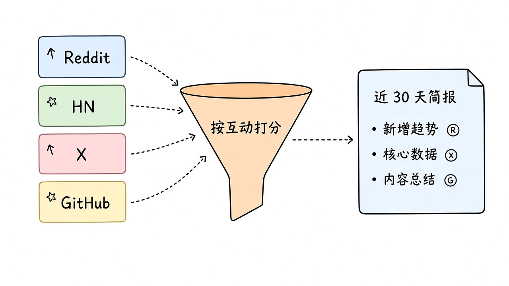
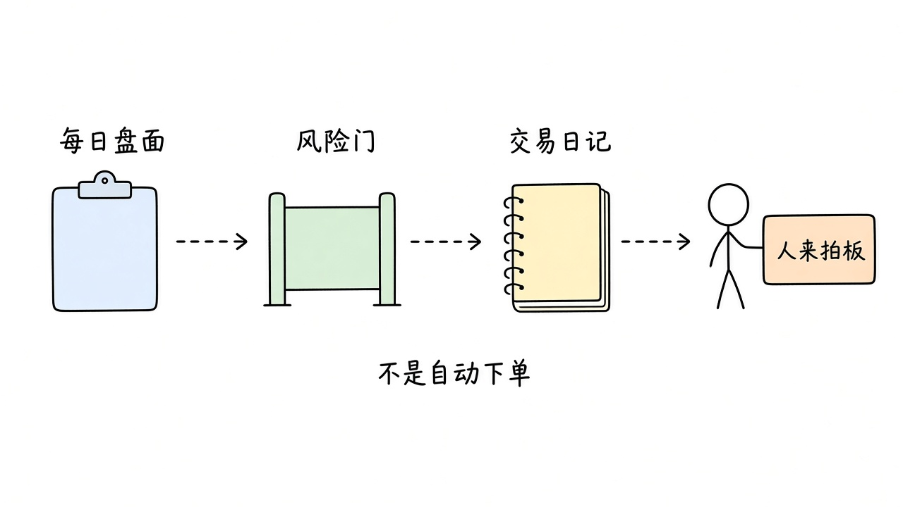

# 2026-11-17 Skills 日报

今日三条：Google Labs 给 Stitch MCP 配的技能库、以真实互动打分的调研技能 last30days，以及个人投资者用的交易流程技能包。

## 1. google-labs-code/stitch-skills — 把 Google Stitch 设计工作流装进编码代理

**介绍**  
[stitch-skills](https://github.com/google-labs-code/stitch-skills) 是 Google Labs 按 [Agent Skills](https://agentskills.io) 开放标准写的技能 / 插件库，配合 [Stitch MCP](https://stitch.withgoogle.com/docs/mcp/setup) 用：从文案或截图出界面、维护 DESIGN.md，再把 Stitch 画板转成 React / React Native 组件等。分 `stitch-design`、`stitch-build`、`stitch-utilities` 三组。Apache-2.0，约 9.7k★，今天冲上日榜；仓库上次推送在 2026-08-17，不是新仓库，但此前日报没写过。README 写明「This is not an officially supported Google product」。

**用法**  
先按官方文档配好 Stitch MCP。Claude Code / Cursor：

```bash
npx plugins add google-labs-code/stitch-skills --scope project --target claude-code
npx plugins add google-labs-code/stitch-skills --scope workspace --target cursor
```

只装技能：`npx skills add google-labs-code/stitch-skills`。Codex 可把仓库加为 marketplace（可用 sparse checkout）。技能之间常有依赖，选装时要对齐。配好后可以直接说：「根据这张草图生成移动端浏览页，并导出 DESIGN.md」。

**应用场景**  
把一句话的产品描述交给已接好 Stitch MCP 的助手，先出多屏设计，再让 `stitch::react-components` 同步成可跑的 React 组件。



**推荐学习程度**：进阶

---

## 2. mvanhorn/last30days-skill — 按赞、评和真金白银，汇总一个话题近 30 天在说什么

**介绍**  
[/last30days](https://github.com/mvanhorn/last30days-skill) 是一个调研技能（MIT）：并行搜 Reddit、X、YouTube、HN、Polymarket、GitHub 和网页等，按真实互动打分，再合成一份有出处的简报。约 6.8 万★，昨天还有提交，今天仍在日榜。运行时以 `skills/last30days/SKILL.md` 为准，README 写的是当前 v4 流水线。Reddit、HN、Polymarket、GitHub 零配置可用；跑一次安装向导可再开 X、YouTube、TikTok、arXiv、Techmeme 等。默认数据留在本机；只有配置了推理提供商的 API key 时，才会把主题和片段送去重排序。

**用法**  
Claude Code（推荐，走 marketplace 自动更新）：

```
/plugin marketplace add mvanhorn/last30days-skill
/plugin install last30days
```

Cursor / Codex / Gemini CLI 等：

```bash
npx skills add mvanhorn/last30days-skill -g
```

然后 `/last30days <话题>`。源码里可用 `python3 skills/last30days/scripts/last30days.py --preflight` 预检配置，不发起检索。需要 Python 3.12+。

**应用场景**  
开会前对一个人或一家公司跑 `/last30days`，把近一个月 Reddit 讨论、X 帖和仓库动态收成一页简报，而不是只翻过时的搜索结果。



**推荐学习程度**：入门

---

## 3. tradermonty/claude-trading-skills — 个人投资者的复盘与风控技能包，不是荐股机器人

**介绍**  
[Claude Trading Skills](https://github.com/tradermonty/claude-trading-skills) 是一套给个人投资者用的 Agent Skills（MIT）：把每日盘面、组合周检、条件成熟时的波段筛选、交易日记和月度复盘收成可安装工作流。约 6.3k★，昨天还有提交，今天冲上日榜。文档站：[tradermonty.github.io/claude-trading-skills](https://tradermonty.github.io/claude-trading-skills/)。作者写明：不是信号服务，不外包买卖决策，也不保证收益；人是决策门。部分技能需要 FMP / FINVIZ Elite / Alpaca 的 API，也有不需要 key 的入门路径（如 15 分钟每日盘面检查 `market-regime-daily`）。

**用法**  
Claude Code：克隆仓库，把要用的技能目录拷到 `~/.claude/skills/` 或项目内 `.claude/skills/`。Web 端可从 [Releases](https://github.com/tradermonty/claude-trading-skills/releases/latest) 下载 `.skill` 包，在 Customize > Skills 上传。建议先按 `workflows/` 里的清单走一条完整流程，而不是一次装完全部技能。

**应用场景**  
收盘后按 `trade-memory-loop` 把已结束的交易记下来，月底再用 `monthly-performance-review` 对照规则做复盘，而不是让模型直接下单。



**推荐学习程度**：进阶
