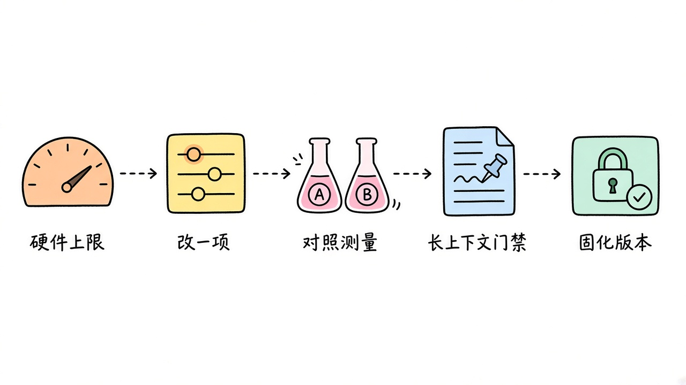

# 2026-11-18 Skills 日报

今日两条：把本地 LLM 推理速度按上限一项项往上推的技能，以及面向本地生意的 32 个营销技能包。

## 1. sybil-solutions/inference-optimisation-skill — 先算硬件上限，再一项项爬本地推理速度

**介绍**  
[inference-optimisation](https://github.com/sybil-solutions/inference-optimisation-skill) 是一份给编码代理用的技能（MIT）：在任意硬件和量化下，给本地 LLM 服务做 decode、投机解码、prefill、KV、启动和 TTFT 的爬山优化。流程是先算理论上限，一次只改一项，和穿插的对照跑比较，记录成功和失败，再用长上下文检索和满 KV 浸泡做门禁，最后才固化版本。仓库 11-16 创建，约 930★。技能是从作者自己的调优日志里提炼的，README 列出在 Intel Arc B390 / B70、RTX 3090、4×H200 上的前后数字，都指向 [local-ai-registry](https://github.com/sybil-solutions/local-ai-registry) 等来源，是作者测量，不是通用保证。它不是一份旗标清单。配套有只在需要时加载的 `references/`（上限计算、测量陷阱、杠杆、各引擎坑）和标准库 Python / bash 脚本。

**用法**  
Claude Code（用户级）：

```bash
git clone https://github.com/sybil-solutions/inference-optimisation-skill
mkdir -p ~/.claude/skills
cp -r inference-optimisation-skill/skills/inference-optimisation ~/.claude/skills/
```

然后可以说：「在 40 GiB 上限下，给 :8000 上的模型爬山 decode 和 prefill」，或「这台机器上这个模型理论最快多少 tok/s」。其他代理指向 `skills/inference-optimisation/SKILL.md`，或把 `PROMPT.md` 当作任务提示。不靠代理也可以直接跑 `scripts/ceiling.py`、`bench.py` 和 `queue.sh`。

**应用场景**  
同一张消费级卡上把服务调快之前，先算出 decode / prefill 的物理上限，再一次只改一个杠杆，用对照跑确认不是噪声，最后用长上下文针测决定能不能上线。



**推荐学习程度**：进阶

---

## 2. boringmarketer/boring-marketing-skills — 32 个免费营销技能，先读网站再决定下一步

**介绍**  
[Boring Marketing Skills](https://github.com/boringmarketer/boring-marketing-skills) 是 James Dickerson 按 Agent Skills 标准写的 32 个营销技能包（MIT）：覆盖调研、定位、文案、页面、SEO / AI 搜索、广告、邮件和内容，并带一套本地生意的深包。11-16 创建，昨天还有提交，约 540★。作者写明每个技能都可以在不付费工具的前提下跑；需要更强检索或出图时，技能会在对应步骤写出免费路径和他们实际用的付费栈。入口是 `/start-here`：读网站和评价，写出其他技能共用的品牌文件，再告诉你下一步跑哪一个。这和 11-16 日报里偏技术 SEO / GEO 的 `seo-skills` 不是同一份包。

**用法**  
任意代理：

```bash
npx skills add boringmarketer/boring-marketing-skills
```

Claude Code：

```
/plugin marketplace add boringmarketer/boring-marketing-skills
/plugin install boring-marketing@boring-marketing-skills
```

然后输入 `/start-here` 并给出公司名。作者说第一轮大约 3 分钟。

**应用场景**  
给一家本地服务公司跑 `/start-here`，先核对手机首屏有没有电话和承诺，再写一页只推一个服务的落地页；若在投广告，用暂停测试对照电话记录，看转化是真增量还是平台在邀功。


**推荐学习程度**：入门
