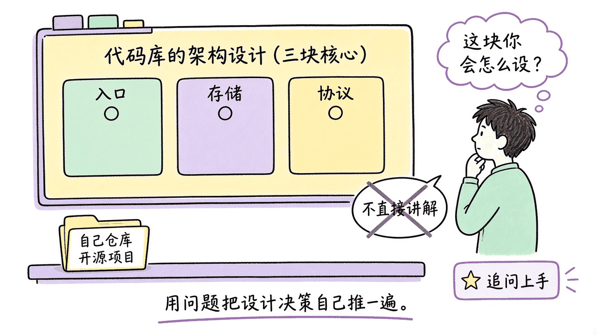
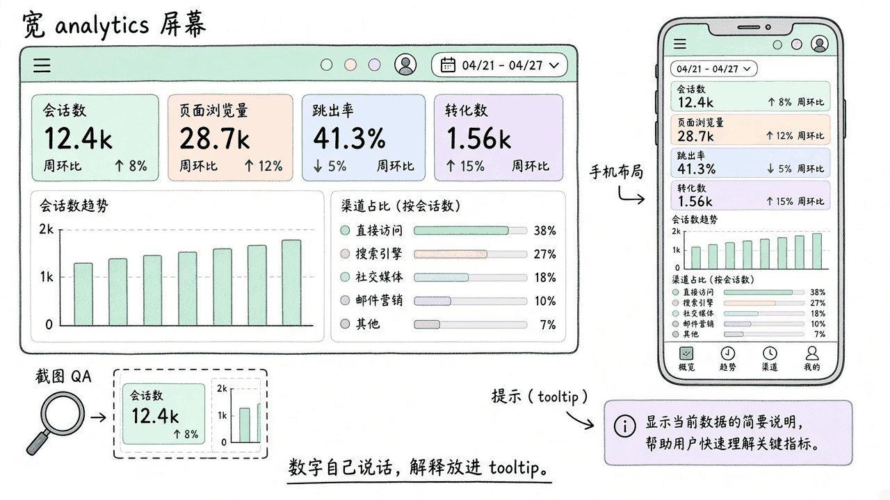

# 2026-11-19 Skills 日报

今日两条：用苏格拉底提问带你重推设计的 rederive，以及强调「屏幕自己会说话」的 Dashboard Design。

## 1. EricJujianZou/rederive — 只提问，让你自己把设计推一遍

**介绍**  
[rederive](https://github.com/EricJujianZou/rederive) 是一份 Agent Skill（MIT）：面对 AI 写过的仓库，或你想读懂的开源项目，它不会直接讲解，而是问「这块你会怎么做」，逼你从第一性原则把设计决策重新推出来。作者把它定位成面试或日常交接时讲清楚「自己的」代码，也可拿来学别人的仓库。10-19 创建，昨天还有提交，约 1.1k★，本周星标增长很快。演示和说明：[ericzou.dev/rederive](https://ericzou.dev/rederive/)。依赖 `git`、`bash` 和 `python3`。

**用法**  
任意兼容 Agent Skills 的代理：

```
npx skills add EricJujianZou/rederive
```

加 `-g` 会装到本机所有项目。然后在代理里输入 `/rederive`。Claude Code 也可用插件：

```
/plugin marketplace add EricJujianZou/rederive
/plugin install rederive@rederive
```

或把仓库里的 `skills/rederive` 拷进 `~/.claude/skills/` / `~/.agents/skills/`。目标可以是当前仓库，也可以是一个本地路径或 git URL。

**应用场景**  
面试前把自己用代理搭的小项目跑一遍 `/rederive`，被问到「为什么这样分层、状态放在哪」时，答的是自己推过的理由，而不是复述一段生成说明；入职读一份开源服务时，也可以指定仓库地址，按模块把关键决策问出来。



**推荐学习程度**：入门

---

## 2. abdiraimov-otabek/dashboard-design-skill — 干净、少废话的数据屏技能

**介绍**  
[Dashboard Design](https://github.com/abdiraimov-otabek/dashboard-design-skill) 是一份给编码代理用的仪表盘设计技能（MIT，当前 v2.1.0）：覆盖 Web 和 SwiftUI 的分析、收入、指标和后台屏，包括 KPI 卡片、图表、热力、子弹图、对比周期、排序拆解、日期筛选、空态，以及宽屏和手机布局。原则是「数字和形状自己说话，解释放进 tooltip」；每项工作结束要做截图 QA，看的是屏幕而不是代码。作者写规则来自 127 个已上线数据屏，加上 Few / Tufte / Knaflic 等经典和一组 WWDC 图表与无障碍课程。2.1 加了目标瓷片、带目标的数字卡、密度尺度和近期来源笔记；2.0 起明确反对 KPI 下再挂一句洞察文案。10-20 创建，最近提交在 11-09，约 950★，本周热度明显上来。

**用法**  
Claude Code：

```
/plugin marketplace add abdiraimov-otabek/dashboard-design-skill
/plugin install dashboard-design@dashboard-design-skill
```

然后直接说：「给这个应用做分析仪表盘：访问、注册、分渠道收入。」技能在你做仪表盘时也会自己触发。Codex、Cursor 或只读 Markdown 的代理：把 `AGENTS.md` 或规则文件指到仓库里的 `skills/dashboard-design/SKILL.md`（引用文档从那里加载）。仓库没有把它写成 `npx skills add` 的一键包，按官方这两条装即可。

**应用场景**  
改一版运营数据首页时，让代理按技能先出宽屏 KPI 和圆整刻度的图，再切到手机布局；用截图 QA 抓「数字下面又写了一句解释」「最差值在热力图上反而最浅」这类问题，把句子收进 tooltip，而不是再堆一排洞察卡片。



**推荐学习程度**：入门
