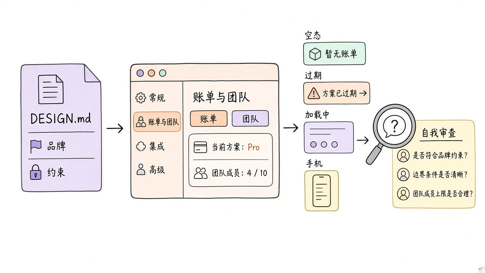
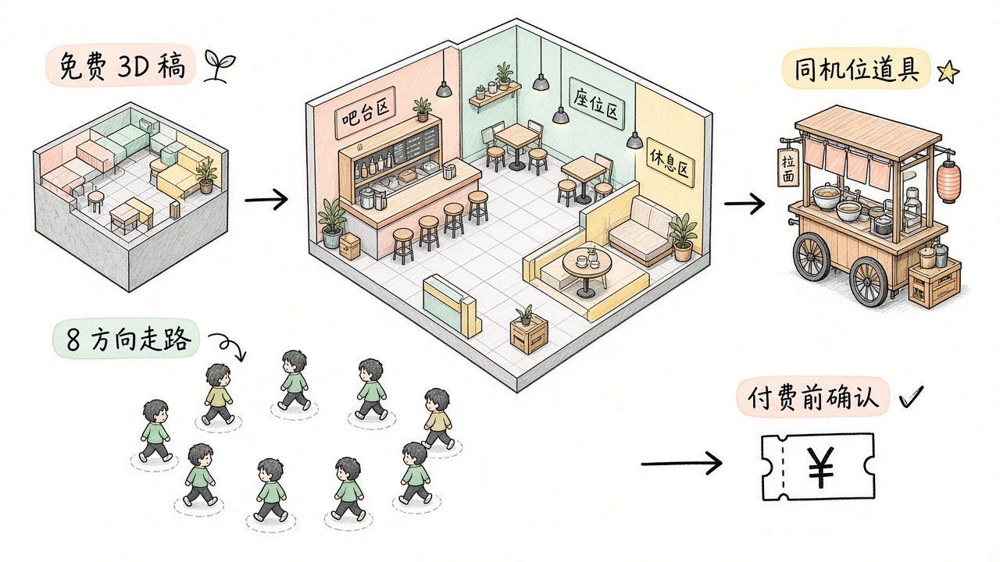
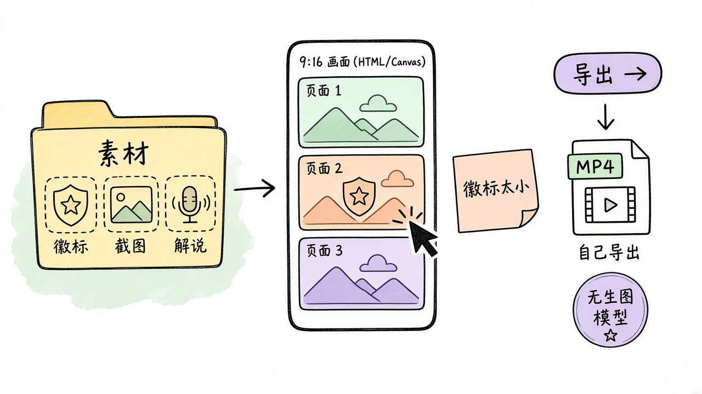

# 2026-11-20 Skills 日报

今日三条：把设计简报和状态清单写进流程的 craft、按游戏机位出精灵图的 SpriteCast，以及把视频写成可批注场景代码的 motlab。

## 1. diego3g/craft — 先写简报，覆盖每种状态，再自我审查

**介绍**  
[craft](https://github.com/diego3g/craft) 是 Diego Fernandes（Rocketseat）的一套 UI 设计 Agent Skills（MIT；hooks 里对 obra/superpowers 的致谢也是 MIT）。`craft-setup` 一次只问一个问题，写出 `DESIGN.md`（产品、受众和语气、情绪、品牌、参考、约束、带日期的决策日志、未决问题），以及 tokens / 基础组件。`craft` 是入口：确认范围，用 `craft-states` 列出空态、加载、错误、过长内容、权限、离线和脏数据等状态，只用设计系统里的零件来画，展示前以自检模式跑 `craft-critique`。另外还有 `craft-explore`（三个结构不同的方向，不只是换色）、`craft-system`、`craft-sync`（设计工具 ↔ 代码）。适配 Paper、pen.dev、Figma 的 MCP，或退回普通 HTML。Figma 适配器在 README 里写明还没在真实运行里测过。「Stops」是真停：代理必须结束本轮并等待，不能自己批准。技能按测试先行编写，仓库有 `npm test` / `npm run check`。11-16 创建，最近代码合并在 11-18，约 280★，列在 [skills.sh/diego3g/craft](https://skills.sh/diego3g/craft)。Cursor / Codex 等不会跑 session-start hook，README 要求把路由块贴进 `AGENTS.md`。

**用法**  
Claude Code / Claude Desktop / claude.ai：

```
/plugin marketplace add diego3g/craft
/plugin install craft@craft
```

斜杠命令会变成 `/craft:craft`、`/craft:craft-setup` 等。更新：`claude plugin update craft@craft`。

Codex、OpenCode、Cursor 等：

```
npx skills add diego3g/craft
```

可加 `-a cursor` / `-a codex` 等，`-g` 装到所有项目。手动方式是把 `skills/` 拷进 `.agents/skills/`。

**应用场景**  
做一页带账单和团队的新设置页：先跑一次 `craft-setup` 写出 `DESIGN.md`，再要这一页。先确认状态清单（空订阅、逾期账单、加载中、手机），让它从 tokens 里画，再说「review this」走 `craft-critique`。



**推荐学习程度**：入门（搭建并做一屏）；系统和设计工具同步则偏进阶

---

## 2. Sunghwan0112/spritecast — 按游戏机位，从 3D 引导稿出精灵图

**介绍**  
[SpriteCast](https://github.com/Sunghwan0112/spritecast) 是一份给 Claude Code 用的插件/技能（MIT）：按给定机位做游戏精灵（道具，8 方向走/跑/跳/劈/投，坐在你自己的椅子上的角色，像素风约 96 px，可选 64/32）。默认 2:1 等轴测，也有真等轴测、3/4 俯视和正面。流程是：代理按米写出 JSON 规格 → `isoprop.py render` 用 three.js / 无头 Chrome 画出 3D 块状引导稿（免费）→ OpenAI Images 按你的风格重画（付费）→ 收尾、对齐、烘焙阴影、测量锚点。行走角色/动物的 3D 模型、绑定和走路用 Tripo。付费步骤会打印费用并等你确认。`"draw": false` 可以跳过图像模型，直接用 3D 渲染当帧。免费试用：「try SpriteCast」或 `isoprop.py try` 用自带示例图，不需要密钥。导出（免费）支持 Godot 4 场景、Phaser 3 模块、Aseprite 标签、Unity prefab。11-04 创建，今早还有提交，约 350★。仓库体积很大（GitHub size 约 231 MB，主要是文档和示例媒体）。技能明确写给 Claude Code（Python、Playwright、本地 Chrome，以及你自己的 OpenAI Images 密钥）；不要臆造 Cursor / Codex 的安装命令。走路角色需要 Tripo credits，出图需要 OpenAI，组织账号可能还要完成图像模型验证。README 里的费用表是作者自己的数字（例如走一轮约 $2.2 + 75 Tripo credits，一个道具约 $0.07），不是这里实测的。轮廓检查抓不到头朝错方向，得自己看结果。

**用法**  
仓库里只写了 Claude Code 这条路径，没有 `npx skills add`：

```
claude plugin marketplace add Sunghwan0112/spritecast
claude plugin install spritecast@spritecast
```

或在 Claude Code 里：`/plugin marketplace add Sunghwan0112/spritecast`，再 `/plugin install spritecast@spritecast`。需要 Python 3.9+ 和 Chrome 或 Edge；第一次跑时代理会执行 `doctor.py --fix`（venv 在 `~/.cache/spritecast/`）。密钥放进插件设置（`/plugin` → SpriteCast），或环境变量 `OPENAI_API_KEY` / `TRIPO_API_KEY`，然后重启 Claude Code。之后可以说：「Here's my character (hero.png). Make her walk in 8 directions。」或「try SpriteCast」。SKILL.md 禁止把密钥贴进聊天，也禁止未经同意花钱。

**应用场景**  
做一款等轴测咖啡馆游戏：丢一张正面角色图，先要 8 方向走路，再要一辆同一机位、同一角色尺度的拉面车；先预览免费 3D 引导稿，确认后再付费出图，最后导出 Godot 或 Phaser 资源包。



**推荐学习程度**：进阶

---

## 3. staryone/motlab — 视频即代码，按你的素材做可批注场景

**介绍**  
[motlab](https://github.com/staryone/motlab) 是一个引擎加两份 Agent Skills（MIT；转场来自 gl-transitions，也是 MIT）。每个场景是带 `renderAt(t)` 的 HTML canvas 页。本地 viewer 一帧帧播放这些真页面；你点一帧或框一块、写下备注，备注进 `selection.json` 给代理改。导出是在无头 Chrome 里用 WebCodecs 出 720p–4K MP4，ffmpeg 只负责封装。**不用 AI 图像或视频模型。** 你提供参考文件夹（徽标、截图、素材、字体、音乐、解说），代理规划镜头、写场景、打开 viewer，再按备注改。技能规则：除非你明确要求，代理不得自行运行 `motlab render`；导出由你在 viewer 里按 Export。第二份技能 `motlab-assets` 做可复用的图标、2D 绑定和 3D/GLB/FBX/OBJ 套件。11-16 创建，11-19 晚上还有提交，约 220★。需要 Node.js 24+、Chrome 或 Chromium，以及 PATH 上的 ffmpeg + ffprobe；Blender 只在 assets 技能的主 3D 路径上可选。README 写明项目还年轻：主要在一台 Windows 笔记本上构建和计时；技能实际做完过两支片子（2 分钟演示 10 个场景、19 秒广告 7 个场景，都导出过 4K）；macOS 还没跑过。作者在那一台机器上相对 Remotion 4.0.543 和 HyperFrames 0.9.52 的速度数字，只当作单机数据，不要推广成一般结论。

**用法**

```bash
npm install -g @motlab/cli
npx @motlab/cli setup
```

默认 setup 会给 Claude Code 拷技能。其他代理：

```bash
npx @motlab/cli setup --skill agents          # Codex, Cursor, OpenCode 等
npx @motlab/cli setup --skill antigravity
npx @motlab/cli setup --skill hermes
npx @motlab/cli setup --skill claude,agents,antigravity
npx @motlab/cli setup --skill-dir <folder>
```

之后新开一轮代理会话。快捷开始：`motlab edit example`，然后说：「Make a 20 second portrait promo for my app with motlab. The references are in ./promo-refs。」如果你自己要命令行渲染：`motlab render example --scale 1`。另有 `motlab update`、`motlab uninstall`、`motlab doctor`。

**应用场景**  
把徽标、应用截图和解说放到 `./promo-refs`，要一条 20 秒的 9:16 宣传片，在 viewer 里看，标出「这一帧徽标太小 / 解说偏晚」，让代理改场景代码，最后自己按 Export 出 1080×1920。



**推荐学习程度**：进阶
