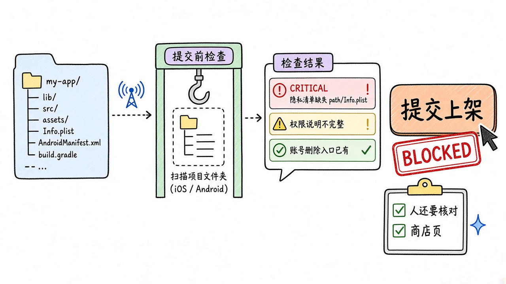
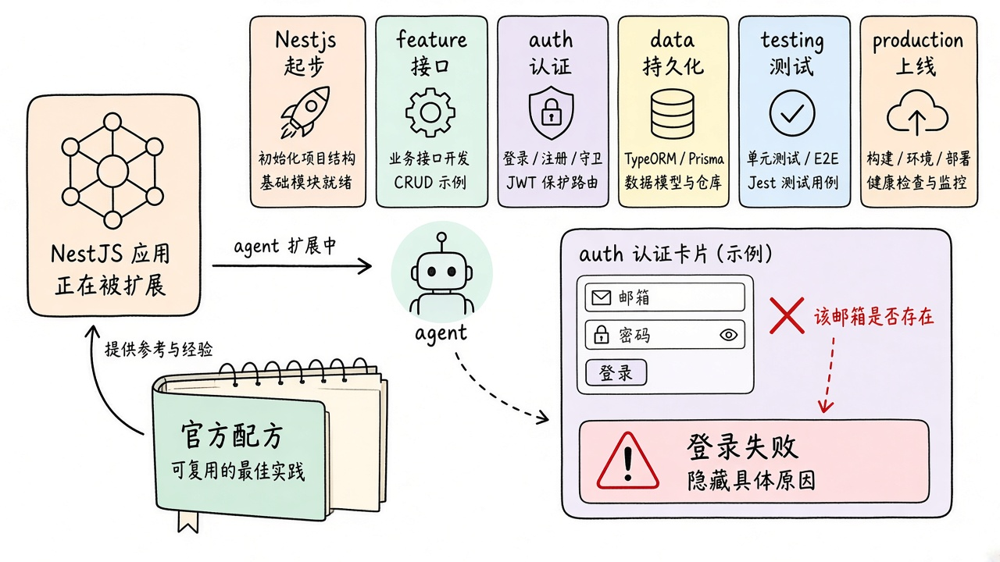
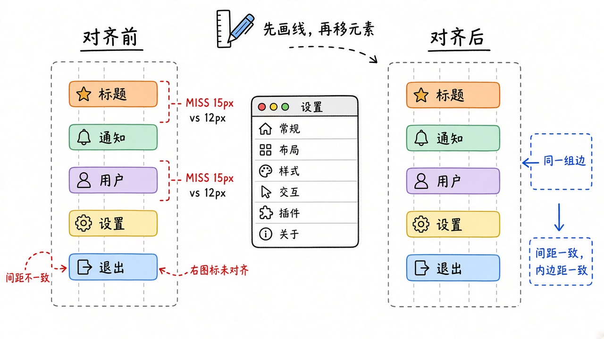

# 2026-11-23 Skills 日报

今日三条：提交前拦截应用商店常见拒审点的 App Store Compliance、NestJS 官方 Agent Skills，以及先画参考线再对齐界面的 gridlines。未重复今早周报已写过的 last30days、stitch-skills、ffmpeg-skill、claude-trading-skills、inference-optimisation-skill、seo-skills、Chisle、spritecast、craft、music-skill。

## 1. mjmirza/app-store-compliance — 提交前先扫一遍拒审模式

**介绍**  
[App Store Compliance Playbook](https://github.com/mjmirza/app-store-compliance) 是一份面向 iOS / Android 的拒审预案和提交前守卫：文档化的拒审模式与修复、隐私清单与 Data safety 检查、法规截止日期跟踪，以及给编码代理用的 skill 和 hook。站点：[mjmirza.github.io/app-store-compliance](https://mjmirza.github.io/app-store-compliance/)。仓库描述写明 124 条拒审模式、112 条跟踪中的截止日期（如 EU AI Act、DSA、COPPA、年龄法规）。守卫只扫代码能证明的部分，不保证过审；`CLEAR.` 仍要人去核对外面的账号、协议和商店页。约 4020★，周末日涨约七百，仍在热榜。许可证是 [OpenRoots Agent License 2.3](https://openroots.org/licenses/ora/2.3)（不是 MIT）：个人、非营利、学校、政府，以及年营收不超过 2000 万美元（按条款每年通胀调整）的公司可免费使用；超过门槛后，对使用该剧本的产品超额部分有 0.5% 使用费等条款，细节以许可证原文为准。训练模型使用本仓库需要单独的 Compute 许可。

**用法**  
仓库：[github.com/mjmirza/app-store-compliance](https://github.com/mjmirza/app-store-compliance)。一次性扫描（不改你的项目）：

```bash
git clone https://github.com/mjmirza/app-store-compliance ~/repositories/app-store-compliance
bash ~/repositories/app-store-compliance/agent-os/hooks/app-store-compliance-guard.sh "/path/to/your/app"
```

要把检查接到每次提交前，用安装脚本（需要 git 和 bash；除 Claude Code 外还需要 python3）：

```bash
bash ~/repositories/app-store-compliance/scripts/install.sh --tool all
# 或指定工具，例如 Cursor：
# bash ~/repositories/app-store-compliance/scripts/install.sh --tool cursor
```

安装成功应看到 `Install verified.`，然后按提示重启对应工具。Claude Code / Gemini CLI / OpenCode 也可用 `/app-store-audit`。卸载：`install.sh --tool <name> uninstall`。Windows 请在 Git Bash 里跑。

**应用场景**  
iOS 或 Android 应用准备点提交之前，先让 hook 或 `/app-store-audit` 按文件行号列出 CRITICAL（例如隐私清单缺失），拦住上传命令；扫描通过后，再按预提交清单人工核对账号状态和商店页。



**推荐学习程度**：入门

---

## 2. nestjs/agent-skills — NestJS 官方给编码代理的技能包

**介绍**  
[nestjs/agent-skills](https://github.com/nestjs/agent-skills) 是 NestJS 11-20 发布的官方 Agent Skills（MIT）：补上模型训练数据里往往过时的当前 API、一等公民包，以及「测试能过、生产仍会踩」的写法，例如登录接口泄露某个邮箱是否存在、`@IsOptional()` 把 `null` 放进 500、限流看不到用户、事件流在密钥撤销后还继续推。六个 skill：`nestjs`（起步与目录）、`nestjs-feature`（接口与校验）、`nestjs-auth`（认证授权）、`nestjs-data`（`@nestjs/drizzle` / `@nestjs/typeorm`）、`nestjs-testing`、`nestjs-production`。每条配方都在已发布的包上跑过。约 145★，体积不大，但是官方维护、可直接装进 Cursor / Claude Code / Codex。

**用法**  
仓库：[github.com/nestjs/agent-skills](https://github.com/nestjs/agent-skills)。

```bash
npx @nestjs/skills add
# 默认装到当前项目的 .agents/skills/（Codex、Cursor 等会读）
npx @nestjs/skills add --agent all          # 同时写入 .agents/skills 与 .claude/skills
npx @nestjs/skills add --agent agents --global
npx @nestjs/skills add nestjs nestjs-auth   # 只装一部分
```

Claude Code 也可用插件：

```bash
claude plugin marketplace add nestjs/agent-skills
claude plugin install nestjs@nestjs
```

代理会在任务匹配时自行加载对应 skill，一般不必手输斜杠命令。

**应用场景**  
给现有 Nest 项目加登录或接口时，让代理先加载 `nestjs-auth` / `nestjs-feature`，按官方配方写校验、错误码和认证，避免随手写出「邮箱不存在」这类可枚举的失败信息。



**推荐学习程度**：入门

---

## 3. pritamux/gridlines — 先画参考线，再把界面对齐到同一组边

**介绍**  
[gridlines](https://github.com/pritamux/gridlines) 是 11-21 发布的 MIT 技能：给界面画垂直参考线，找出每一个没落到线上的元素，再改 padding，让侧栏、工具条、面板、菜单和表格共享一小组合边。规则来自 Karri Saarinen 对 Linear 侧栏的重绘笔记，以及 Apple HIG 的布局章节。约 188★。包含 `SKILL.md`、可在页面里跑的 `probe.js`，以及用 Playwright 打开页面、导出 2x 截图和 JSON 报告的 `audit.mjs`。

**用法**  
仓库：[github.com/pritamux/gridlines](https://github.com/pritamux/gridlines)。

```sh
npx skills add pritamux/gridlines
```

也可把 `skills/gridlines/` 拷到代理的 skills 目录。然后直接说「做一次对齐检查」，或调用 `/gridlines line up the settings sidebar`。本机预览探针（需 Playwright）：

```sh
npm i --prefix /tmp/gridlines-pw playwright
npx --prefix /tmp/gridlines-pw playwright install chromium
PW_DIR=/tmp/gridlines-pw node skills/gridlines/audit.mjs "file://$PWD/examples/sidebar.html" .gridlines 800
```

也可把 `probe.js` 贴进页面控制台，执行 `window.__gridlines()`。

**应用场景**  
设置页侧栏看起来「差不多齐」，其实图标、标签和尾部按钮的内边距差了几像素。先让技能画出参考线、标出 MISS，再把元素收拢到同一组边上。



**推荐学习程度**：入门
