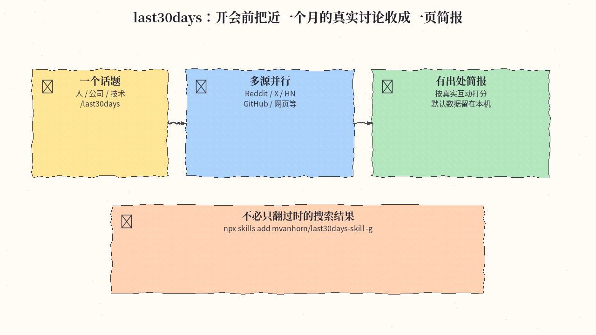
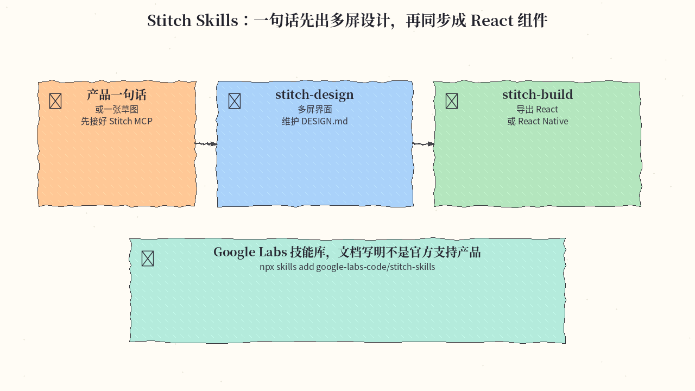
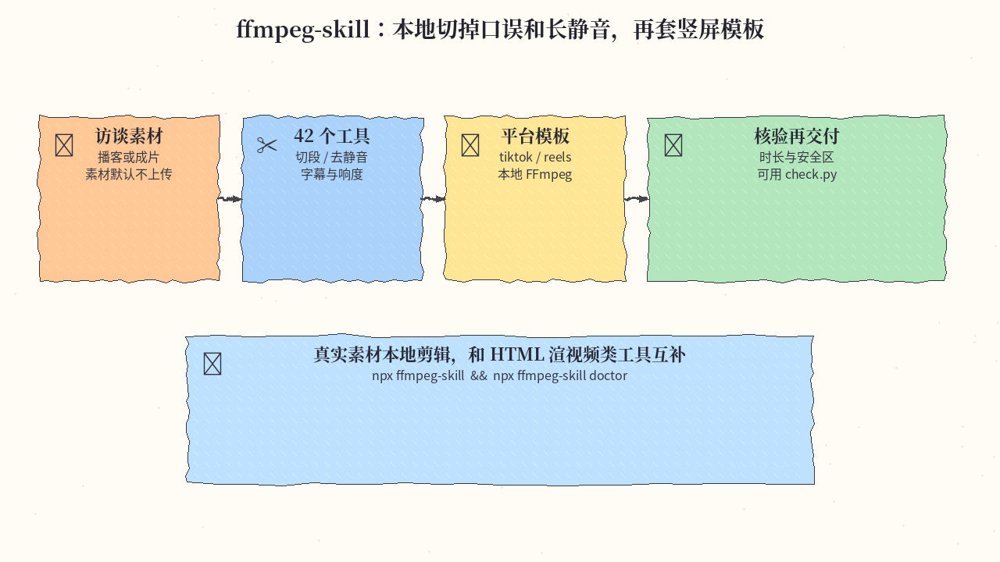
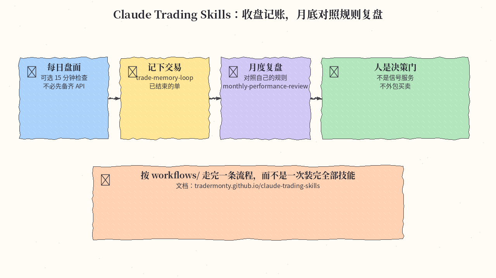
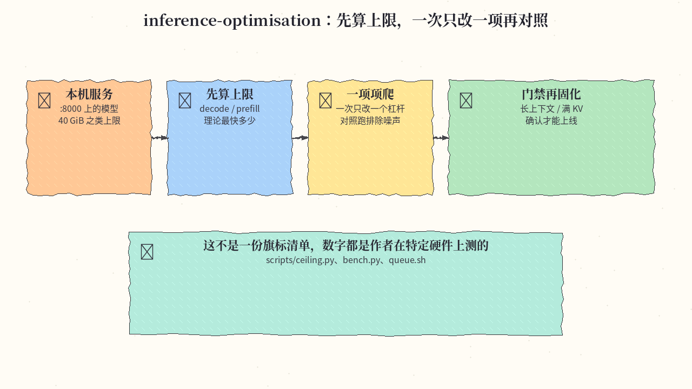
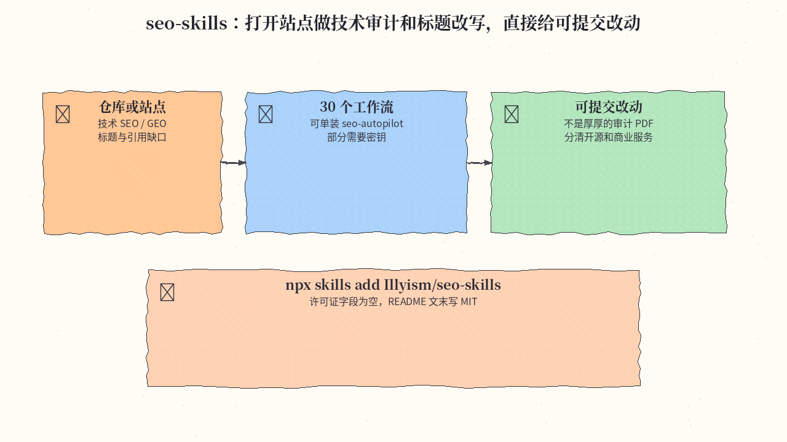
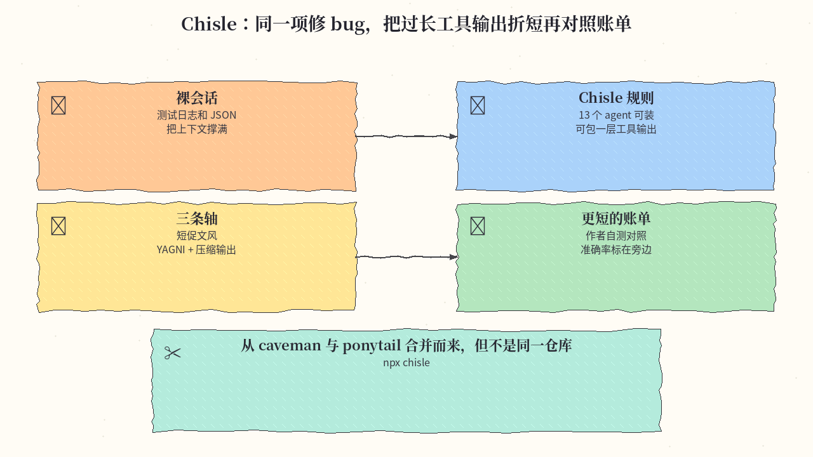
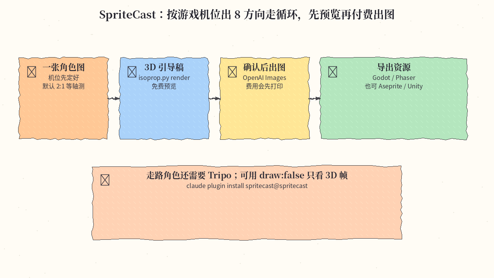
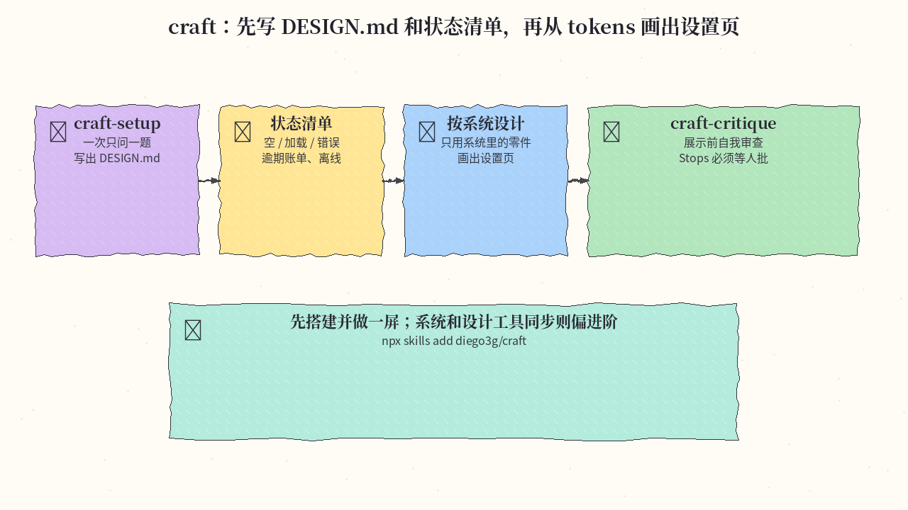
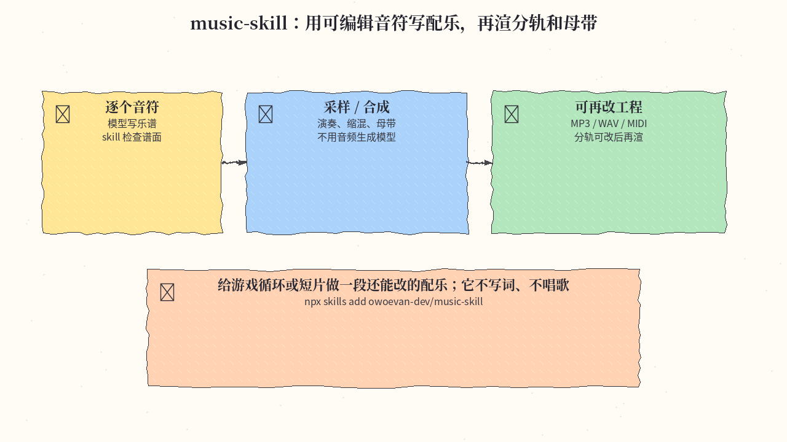

# 2026-11-23 Skills 周报

上周（11/16–11/22）精选 10 个技能包（偏话题调研与本地剪辑、设计工作流、本机推理调优与交易复盘）。来源不限 SkillHub。ffmpeg-skill 虽在 11-06 日报出现过，但未进过周报，本周仍新增约 3.6k★，故补入。

## 1. mvanhorn/last30days-skill — 按赞、评和真金白银，汇总一个话题近 30 天在说什么

**介绍**  
[/last30days](https://github.com/mvanhorn/last30days-skill) 是一个调研技能（MIT）：并行搜 Reddit、X、YouTube、HN、Polymarket、GitHub 和网页等，按真实互动打分，再合成一份有出处的简报。约 7.3 万★，本周新增约 4.2k。运行时以 `skills/last30days/SKILL.md` 为准，README 写的是当前 v4 流水线。Reddit、HN、Polymarket、GitHub 零配置可用；跑一次安装向导可再开 X、YouTube、TikTok、arXiv、Techmeme 等。默认数据留在本机；只有配置了推理提供商的 API key 时，才会把主题和片段送去重排序。

**用法**  
Claude Code（推荐，走 marketplace 自动更新）：

```
/plugin marketplace add mvanhorn/last30days-skill
/plugin install last30days
```

Cursor / Codex / Gemini CLI 等：

```bash
npx skills add mvanhorn/last30days-skill -g
```

然后 `/last30days <话题>`。源码里可用 `python3 skills/last30days/scripts/last30days.py --preflight` 预检配置，不发起检索。需要 Python 3.12+。

**应用场景**  
开会前对一个人或一家公司跑 `/last30days`，把近一个月 Reddit 讨论、X 帖和仓库动态收成一页简报，而不是只翻过时的搜索结果。



**推荐学习程度**：入门

---

## 2. google-labs-code/stitch-skills — 把 Google Stitch 设计工作流装进编码代理

**介绍**  
[stitch-skills](https://github.com/google-labs-code/stitch-skills) 是 Google Labs 按 [Agent Skills](https://agentskills.io) 开放标准写的技能 / 插件库，配合 [Stitch MCP](https://stitch.withgoogle.com/docs/mcp/setup) 用：从文案或截图出界面、维护 DESIGN.md，再把 Stitch 画板转成 React / React Native 组件等。分 `stitch-design`、`stitch-build`、`stitch-utilities` 三组。Apache-2.0，约 1.2 万★，本周新增约 2.4k。仓库上次大推送较早，不是本周新建，但此前周报没写过。README 写明「This is not an officially supported Google product」。

**用法**  
先按官方文档配好 Stitch MCP。Claude Code / Cursor：

```bash
npx plugins add google-labs-code/stitch-skills --scope project --target claude-code
npx plugins add google-labs-code/stitch-skills --scope workspace --target cursor
```

只装技能：`npx skills add google-labs-code/stitch-skills`。Codex 可把仓库加为 marketplace（可用 sparse checkout）。技能之间常有依赖，选装时要对齐。配好后可以直接说：「根据这张草图生成移动端浏览页，并导出 DESIGN.md」。

**应用场景**  
把一句话的产品描述交给已接好 Stitch MCP 的助手，先出多屏设计，再让 `stitch::react-components` 同步成可跑的 React 组件。



**推荐学习程度**：进阶

---

## 3. kajisho5/ffmpeg-skill — 本地 FFmpeg 剪辑引擎（42 tools + MCP）

**介绍**  
[ffmpeg-skill](https://github.com/kajisho5/ffmpeg-skill) 是本地视频剪辑 skill（MIT）：42 个结构化 FFmpeg 工具（切段、拼接、去静音、字幕、叠层、响度、平台交付等），机器可读 contract，默认不上传素材。可当独立 skill，也可 MCP；与 HTML 渲视频类工具互补，偏真实素材剪辑。约 9.7k★，本周新增约 3.6k，仍在周榜前列。11-06 日报写过，但还没进过周报。

**用法**  
仓库：[github.com/kajisho5/ffmpeg-skill](https://github.com/kajisho5/ffmpeg-skill)。

```bash
sudo apt install ffmpeg   # macOS/Windows 见仓库 Install 表
npx ffmpeg-skill          # 默认装到 Claude Code；可用 --cursor / --codex / --all
npx ffmpeg-skill doctor
npx ffmpeg-skill contract --json | head -40
# 可选本地转写：pip install faster-whisper
```

**应用场景**  
播客访谈成片：agent 按段落切掉口误与长静音，套 `tiktok`/`reels` 模板出竖屏包，并用 `check.py` 核验时长与安全区。



**推荐学习程度**：入门

---

## 4. tradermonty/claude-trading-skills — 个人投资者的复盘与风控技能包，不是荐股机器人

**介绍**  
[Claude Trading Skills](https://github.com/tradermonty/claude-trading-skills) 是一套给个人投资者用的 Agent Skills（MIT）：把每日盘面、组合周检、条件成熟时的波段筛选、交易日记和月度复盘收成可安装工作流。约 7.8k★，本周新增约 3.1k。文档站：[tradermonty.github.io/claude-trading-skills](https://tradermonty.github.io/claude-trading-skills/)。作者写明：不是信号服务，不外包买卖决策，也不保证收益；人是决策门。部分技能需要 FMP / FINVIZ Elite / Alpaca 的 API，也有不需要 key 的入门路径（如 15 分钟每日盘面检查 `market-regime-daily`）。

**用法**  
Claude Code：克隆仓库，把要用的技能目录拷到 `~/.claude/skills/` 或项目内 `.claude/skills/`。Web 端可从 [Releases](https://github.com/tradermonty/claude-trading-skills/releases/latest) 下载 `.skill` 包，在 Customize > Skills 上传。建议先按 `workflows/` 里的清单走一条完整流程，而不是一次装完全部技能。

**应用场景**  
收盘后按 `trade-memory-loop` 把已结束的交易记下来，月底再用 `monthly-performance-review` 对照规则做复盘，而不是让模型直接下单。



**推荐学习程度**：进阶

---

## 5. sybil-solutions/inference-optimisation-skill — 先算硬件上限，再一项项爬本地推理速度

**介绍**  
[inference-optimisation](https://github.com/sybil-solutions/inference-optimisation-skill) 是一份给编码代理用的技能（MIT）：在任意硬件和量化下，给本地 LLM 服务做 decode、投机解码、prefill、KV、启动和 TTFT 的爬山优化。流程是先算理论上限，一次只改一项，和穿插的对照跑比较，记录成功和失败，再用长上下文检索和满 KV 浸泡做门禁，最后才固化版本。仓库 11-16 创建，周三日报时约 930★，本周已到约 2.0k★。技能是从作者自己的调优日志里提炼的，README 列出在 Intel Arc B390 / B70、RTX 3090、4×H200 上的前后数字，都指向 [local-ai-registry](https://github.com/sybil-solutions/local-ai-registry) 等来源，是作者测量，不是通用保证。它不是一份旗标清单。配套有只在需要时加载的 `references/`（上限计算、测量陷阱、杠杆、各引擎坑）和标准库 Python / bash 脚本。

**用法**  
Claude Code（用户级）：

```bash
git clone https://github.com/sybil-solutions/inference-optimisation-skill
mkdir -p ~/.claude/skills
cp -r inference-optimisation-skill/skills/inference-optimisation ~/.claude/skills/
```

然后可以说：「在 40 GiB 上限下，给 :8000 上的模型爬山 decode 和 prefill」，或「这台机器上这个模型理论最快多少 tok/s」。其他代理指向 `skills/inference-optimisation/SKILL.md`，或把 `PROMPT.md` 当作任务提示。不靠代理也可以直接跑 `scripts/ceiling.py`、`bench.py` 和 `queue.sh`。

**应用场景**  
同一张消费级卡上把服务调快之前，先算出 decode / prefill 的物理上限，再一次只改一个杠杆，用对照跑确认不是噪声，最后用长上下文针测决定能不能上线。



**推荐学习程度**：进阶

---

## 6. Illyism/seo-skills — 30 个可安装的 SEO / GEO 技能包

**介绍**  
seo-skills 是 Ilias Ism 做的 30 个 `SKILL.md` 工作流，覆盖技术 SEO、Ahrefs / DataForSEO、第一手证据库、外链、GEO / AEO、文案等（目录在 `seo/`、`content/`、`copywriting/`、`marketing/`）。约 1.9k★。作者目录：[il.ly/skills](https://il.ly/skills)。GitHub 许可证字段为空，根目录没有 LICENSE 文件；README 文末写「MIT © Ilias Ism」。若干 skill / 赞助区指向作者自家产品，装之前要分清开源工作流和商业服务。部分流程需要 Ahrefs / DataForSEO 等密钥。这和 boring-marketing-skills 不是同一份包。

**用法**  
仓库：[github.com/Illyism/seo-skills](https://github.com/Illyism/seo-skills)。

```bash
npx skills add Illyism/seo-skills
npx skills add Illyism/seo-skills --skill seo-autopilot
npx skills add Illyism/seo-skills --list
# 也可加 -a claude-code / -a cursor
```

**应用场景**  
Agent 打开仓库或站点，一边跑技术审计与标题改写，一边对照搜索结果和 GEO 引用缺口，直接给出可提交的改动，而不是一份厚厚的审计 PDF。



**推荐学习程度**：进阶

---

## 7. JayPokale/Chisle — 从三条轴砍 agent 的 token 账单

**介绍**  
Chisle 是一套跨 Claude Code、Codex、Cursor、Gemini、OpenCode 等的规则集 + 工具输出压缩器（仓库写 13 个 agent）：短促文风、YAGNI 优先的代码，以及把过大的工具输出压短。MIT，约 1.3k★。项目从 [JuliusBrussee/caveman](https://github.com/JuliusBrussee/caveman) 与 [DietrichGebert/ponytail](https://github.com/DietrichGebert/ponytail) 合并而来，但规则集更宽，不是同一仓库。本周初前后发布过 v3.12.x（OpenCode v2 插件、`--update` 真正更新 Claude 插件等）。README 图注写对照无规则集：账单输出 token 少 29%、回答短 45%、过大工具输出小 48%、正确率 156/156 vs 154/156——数字来自作者自测，未独立复跑。

**用法**  
仓库：[github.com/JayPokale/Chisle](https://github.com/JayPokale/Chisle)。主安装：

```bash
npx chisle
```

也可以：

```bash
claude plugin marketplace add JayPokale/Chisle
claude plugin install chisle@chisle
curl -fsSL https://raw.githubusercontent.com/JayPokale/Chisle/main/install.sh | bash
```

Windows 可用 `irm https://raw.githubusercontent.com/JayPokale/Chisle/main/install.ps1 | iex`。README 还提到 `--dry-run`、`--uninstall`、`/chisle off`、`/chisle-review`、`/chisle-audit`、`npx chisle tools`、`npx chisle mcp wrap`。管道安装脚本使用前应自行审阅。

**应用场景**  
同一项修 bug 任务：左边裸会话被测试日志和冗长 JSON 撑满上下文；右边 Chisle 把工具输出折短，账单更短，准确率标在旁边对照。



**推荐学习程度**：入门

---

## 8. Sunghwan0112/spritecast — 按游戏机位，从 3D 引导稿出精灵图

**介绍**  
[SpriteCast](https://github.com/Sunghwan0112/spritecast) 是一份给 Claude Code 用的插件/技能（MIT）：按给定机位做游戏精灵（道具，8 方向走/跑/跳/劈/投，坐在你自己的椅子上的角色，像素风约 96 px，可选 64/32）。默认 2:1 等轴测，也有真等轴测、3/4 俯视和正面。流程是：代理按米写出 JSON 规格 → `isoprop.py render` 用 three.js / 无头 Chrome 画出 3D 块状引导稿（免费）→ OpenAI Images 按你的风格重画（付费）→ 收尾、对齐、烘焙阴影、测量锚点。行走角色/动物的 3D 模型、绑定和走路用 Tripo。付费步骤会打印费用并等你确认。`"draw": false` 可以跳过图像模型，直接用 3D 渲染当帧。免费试用：「try SpriteCast」或 `isoprop.py try` 用自带示例图，不需要密钥。导出（免费）支持 Godot 4 场景、Phaser 3 模块、Aseprite 标签、Unity prefab。约 460★。仓库体积较大（文档和示例媒体很多）。技能明确写给 Claude Code（Python、Playwright、本地 Chrome，以及你自己的 OpenAI Images 密钥）；不要臆造 Cursor / Codex 的安装命令。走路角色需要 Tripo credits，出图需要 OpenAI。README 里的费用表是作者自己的数字（例如走一轮约 $2.2 + 75 Tripo credits，一个道具约 $0.07），不是这里实测的。轮廓检查抓不到头朝错方向，得自己看结果。

**用法**  
仓库里只写了 Claude Code 这条路径，没有 `npx skills add`：

```
claude plugin marketplace add Sunghwan0112/spritecast
claude plugin install spritecast@spritecast
```

**应用场景**  
给自己的角色出一组 8 方向走循环，旁边再放一辆同一机位、同一角色尺度的拉面车；先预览免费 3D 引导稿，确认后再付费出图，最后导出 Godot 或 Phaser 资源包。



**推荐学习程度**：进阶

---

## 9. diego3g/craft — 先写简报，覆盖每种状态，再自我审查

**介绍**  
[craft](https://github.com/diego3g/craft) 是 Diego Fernandes（Rocketseat）的一套 UI 设计 Agent Skills（MIT；hooks 里对 obra/superpowers 的致谢也是 MIT）。`craft-setup` 一次只问一个问题，写出 `DESIGN.md`（产品、受众和语气、情绪、品牌、参考、约束、带日期的决策日志、未决问题），以及 tokens / 基础组件。`craft` 是入口：确认范围，用 `craft-states` 列出空态、加载、错误、过长内容、权限、离线和脏数据等状态，只用设计系统里的零件来画，展示前以自检模式跑 `craft-critique`。另外还有 `craft-explore`（三个结构不同的方向，不只是换色）、`craft-system`、`craft-sync`（设计工具 ↔ 代码）。适配 Paper、pen.dev、Figma 的 MCP，或退回普通 HTML。Figma 适配器在 README 里写明还没在真实运行里测过。「Stops」是真停：代理必须结束本轮并等待，不能自己批准。技能按测试先行编写，仓库有 `npm test` / `npm run check`。11-16 创建，约 420★，列在 [skills.sh/diego3g/craft](https://skills.sh/diego3g/craft)。Cursor / Codex 等不会跑 session-start hook，README 要求把路由块贴进 `AGENTS.md`。

**用法**  
Claude Code / Claude Desktop / claude.ai：

```
/plugin marketplace add diego3g/craft
/plugin install craft@craft
```

斜杠命令会变成 `/craft:craft`、`/craft:craft-setup` 等。更新：`claude plugin update craft@craft`。

Codex、OpenCode、Cursor 等：

```
npx skills add diego3g/craft
```

可加 `-a cursor` / `-a codex` 等，`-g` 装到所有项目。手动方式是把 `skills/` 拷进 `.agents/skills/`。

**应用场景**  
做一页带账单和团队的新设置页：先跑一次 `craft-setup` 写出 `DESIGN.md`，再要这一页。先确认状态清单（空订阅、逾期账单、加载中、手机），让它从 tokens 里画，再说「review this」走 `craft-critique`。



**推荐学习程度**：入门（搭建并做一屏）；系统和设计工具同步则偏进阶

---

## 10. owoevan-dev/music-skill — 用可编辑的音符作曲，而不是生成一段音频

**介绍**  
music-skill 让模型写出每一个音符，再由 skill 检查乐谱、用采样乐器或合成器演奏、缩混和母带。输出 MP3 / WAV、MIDI、分轨，以及可改后再渲的工程。不用音频生成模型。MIT（第三方音源另见仓库 `THIRD_PARTY.md`）。约 270★。本周初发布过 0.7.0：每首曲子抽十二个词、计划对照乐谱，并更新了示例和 README。它不会写词、不唱歌。

**用法**  
仓库：[github.com/owoevan-dev/music-skill](https://github.com/owoevan-dev/music-skill)。

```text
/plugin marketplace add owoevan-dev/music-skill
/plugin install music-skill@music-skill
```

```bash
npx skills add owoevan-dev/music-skill
# 然后按 README Install 让 agent 装渲染器与音源；另有：
python -m pip install -r skills/music-production/requirements.txt
```

音源下载约 3.7 GB；README 写全部三十套约 3.5 GB 下载 / 8 GB 安装，建议预留约 12 GB。可选 Surge XT（GPL-3.0，单独进程）。Linux / macOS 还需 FluidSynth、FFmpeg。

**应用场景**  
给游戏循环或短片配一段可再改的配乐：左边是钢琴卷帘上可编辑的音符，右边渲出分轨和母带，中间标明没有音频生成模型。



**推荐学习程度**：进阶
