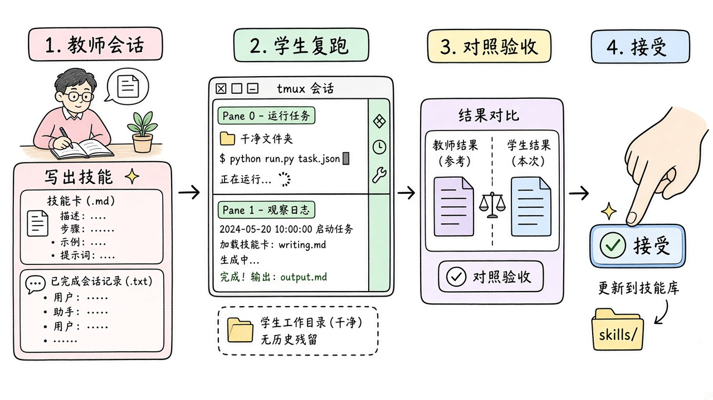
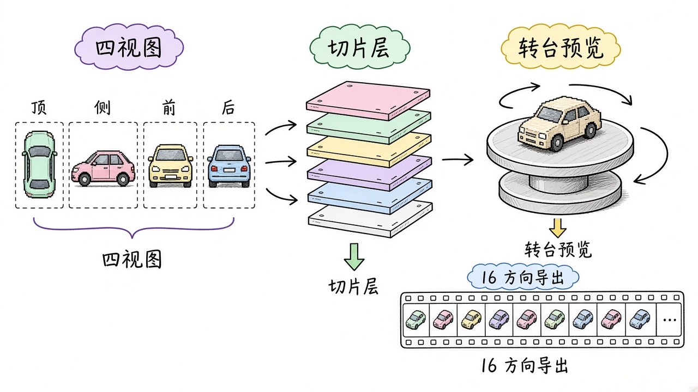
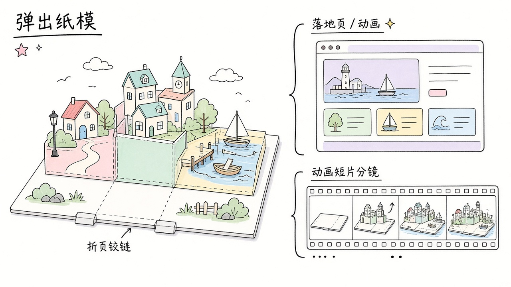

# 2026-11-24 Skills 日报

今日三条：把一次跑得好的会话蒸馏成开源权重模型也能跟上的技能、用四视图雕刻可旋转的像素精灵，以及按弹出纸模风格做页面或动画。未重复近日与周报已写过的 last30days-skill、stitch-skills、app-store-compliance、nestjs/agent-skills、gridlines、spritecast、craft、inference-optimisation-skill、ffmpeg-skill 等。

## 1. sybil-solutions/skill-distill — 把一次好会话蒸馏成学生模型能跟上的技能

**介绍**  
[skill-distill](https://github.com/sybil-solutions/skill-distill) 是 11-21 开源的 MIT 技能：在 Claude Code 或 Codex（教师）里，对一次已经跑好的会话调用它，并指定学生——某个 agent harness 加一个开源权重模型。教师会读会话并写出技能，在 tmux 里用干净的起始状态、原提示和这份技能启动学生，对照参考结果，从学生第一次走错的地方改技能，每个版本跑三轮，直到对齐；**只有你点头接受，技能才算完成**。规则要求技能教步骤、判断、陷阱和检查，不能塞进参考成品或一段直接写出答案的脚本。需要 `tmux`、`git`、Python 3.10+，以及已安装并指向模型的学生 harness；若要比对网页结果，还需 Playwright 与 Chromium。约 520★。同组织的 inference-optimisation-skill 已在 11-18 日报写过，不是同一份技能。

**用法**  
仓库：[github.com/sybil-solutions/skill-distill](https://github.com/sybil-solutions/skill-distill)。README 写的是符号链接，没有 `npx skills add`：

```
git clone https://github.com/sybil-solutions/skill-distill
ln -s "$PWD/skill-distill/skills/skill-distill" ~/.claude/skills/skill-distill    # Claude Code
ln -s "$PWD/skill-distill/skills/skill-distill" ~/.agents/skills/skill-distill    # Codex
```

一次会话结束后可以说：「distill this session into a skill for omp with deepseek-v4.1-flash on my local server」。教师按 [`skills/skill-distill/SKILL.md`](https://github.com/sybil-solutions/skill-distill/blob/main/skills/skill-distill/SKILL.md) 执行。可用 `tmux attach -t distill-<task>` 看学生怎么跑。仓库 `examples/` 里有已完成的提示、产出技能、账本和截图。

**应用场景**  
刚用前沿模型在一个仓库里把某类重构跑通了，想让本机的开源权重模型以后按同一套步骤做：先蒸馏出技能，看对照结果，你接受后再收进技能库。



**推荐学习程度**：进阶

---

## 2. danielwh2/sprite-stacking — 四视图雕出可旋转的假 3D 像素精灵

**介绍**  
[sprite-stacking](https://github.com/danielwh2/sprite-stacking) 是 11-20 开源的 MIT 技能（作者 Daniel White）：把顶、侧、前、后四张正交像素视图雕成体素（只保留四面都覆盖到的格子），再切成自下而上的薄层，渲染时每层旋转、按俯仰压扁并上移 1px，得到可转的假 3D 精灵。适配 Claude Code、Codex、Cursor、OpenCode、Gemini CLI 与 Pi。没有生图模型时，代理可用一小段 Python 自己画出视图。另有独立 HTML 查看器（转台、场景、切片扫描、爆炸视图，以及驾驶/风摆/碎裂等 Play 模式），并可导出 16 方向 PNG 精灵表。需要 Python 3 以及 Pillow、NumPy。作者写明 sprite stacking 是已有的独立游戏技法，这份技能补的是四视图雕刻和代理工作流。约 660★。与 11-20 介绍过的 SpriteCast（按机位从 3D 引导稿出精灵图）不是同一条路。

**用法**

```bash
npx skills add danielwh2/sprite-stacking
```

装到当前项目；加 `-g` 装到所有项目，`-a claude-code`（或 `codex`、`cursor` 等）指定代理。需要 Node 22.20+。也可把 `skills/sprite-stacking` 拷进 `~/.claude/skills/` 或 `~/.agents/skills/`。直接对代理说：「Make a rotatable pixel art car.」或「Sprite stack this 4-view sheet and give me a turntable.」

切片 CLI：

```bash
python3 skills/sprite-stacking/scripts/views_to_slices.py views.png slices.png \
  --slices 36 --preview check.png --html viewer.html
```

`--slices` 建议 15–20 偏块状、32–48 更细；`--round` 适合塔、气球、罐子；`--colours N` 可收成共享调色板。

**应用场景**  
给一款小游戏做一辆可绕圈展示的像素小车：先准备或让代理画出四视图，切成层，在转台上确认轮廓，再导出 16 方向表给引擎用。



**推荐学习程度**：入门

---

## 3. xikhar/papercraft — 用弹出纸模的方法做页面、场景和动画

**介绍**  
[papercraft](https://github.com/xikhar/papercraft) 是 11-21 开源的 MIT 技能：按「拍摄纸模型」的方法做游戏、互动场景、网页、动画和视频——卡纸零件、薄切边、着色的软阴影、俯拍的移轴镜头、铰链运动和纸张声。它带上从一款已上线 three.js 弹出书游戏里收来的结构类型（插接十字、层层平面、折叠盒与棱柱、穹顶、印刷水面，以及可走的桥、甲板和楼梯）和一套度量/审查循环。题材由你的提示和参考图决定；只有你明确要求时才会调用图像模型，也可以全程用代码做。同一套世界可输出 16:9、9:16、方形或 4:5、4K 静帧等，`capture.py` 按 `--size reel` / `square` / `4k` 等导出。兼容支持 [Agent Skills](https://agentskills.io) 的 Claude Code、Codex、Cursor、Gemini CLI、OpenCode 等。约 450★。

**用法**

```bash
npx skills add xikhar/papercraft
```

或把 `skills/papercraft/` 拷进代理的 skills 目录。然后直接说，例如：「make our bakery landing page feel like a pop-up storybook」，或「a 20-second paper diorama animation of a city waking up, rendered to mp4」。仓库还提供 `popup-3d` / `popup-2d` 模板，以及 `paperkit-2d.js`、`paperkit-3d.js` 等可直接引用的库。

**应用场景**  
品牌页或短视频不想走一套常见的 AI 插画风：先定参考图和色板，让代理按弹出纸模搭一座港口小镇，在浏览器里检查铰链和阴影，再导出一条竖版短片。



**推荐学习程度**：入门（导出和三维结构偏进阶）
