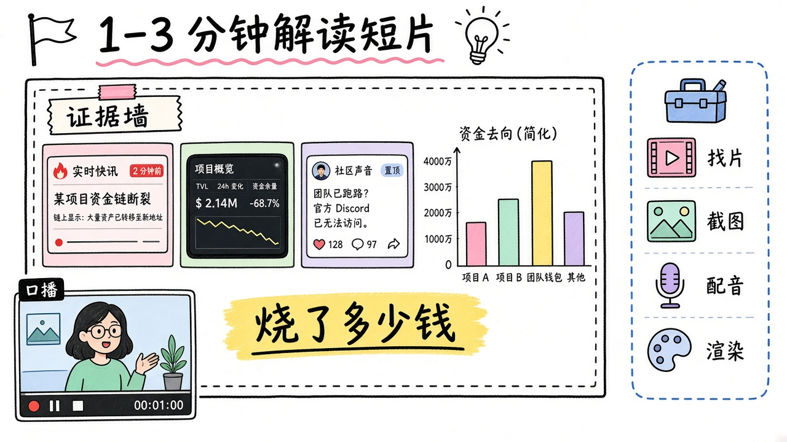

# 2026-11-25 Skills 日报

今日三条：把 Blender 5.3 工作流装进编码代理的 blender-skills；做华尔街式财经/科技解读短片的 wallstreet-explainer；以及 GPT Image 玩法合集 vane-gpt-image-skills。未重复昨日与周报已写过的 skill-distill、sprite-stacking、papercraft、last30days-skill、stitch-skills、ffmpeg-skill、rust-anything、inference-optimisation-skill、rederive、seo-skills 等。

## 1. EL4CTEO/blender-skills — 把专业 Blender 工作流交给编码代理

**介绍**  
[blender-skills](https://github.com/EL4CTEO/blender-skills) 是一套给 Claude Code、Codex、OpenCode、Gemini CLI、GitHub Copilot 和 Cursor 用的 Agent Skills（MIT）：28 个技能覆盖建模、UV、PBR、贴图烘焙、绑定、动画、布料、毛发、环境、风格化、优化、导出、渲染、视频、天气、模拟和 QA。面向 Blender 5.2 LTS 及以上，作者写明全部脚本在真实 Blender 里测过，并在 5.3.0 上验证（5.3 还加了 KTX2 网页导出、合成器效果栈和 Gaussian splat）。有 Blender MCP 时，代理可以在你已打开的 Blender 里干活；没有则在后台启动 Blender。约 2860★。作者提供了「同样提示、有无技能」的对照页：[el4cteo.github.io/blender-skills/comparison](https://el4cteo.github.io/blender-skills/comparison/)。

**用法**  
仓库：[github.com/EL4CTEO/blender-skills](https://github.com/EL4CTEO/blender-skills)。Claude Code 插件：

```
/plugin marketplace add EL4CTEO/blender-skills
/plugin install blender-agent-skills@blender-agent-skills
```

其他代理可以克隆后跑安装脚本（默认装到 `~/.claude/skills` 和 `~/.agents/skills`）：

```bash
git clone https://github.com/EL4CTEO/blender-skills
./blender-skills/install/install.sh          # macOS / Linux
# Windows: .\blender-skills\install\install.ps1
```

可用 `--agent claude|codex|opencode|gemini|copilot|cursor|all`，或 `--project DIR` 只装到一个项目。先从 `blender-core` 开始，它负责跑代码、分派任务和 5.x API 规则。需求是 Blender 5.2 LTS 或更新，建议用 5.3.0。

**应用场景**  
要把一只游戏用木箱做到带法线烘焙和 LOD、再导出到 Unreal，自己逐步点 Blender 菜单又容易漏 QA：让代理按这套技能走建模 → UV → 烘焙 → LOD → 导出，最后用 `blender-asset-qa` 扫一遍重叠面、法线和权重。


**推荐学习程度**：进阶

---

## 2. HeyChengC/wallstreet-explainer — 用证据墙做 1 到 3 分钟的解读短片

**介绍**  
[wallstreet-explainer](https://github.com/HeyChengC/wallstreet-explainer) 是一套做华尔街式财经/科技解读短片的技能（MIT）：1–3 分钟，同时给 16:9 和 9:16。有口播视频就围着人做，证据挂在身后的墙上，讲细节时人缩到角落小窗；没有口播就把新闻里的当事人抠出来，站在大字前面。技能会自己找素材、截新闻页、把关键句刷黄，并用大字、柱子和图表讲数字关系。约 1320★。代码和文档是 MIT；样片里的第三方画面、截图、logo 和人物不在 MIT 范围内，素材只用于评论和解读，每条片要在简介里写清出处。

**用法**  
仓库：[github.com/HeyChengC/wallstreet-explainer](https://github.com/HeyChengC/wallstreet-explainer)。Claude Code 手动安装：

```bash
git clone https://github.com/HeyChengC/wallstreet-explainer.git ~/.claude/skills/wallstreet-explainer
cd ~/.claude/skills/wallstreet-explainer
pip install -r requirements.txt
npm install && npx playwright install chromium
```

还需要把 ffmpeg 放进 PATH。字体要自己下载放进 `fonts/`：MiSans、阿里妈妈数黑体、Bebas Neue、Montserrat、Noto Sans SC，文件名与 `kit/kit.css` 对齐。重启 Claude Code 后可以直接说：「用 wallstreet-explainer 做一条 1 分钟的片子，讲 AI 到底有多烧钱」。有口播视频就一起发给它；没有的话，它先用 edge-tts 临时配音，画面定了再换成你的配音。`yt-dlp` / `edge-tts` 若报 403，先升级这两个包。

**应用场景**  
要把一条刚发生的科技或财经新闻做成一分钟解读，让观众先看清数字和出处，而不是只有口播：把选题（和可选的口播素材）交给技能，先出带证据墙和关键句高亮的成片，再人工核对出处后发布。



**推荐学习程度**：入门

---

## 3. VaneAi888/vane-gpt-image-skills — GPT Image 2.6 的一套可安装玩法

**介绍**  
[vane-gpt-image-skills](https://github.com/VaneAi888/vane-gpt-image-skills) 是一套围绕 GPT Image 2.6 的开源玩法合集（MIT），目前 6 个技能：照片转动态表情包（12 种画风、6 个主题，默认 16 张）、电影级海报（36 种版式，中英文分开设计）、把书里的故事做成海报、微信红包封面、宠物新年写真，以及小红书图文封面和正文图。约 1500★，本周仍在涨。作者写明：示例里的第三方角色只用于非官方风格演示；用照片或角色素材时，请确认自己有相应使用权。GIF 动作、图片文字和透明背景的效果取决于实际素材与可用工具。

**用法**  
仓库：[github.com/VaneAi888/vane-gpt-image-skills](https://github.com/VaneAi888/vane-gpt-image-skills)。

```bash
git clone https://github.com/VaneAi888/vane-gpt-image-skills.git
cd vane-gpt-image-skills
python3 scripts/install_skills.py --all
```

只装其中一个、或已有同名技能时，看 [docs/installation.md](https://github.com/VaneAi888/vane-gpt-image-skills/blob/main/docs/installation.md)。装完后开一个新的 Codex 对话，再用对应的 `$Skill` 名称。已经装过的，用 [docs/updating.md](https://github.com/VaneAi888/vane-gpt-image-skills/blob/main/docs/updating.md) 里的更新脚本。使用前要确认环境能读参考图并做图像生成。

**应用场景**  
手头有一张自己的宠物或角色照片，想先出一套聊天用的动态表情，或一张海报 / 红包封面：选一个玩法把参考图丢给技能，先看预览再改画风，不要从零写提示词。


**推荐学习程度**：入门
