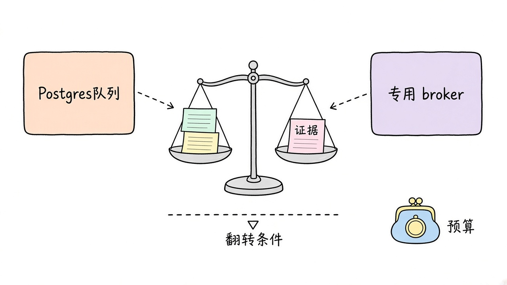
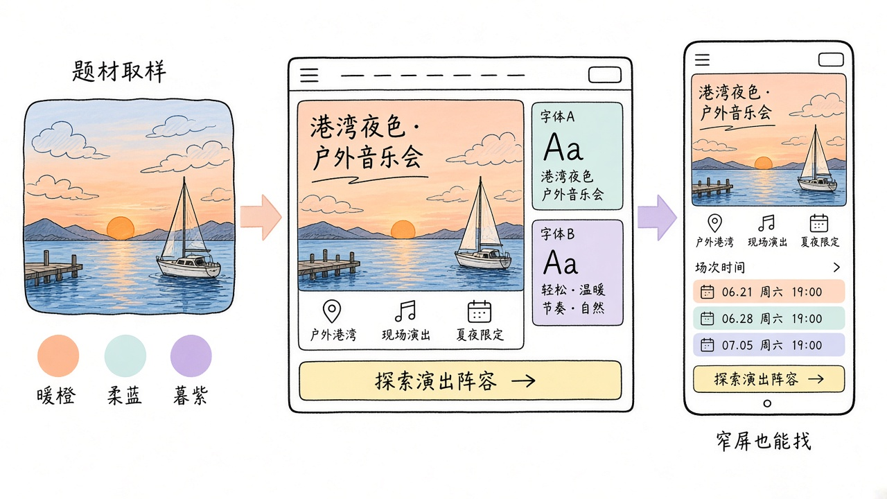

# 2026-11-26 Skills 日报

今日两条：先拿证据再下结论的调研技能 weaponized-curiosity；以及按题材选配色和字体的前端美术指导 anything-frontend-art-direction。未重复昨日与周报已写过的 blender-skills、wallstreet-explainer、vane-gpt-image-skills、skill-distill、papercraft、last30days-skill、stitch-skills、ffmpeg-skill 等。

---

## 1. AyushRajSinghParihar/weaponized-curiosity — 先找能改变结论的证据，再决定要不要深挖

**介绍**  
[weaponized-curiosity](https://github.com/AyushRajSinghParihar/weaponized-curiosity) 是 11-23 开源的 MIT 技能：让编码代理做调研、对比方案或验证一个想法时，从最可能改变答案的证据起步，而不是先给一个立场坚定的结论。有四种模式：Quick 用来核对一个断言或比较两个选项；Deep 处理互相冲突的证据，并在所支持的环境里最多拆成四个独立工人再对照；Extreme 给更难的问题更多时间做来源审查和复现；Autoresearch 则针对你能测量的目标，在固定评估器和试验次数里改一版、测一版。也可以用口语或 `searches=12 experiments=2 minutes=10` 这类设置限制预算，`experiments=0` 就只做调研。约 180★。

**用法**  
仓库：[github.com/AyushRajSinghParihar/weaponized-curiosity](https://github.com/AyushRajSinghParihar/weaponized-curiosity)。用 [Skills CLI](https://github.com/vercel-labs/skills) 安装：

```sh
npx skills add AyushRajSinghParihar/weaponized-curiosity --skill weaponized-curiosity
```

在 Codex 里用 `$weaponized-curiosity`，在 Claude Code 里用 `/weaponized-curiosity`，或直接在句子里点名这个技能。想把「调研这个」变成习惯，可在 `AGENTS.md` / `CLAUDE.md` 里写一句：要做有证据的调研或对比时，使用 `weaponized-curiosity`。更细的安装见 [docs/installation.md](https://github.com/AyushRajSinghParihar/weaponized-curiosity/blob/main/docs/installation.md)。

**应用场景**  
团队在争要不要把 Postgres 任务队列换成专用 broker，你让代理用这个技能做一次有预算的调研：先收集能改变结论的证据，写明什么情况下建议会翻转，而不是先给一个立场坚定的结论。



**推荐学习程度**：入门

---

## 2. RNA4219/anything-frontend-art-direction — 配色和字体从题材里取，而不是先套模板

**介绍**  
[Anything Frontend Art Direction](https://github.com/RNA4219/anything-frontend-art-direction) 是 11-22 开源的 MIT 前端设计技能（日文为主，仓库提供[简体中文说明](https://github.com/RNA4219/anything-frontend-art-direction/blob/main/README.zh-CN.md)）：根据题材选配色、字体、留白和构图，并可对照作品与设计者本人的说明。实现或评审卡住时，可从 12 个领域、共 1,464 个条目的索引追到规范或研究原文；字体调查数据也在仓库里。仓库带可离线打开的单页 HTML 示例，例如从插画取样配色的虚构电台 [DEAD AIR FM](https://rna4219.github.io/anything-frontend-art-direction/examples/dead-air-fm/)，以及港口露天电影节「潮待电影节」。功能、信息优先级和操作流程若也要一起定，README 建议并用同一作者的 [Product Design 技能](https://github.com/RNA4219/anything-frontend-product-design)。约 194★。

**用法**  
仓库：[github.com/RNA4219/anything-frontend-art-direction](https://github.com/RNA4219/anything-frontend-art-direction)。

1. [下载 ZIP 并解压](https://github.com/RNA4219/anything-frontend-art-direction/archive/refs/heads/main.zip)，或 `git clone https://github.com/RNA4219/anything-frontend-art-direction.git`。
2. 若是 ZIP，把解压后的文件夹改名为 `anything-frontend-art-direction`，再放到所用工具的技能目录。技能本身的步骤见 [SKILL.md](https://github.com/RNA4219/anything-frontend-art-direction/blob/main/SKILL.md)。
3. 例如对代理说：「用 anything-frontend-art-direction 做一场港口露天活动的单页。电影节名的字体给两套、用真实标题对比。窄屏上也要能找到场次时间。」

资料是普通 Markdown，条目里的链接指向公开来源，便于自己打开原作和原文。

**应用场景**  
你要做一场港口露天活动的单页，先让技能从题材里选配色和标题字体（并要两套真实字体名对比），再做成窄屏也能找到场次时间的页面，而不是先套一版通用模板。



**推荐学习程度**：入门
