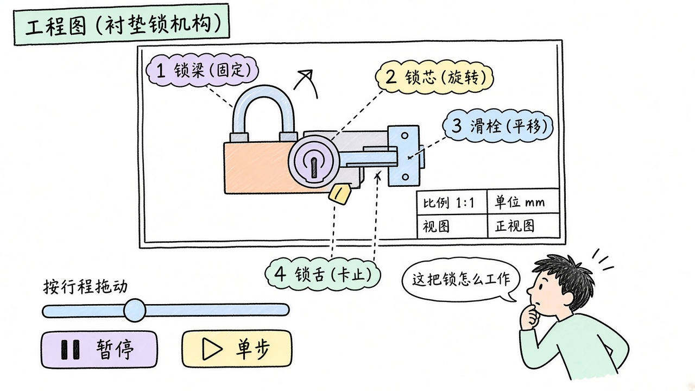
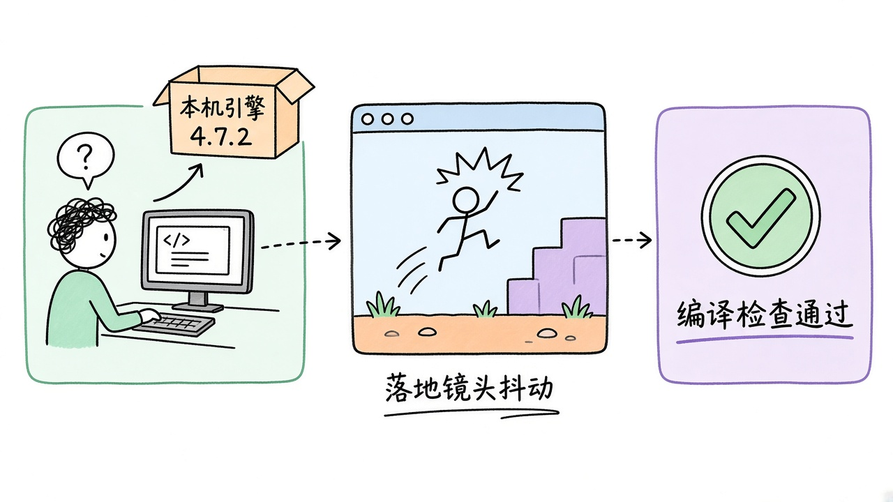
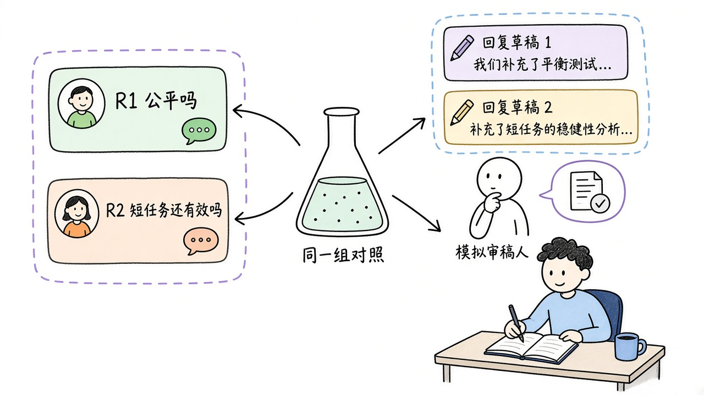

# 2026-11-27 Skills 日报

今日三条：把「它怎么工作」做成可拖动工程图的 Inkworks；面向 Godot 4.7 的 godot-skills；以及按阶段写会议 rebuttal 的 Rebuttal-Skills。未重复昨日与周报已写过的 weaponized-curiosity、anything-frontend-art-direction、blender-skills、sprite-stacking、skill-distill、papercraft、last30days-skill、stitch-skills 等。

---

## 1. Moh4696/inkworks-skill — 一张会动的工程图，用来讲清「它怎么工作」

**介绍**  
[Inkworks](https://github.com/Moh4696/inkworks-skill) 是 11-25 开源的 MIT 技能：让编码代理做成交互式 3D「原理说明」页，看起来像白底工程图——浅灰零件、墨线描边、编号引出球，机器慢到可以跟上。读者能暂停、按相位单步、拖动循环图、跟着一个零件、拉滑块、绕相机转。页面全是代码：three.js 用基本体搭零件，运动由一个驱动角的闭式运动学决定，没有模型文件，也不生成视频，所以单步和慢动作是准确的。适合有固定循环的机构：发动机、泵、锁、齿轮箱、缝纫机等。提供 `sheet`（带图框、读数、仪表和循环图，适合整页探索）和 `figure`（模型加标注，适合嵌入）两种布局，可用 `?layout=` 切换。约 454★。

**用法**  
仓库：[github.com/Moh4696/inkworks-skill](https://github.com/Moh4696/inkworks-skill)。用 [Skills CLI](https://github.com/vercel-labs/skills) 安装（Node 22.20+），然后开一轮新的代理会话：

```bash
npx skills add Moh4696/inkworks-skill
```

Claude Code：`/plugin marketplace add Moh4696/inkworks-skill`，再 `/plugin install inkworks-skill@inkworks-skill`。Codex：`codex plugin marketplace add Moh4696/inkworks-skill`，再 `codex plugin add inkworks-skill@inkworks-skill`。没有 Node 时可用仓库的 `install.sh`（先打开脚本读完再决定是否执行）。本地预览自带的发动机和打气筒例子：

```bash
git clone https://github.com/Moh4696/inkworks-skill && cd inkworks-skill/skills/inkworks
python3 kit/serve.py 9081
# http://localhost:9081/?m=engine
# http://localhost:9081/?m=pump&layout=sheet
python3 scripts/new_project.py ~/how-a-lock-works --name lock --from starter --layout figure
```

对代理说：「用 inkworks 做一页，讲这把锁怎么工作，要能按行程拖动和单步。」工具链（`smoke.py` / `record.py`）需要 `pip install -r requirements.txt` 和 Playwright 的 WebKit，录屏还要 ffmpeg。

**应用场景**  
要把一把锁或一台泵的工作过程讲给非专业读者看：让代理做成可拖动、可单步的工程图页，读者自己把行程拉到卡止或排气，而不是先做一段看不懂内部的演示视频。



**推荐学习程度**：入门

---

## 2. EL4CTEO/godot-skills — 按本机安装的 Godot 4.7 查 API，改完再编译检查

**介绍**  
[godot-skills](https://github.com/EL4CTEO/godot-skills) 是 EL4CTEO（此前 daily 写过 fast-anything、shrink-anything、blender-skills）开源的 MIT 技能包，针对 Godot **4.7.2**，GDScript 和 C#/.NET 都覆盖。一共 27 个短技能：从本机已安装的引擎查准确 API，经 Godot 本身改场景，再用真实的编译、测试和导出检查。技能里的代码示例会在 4.7.2 上由测试套件编译。作者建议优先用 Godot 的 .NET / C# 构建，因为模型见过的 C# 更多、编译器也能先抓住类型错误；需要 Web 导出时再用 GDScript（Godot 4.x 的 C# 项目不支持 Web 导出）。约 52★，11-21 之后仍有 CI。

**用法**  
仓库：[github.com/EL4CTEO/godot-skills](https://github.com/EL4CTEO/godot-skills)。需要 Godot 4.7+（标准版或 .NET）和 Python 3.9+；做 C# 还要 .NET 8+ SDK。找不到引擎时设 `GODOT_EXE`。

Claude Code：

```
/plugin marketplace add EL4CTEO/godot-skills
/plugin install godot-agent-skills@godot-agent-skills
```

其他代理：

```bash
git clone https://github.com/EL4CTEO/godot-skills
./godot-skills/install/install.sh          # macOS / Linux
# Windows: .\godot-skills\install\install.ps1
```

默认装到 `~/.claude/skills` 和 `~/.agents/skills`（后者给 Codex、OpenCode、Gemini CLI、Copilot、Cursor 读）。可加 `--agent`、`--project DIR` 或 `--uninstall`。从 `godot-core` 开始。例如对代理说：「给玩家加上 coyote-time 跳跃，落地时镜头抖一下，然后编译检查。」或「把主菜单做成手柄也能用，再导出 Windows 和 Android。」

**应用场景**  
Godot 4.7 项目要加 coyote-time 跳跃和落地镜头抖动：让技能先查你本机引擎里的 API，改场景后再跑编译检查，而不是凭模型记忆里的旧函数名直接改。



**推荐学习程度**：入门

---

## 3. Jurio0304/Rebuttal-Skills — 先定一组能同时回答两位审稿人的实验，再写回复

**介绍**  
[Rebuttal-Skills](https://github.com/Jurio0304/Rebuttal-Skills) 是 11-25 开源的 MIT 技能：把会议 rebuttal 拆成八个阶段，从读审稿意见、在时间和算力限制下选实验，到解释结果、起草回复、用独立的模拟审稿人预演、处理追问、给 AC 写总回复，以及把承诺改回稿件。作者强调一个判断：两位审稿人要同一组 baseline 时，问题可能并不相同——一个在问对比是否公平，另一个在问短任务上是否仍然值得用——一组选得好的对照可以同时回答，但回复里要分别对准他们的问题。README 里列出的 ICML / NeurIPS / ICLR 分数变化，是作者自己投稿的记录，不是这里的验证。仓库带虚构的 RunFold 排序论文例子，可走完八步。约 66★，提供[简体中文说明](https://github.com/Jurio0304/Rebuttal-Skills/blob/main/README.zh-CN.md)。

**用法**  
仓库：[github.com/Jurio0304/Rebuttal-Skills](https://github.com/Jurio0304/Rebuttal-Skills)。先克隆到共享位置，再在每篇论文的工作区里链进去（不会覆盖已有的 `rebuttal` 入口）：

```sh
git clone https://github.com/Jurio0304/Rebuttal-Skills.git "$HOME/Rebuttal-Skills"

# Codex
mkdir -p .agents/skills
ln -s "$HOME/Rebuttal-Skills/skills/rebuttal" .agents/skills/

# Claude Code
mkdir -p .claude/skills
ln -s "$HOME/Rebuttal-Skills/skills/rebuttal" .claude/skills/
```

在 Codex 里用 `$rebuttal`，在 Claude Code 里用 `/rebuttal`。把论文、审稿意见和该轨道的字数规则交给它。例如：「我只有两天、只能跑一组实验。R1 质疑 baseline 的调参预算，R2 问提升在短任务上还在不在。请设计一组对照，并说明赢或打平后我能分别对两位说什么。」预演时，让每位模拟审稿人只看到自己的意见和回复。阶段说明在 `skills/rebuttal/references/stages/`。

**应用场景**  
两位审稿人同时要一组 baseline，但一个在问对比是否公平，另一个在问短任务上是否仍然有用：先让技能设计一组对照，再分别起草回复，并用模拟审稿人检查原问题有没有被带过。



**推荐学习程度**：入门
